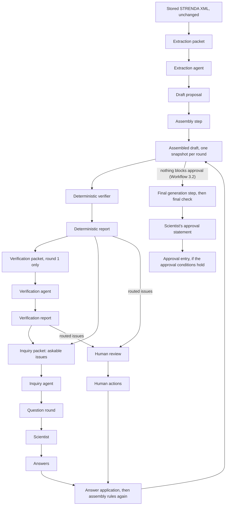

# Handoffs

**Version:** 1.5.\
**Status:** Preliminary for Stage 1, decided on 2026-10-21 under interim authority ([ledger](../README.md#2026-10-29---workflow-and-review-design-consolidated)), amended on 2026-10-22 (changes C01 to C11; [ledger](../README.md#2026-10-29---workflow-and-review-design-consolidated)) and on 2026-10-27 (decisions AD-D01, AD-D04 and AD-D05) ([ledger](../README.md#2026-10-29---workflow-and-review-design-consolidated); [ledger](../README.md#2026-10-29---workflow-and-review-design-consolidated)) and on 2026-10-28 (the stored approval summary and the accepted names) ([ledger](../README.md#2026-10-29---workflow-and-review-design-consolidated); [ledger](../README.md#2026-10-29---workflow-and-review-design-consolidated); [ledger](../README.md#2026-10-29---workflow-and-review-design-consolidated)), and again on 2026-10-28 (unit-scale compatibility of rate-law bindings) ([ledger](../README.md#2026-10-29---workflow-and-review-design-consolidated); [ledger](../README.md#2026-10-29---workflow-and-review-design-consolidated)), and once more on 2026-10-28 (the boundary for numerical use of rate laws) ([ledger](../README.md#2026-10-29---workflow-and-review-design-consolidated); [ledger](../README.md#2026-10-29---workflow-and-review-design-consolidated)); Stage 2 sections proposed ([ledger](../README.md#2026-10-29---workflow-and-review-design-consolidated)). Written in phase P4 of the integration plan ([Package adoption register, section 4.5](PACKAGE_ADOPTION.md#45-phases-of-the-integration-plan)), 2026-10-20. This describes proposed formats for a system that is not implemented.\
**Precedence:** Where this document differs from the provenance ledger, the decided sections of [Architecture](../ARCHITECTURE.md) and [Open questions](../OPEN_QUESTIONS.md) (Q1-Q4), or [Issue format](../ISSUE_FORMAT.md), those texts take precedence (order in [register, section 3](PACKAGE_ADOPTION.md#3-precedence-and-pins)). Issue format version 0.10 applies (version 0.5 decided on 2026-10-20, [ledger](../README.md#2026-10-29---workflow-and-review-design-consolidated); amended on 2026-10-22, [ledger](../README.md#2026-10-29---workflow-and-review-design-consolidated), on 2026-10-27, [ledger](../README.md#2026-10-29---workflow-and-review-design-consolidated), on 2026-10-28, [ledger](../README.md#2026-10-29---workflow-and-review-design-consolidated), again that day, [ledger](../README.md#2026-10-29---workflow-and-review-design-consolidated), and once more that day, [ledger](../README.md#2026-10-29---workflow-and-review-design-consolidated)); section 6 maps the changes of version 0.5 from version 0.4 that touch these formats.\
**Rests on:** the ledger entries of 2026-10-12 on the [Stage 1 datasets](../README.md#2026-10-12---stage-1-benchmark-datasets-decided), the record requirements, the EnzymeML target, the evaluation design and the [pipeline](../README.md#2026-10-12---pipeline-architecture-decided), of 2026-10-19 on [Hermes Agent as Stage 1 runtime](../README.md#2026-10-29---workflow-and-review-design-consolidated), and of 2026-10-20 on [issue format v0.5](../README.md#2026-10-29---workflow-and-review-design-consolidated) (D7 A); decisions Tillman Heisner made, documented in the Stage 1 design ([ledger](../README.md#2026-10-29---workflow-and-review-design-consolidated); [register, section 4.3](PACKAGE_ADOPTION.md#43-decided-by-tillman-heisner-on-2026-10-19-not-yet-in-the-ledger)): of 2026-10-19, D3, D5 A and the token-cap decision; of 2026-10-20, D6 A, D8 A, D10 A, D11 A1, D12 A, D13 A, D14 A, D15 A, D16 A, D17 B and D18 A to D24 A; of 2026-10-21, D25 A, D26 A, D27 B and D28 A to D32 A; the design changes C01 to C11 of 2026-10-22 ([ledger](../README.md#2026-10-29---workflow-and-review-design-consolidated)); and the decisions of 2026-10-27 on [kinetic-equation bindings](../README.md#2026-10-29---workflow-and-review-design-consolidated) (AD-D01, with its clarification of the same day), [sequential round application](../README.md#2026-10-29---workflow-and-review-design-consolidated) (AD-D04) and the [approval change summary](../README.md#2026-10-29---workflow-and-review-design-consolidated) (AD-D05), and on [monitor health](../README.md#2026-10-29---workflow-and-review-design-consolidated) (AD-D06), whose code section 2.13 names; and the decisions of 2026-10-28 on the [stored approval summary](../README.md#2026-10-29---workflow-and-review-design-consolidated) and the [accepted names](../README.md#2026-10-29---workflow-and-review-design-consolidated), on [rate-law unit scales](../README.md#2026-10-29---workflow-and-review-design-consolidated) and on the [boundary for numerical use of rate laws](../README.md#2026-10-29---workflow-and-review-design-consolidated). Point 2 of [register, section 4.4](PACKAGE_ADOPTION.md#44-open-decisions), a Hill n without a stated unit, is open, and so is the mechanism of point 3, how a numerical target and its unit are determined and how an equation reaches a downstream tool; section 2.15, tests 10 and 12 to 14, keeps the conservative behaviour until they are decided.\
**Stage:** Stage 1, except section 7, which is Stage 2 ([stage legend](PACKAGE_ADOPTION.md#41-stage-legend)). Every section and table row carries its own label.\
**Attribution:** Adapted in part from design package ARIADNE-AGENT-ARCH-001 v1.2.1 (AI-generated for Tillman Heisner, 2026-10-12).

This describes a proposed system, not implemented software. Nothing described here has been built or run.

## 1. Purpose and how to read this document

**Stage:** Stage 1 and 2.

### 1.1 Purpose

**Stage:** Stage 1 and 2.

A **handoff** is a file that one step of the proposed pipeline passes to the next ([Architecture, Proposed flow](../ARCHITECTURE.md#proposed-flow)). This document proposes the format of every Stage 1 handoff in full (section 2), says where each value comes from (section 3), estimates how large the extraction agent's output gets and what to do if it is too large (section 4), names the machine-readable schema files that will accompany the formats (section 5), maps the changes of Issue format version 0.5 that touch the formats (section 6), and gives what Stage 2 would add as compact tables (section 7).

**What scientists see.** Scientists never handle these files. They see questions in plain words ([Issue format 5.3](../ISSUE_FORMAT.md#53-plain-language-rule)), give answers and, at the end, one approval, after seeing the approval summary of [Workflow, section 4.3](WORKFLOW.md#43-final-generation-and-approval), step 5, which needs no review interface and certifies nothing. Stage 1 has no review interface yet ([Q7](../OPEN_QUESTIONS.md#q7---how-will-researchers-review-the-results)). Proposed: in Stage 1 the scientist's answers and approval go into the files of sections 2.10 and 2.12, entered by the scientist or, from what the scientist returned, by another named person ([Issue format 6.3](../ISSUE_FORMAT.md#63-assisted-entry)); the file keeps the scientist as author and records who entered it. A person supplies only the content fields (for an approval, also the round shown, section 2.12); the workflow controller adds the context, the ids and the times.

**One source of truth.**
- [Issue format](../ISSUE_FORMAT.md) defines issues, judgments, questions, answers, human actions, approval and evidence entries. This document never restates those rules. Its tables show only where each Issue format object sits in a handoff and who writes each field, and they link to the Issue format section that governs it.
- This document defines what Issue format leaves open: what each packet contains and the packet manifest (section 2.4), the extraction agent's output, the assembled draft, the reports that carry issues, the files around answers, human actions and approval, attempt results and technical failures.
- [Roles, section 7.2](ROLES.md#72-packet-layout) defines the packet blocks: their order, their markers, which blocks are read as instructions, what each agent's reference text holds, and the packet check. [Evaluation interfaces, sections 3.5 and 3.6](EVALUATION_INTERFACES.md#35-packets-for-evaluation) link here for packet contents and the packet manifest, and add only how an evaluation item's files enter a packet: frozen files in mode A, and in mode B the original input together with each run's own outputs (section 2.4, Comparable packets in evaluation). Run-log records are in [Run records, section 2.3](RUN_RECORDS.md#23-run-log-entries). What each agent does is in [Roles](ROLES.md), and the order of steps and the routing of issues in [Workflow](WORKFLOW.md).

### 1.2 Terms

**Stage:** Stage 1.

- **Handoff:** a file passed from one step to the next: a packet, an agent output, the assembled draft, a report, an answer file, a human action, an approval statement or an approval entry.
- **Packet:** what one agent attempt receives ([Evaluation interfaces, section 1.2](EVALUATION_INTERFACES.md#12-terms)). The runner passes it to the model as the user message ([Runtime, section 5.3](RUNTIME.md#53-what-the-launcher-sets-and-switches-off)).
- **Block:** one marked part of a packet: HEADER, REFERENCE, TECHNICAL NOTE, EXAMPLES, INPUT, LINK NAMES, DRAFT, ISSUES and EARLIER, named as in [Roles, section 7.2](ROLES.md#72-packet-layout). LINK NAMES (section 4.3) is a data block.
- **Packet manifest:** a run-log record that lists the blocks of one packet with their checksums. Agents never see it.
- **Draft proposal:** the extraction agent's output (section 2.5).
- **Assembled draft:** the EnzymeML document, its evidence file and its not-mapped report after the assembly step has filled the SOFTWARE fields ([Issue format 3.1](../ISSUE_FORMAT.md#31-software-fields); section 2.6).
- **Local link name:** a name the extraction agent gives an object so that the rest of its draft (a reference field, a parameter link or a not-mapped entry) can refer to it. It is not an id: the assembly step replaces every local link name with an id it writes itself (rule `S-ID`), and in a not-mapped entry it computes the field's pointer from it (section 2.14).
- **Draft-only key:** a key of the draft proposal that is not an EnzymeML property (`link`). The assembly step consumes it, and it never reaches the EnzymeML document.
- **Cited value:** a value written together with the xpath and quote it rests on (section 2.5).
- **Format check:** the software check that a handoff has the shape this document gives it. Failing it is a technical failure (section 2.2).
- **Content check:** a software check on a well-formed agent output. Its findings are recorded and counted, and they never make the output a technical failure (section 2.2).
- **Technical failure:** any step that ends without a usable result: an agent attempt, a software step (assembly step, deterministic verifier, answer application, final generation step), or a check before a step, such as the start-up self-check, the admission check or the packet check. This is the one definition; [Roles, section 1.2](ROLES.md#12-terms) and [Workflow, section 1.2](WORKFLOW.md#12-terms) link here. An agent attempt with outcome `technical_failure` has one of the attempt failure classes of section 2.13, except a refusal at the request guard or at a frozen request cap, which has a code and no class; a void attempt has outcome `void` and the code that made it void (section 2.13, `outcome`, `failure_class` and `code`). Only some classes allow the technical re-run. A failed start-up, admission or packet check is recorded as a run-log code ([Roles, section 8.7](ROLES.md#87-denial-and-failure-codes)), suspends the run ([Workflow, section 4.4.3](WORKFLOW.md#443-suspension)) and uses no re-run. A technical failure is a run-log record, never an issue ([Issue format 7.1](../ISSUE_FORMAT.md#71-flow)).
- **Technical re-run:** the single repeat of an agent attempt that D14 A allows (section 2.13).
- **Attempt:** one run of one agent on one packet, in its own process and container (D10 A; [Runtime, section 1.2](RUNTIME.md#12-terms)). An attempt for which the model gateway forwarded no request uses up no try of its step (section 2.13, `forwarded_requests`).
- **Part:** one share of the extraction, used only in the contingency of section 4.3.
- **Written by** (column in the tables): an agent (extraction agent, verification agent, inquiry agent); a software component, named as in the [register's name table](PACKAGE_ADOPTION.md#5-name-table) (workflow controller, assembly step, deterministic verifier, answer application, final generation step, model gateway) or in [Runtime, section 1.2](RUNTIME.md#12-terms) (launcher, runner); or a person (the scientist, or another named person working on the record: [Issue format 6](../ISSUE_FORMAT.md#6-human-actions)). "Input" means the stored STRENDA DB Export XML, copied unchanged.

### 1.3 Overview

**Stage:** Stage 1.



Every agent output reaches the next step only inside an attempt result with outcome `output` (sections 2.2 and 2.13). The loop from the deterministic verifier to the scientist, and when it ends, follows [Issue format 7.1](../ISSUE_FORMAT.md#71-flow); which issues go to human review follows the routing table of [Issue format 4.2](../ISSUE_FORMAT.md#42-judgment-verification-agents-report) (rule 6); the approval entry is written only when [Issue format 7.2](../ISSUE_FORMAT.md#72-approval) holds (section 2.12).

## 2. Stage 1 formats

**Stage:** Stage 1.

### 2.1 Conventions for every handoff

**Stage:** Stage 1.

| Convention | Proposed rule | Written by | Stage |
|---|---|---|---|
| File form | One JSON object per file, in UTF-8, parsed strictly: duplicate keys, `NaN`, `Infinity`, comments and any text before or after the object are refused. An agent output wrapped in a code fence counts as text around the object, as [Roles, section 7.1](ROLES.md#71-rules-for-all-prompts) (rule 6) tells the agents. | Whoever writes the file; checked by the workflow controller | Stage 1 |
| Format name and version | Each stored handoff holds `format` (for example `draft_proposal`) and `format_version` (the version of this document that defines it). For an agent output they sit in its attempt result (section 2.13), not in the agent's content. | Workflow controller | Stage 1 |
| Context | `context` holds `run_id`, `record_id` and `round`, and in an attempt result also `attempt_id`. Agents never write it: the workflow controller wraps the agent's content in an attempt result (section 2.13). Proposed: run and record ids are opaque and say nothing about the input or what is tested. | Workflow controller | Stage 1 |
| Revision ids in the context | Not used in Stage 1: a handoff names a round, not a revision. Revisions are Stage 2, if ever (section 7.1). | Not applicable | Stage 1 |
| ARIADNE identifiers | Run, record, attempt, issue, question and human-action ids; artifact ids (stored files, prompts, example manifests, packet manifests and agent outputs); and local link names: a letter, then at most 127 letters, digits, dots, underscores, colons or hyphens. `ISS-001`, `Q-001`, `HA-001` and the artifact id `PR-0001` fit. A prompt's version name, such as "Extraction prompt, version 1", is a label written by people, not an id ([Roles, section 1.2](ROLES.md#12-terms)). | Software (ids); extraction agent (local link names only) | Stage 1 |
| EnzymeML object ids | The ids that rule `S-ID` writes: a letter, then at most 127 letters, digits or underscores. [Issue format 3.1](../ISSUE_FORMAT.md#31-software-fields) puts these ids into rate-law formulas (rule `S-RATELAW`, with the rate label `v_<reaction id>`), and rule `S-SYMBOL` may use a parameter's id as its symbol, so a dot or hyphen would read as arithmetic. | Assembly step | Stage 1 |
| Values only software writes | Ids, checksums, round numbers and timestamps. An agent may copy an issue id from its packet to refer to an issue, but never makes one; a local link name is not an id. | Software | Stage 1 |
| Timestamps | RFC 3339 in UTC, for example `2026-10-20T14:03:00Z`. | Software | Stage 1 |
| Pointers | JSON Pointers into the EnzymeML document ([Issue format 2](../ISSUE_FORMAT.md#2-basic-terms)). The assembly step computes them for evidence entries and for the fields that not-mapped entries name (section 2.14); the deterministic verifier and the verification agent write them in their issues; scientists never see them ([Issue format 5.3](../ISSUE_FORMAT.md#53-plain-language-rule)). One exception: the pointer of a parameter-link issue continues past the parameter into its link entry, for example `/parameters/0/link/species_id` ([Issue format 4.1](../ISSUE_FORMAT.md#41-kinds), note 5; section 2.15). | Assembly step; deterministic verifier; verification agent | Stage 1 |
| Locators | `{xpath, quote}`, the term Locator of [Issue format 2](../ISSUE_FORMAT.md#2-basic-terms), which also sets the xpath dialect; used in [Issue format 4](../ISSUE_FORMAT.md#4-issue) and [8.1](../ISSUE_FORMAT.md#81-evidence-entries-this-format-relies-on). Proposed writing convention: positional steps, as in the [Issue format examples](../ISSUE_FORMAT.md#10-examples-t9hq4x). What the citation check requires of a locator is in [Issue format 8.2](../ISSUE_FORMAT.md#82-citation-check). | Whoever cites (extraction agent, verification agent; software for `S-UNIT`) | Stage 1 |
| Exactly one node per xpath | Set by the term Locator of [Issue format 2](../ISSUE_FORMAT.md#2-basic-terms), for xpaths in evidence entries, in not-mapped entries and in the `source_locators` of issues ([Issue format 4](../ISSUE_FORMAT.md#4-issue)). | Not applicable | Stage 1 |
| Checksums | No handoff carries a checksum. Under D13 A, software computes SHA-256 checksums and records them in the run log only: prompts, reference texts, example files, configuration, packets, agent outputs, the containment runtime manifest, approved files and stored answers, besides the input file's own checksum ([Q1](../OPEN_QUESTIONS.md#q1---which-existing-datasets-should-be-used)). The record files are unchanged by this ([Issue format 11](../ISSUE_FORMAT.md#11-deliberately-left-out)). What the run log holds: [Run records, section 1.2](RUN_RECORDS.md#12-terms); what software computes for every stored file: [Run records, section 2.9](RUN_RECORDS.md#29-checksums-d13-a). | Software, in the run log | Stage 1 |
| Whole-string grammars | Each grammar for identifiers (rows ARIADNE identifiers and EnzymeML object ids) and for checksums (64 lowercase hexadecimal characters, [Run records, section 1.2](RUN_RECORDS.md#12-terms)) must match the whole string: a trailing newline, a carriage return, leading or trailing whitespace, any other character outside the grammar, or a string over the length limit makes the value invalid. Software never trims, normalises or rewrites an identifier or checksum to make it match; it refuses it. The derived schema files and the validator recipe of [design/specs/README.md](specs/README.md#how-to-check-a-file) follow this rule. | Whoever checks the value (workflow controller; derived schema files) | Stage 1 |
| References between files | A handoff refers only to the same run and record: issue ids, question ids and object ids that exist in that record's files of the current or an earlier round. An agent output that names an issue id its packet does not hold fails the format check (section 2.2). Inside the EnzymeML document, ids are checked by `C-REF` ([Issue format 8](../ISSUE_FORMAT.md#8-what-the-deterministic-verifier-checks)). | Workflow controller | Stage 1 |
| References bound to checksums of earlier versions | Not used in Stage 1; Stage 2, if ever (section 7.1). | Not applicable | Stage 1 |
| Untrusted text | Input text, agent outputs and notes written by people are data, never instructions. How agents are told this is in [Roles, section 5.3](ROLES.md#53-untrusted-data-and-the-process-boundary); how it is tested is in [Containment, section 7](CONTAINMENT.md#7-prompt-injection-tests-pi-01-to-pi-13). | Not applicable | Stage 1 |

### 2.2 Format check, content checks and technical failures

**Stage:** Stage 1.

Before a step reads a handoff, the workflow controller runs two kinds of check. Neither judges scientific content.

1. **Format check.** Strict parsing (section 2.1, File form), the context, and the shape that the handoff's own section gives it: the fields it must have, their types and their allowed values, as the derived schema file expresses them (section 5). Four further rules belong to the format check, because an output that breaks them cannot be attached to anything or cannot be used: an agent output names only issue ids that its packet holds; every parameter link names a parameter of the same draft proposal, with no parameter linked twice; a question round holds at least one question (section 2.9); and every rate-law option uses only ids of objects that the packet's rate-law information holds (section 2.9; proposed, AD-D01). Breaking one of these four rules makes an output unparsable in D14's sense (D25 A). [Evaluation interfaces, section 4.5](EVALUATION_INTERFACES.md#45-inquiry-agent) counts such an output as a technical failure.
2. **Content checks.** Checks on a well-formed agent output. They never make it a technical failure and never start a re-run. The output is used as it is; each finding goes to the run log and is counted in evaluation ([Evaluation interfaces, sections 4.5](EVALUATION_INTERFACES.md#45-inquiry-agent) and [4.6](EVALUATION_INTERFACES.md#46-uncertain-verdicts-and-other-special-cases)). Each agent output's section lists its content checks (sections 2.5, 2.8 and 2.9).

**Anything that [Issue format 4.1](../ISSUE_FORMAT.md#41-kinds) turns into an issue passes the format check** and reaches the deterministic verifier, so that a scientific or mechanical problem is never hidden as a technical failure. For example:

- a value with no citation, or with an xpath or quote that does not hold, reaches the citation check (`bad_citation`);
- a `null`, `""` or `{}` placeholder, or a property EnzymeML does not define, reaches the schema check (`wrong_type`; [Issue format 2](../ISSUE_FORMAT.md#2-basic-terms));
- a local link name in a reference field or a parameter link that no object carries, or that two objects carry, reaches the reference check after assembly (`broken_reference`; section 2.6).

| Handoff | If the format check fails | Stage |
|---|---|---|
| Agent output (sections 2.5, 2.8, 2.9) | Technical failure of the attempt (class `not_json` or `not_in_format`), recorded in the run log; at most one technical re-run (section 2.13). Not an issue ([Issue format 7.1](../ISSUE_FORMAT.md#71-flow)). | Stage 1 |
| File written by software (sections 2.6, 2.7, the approval entry of 2.12, and 2.13) | The same check runs as a self-check. A failure is a technical failure of that step, and the run is suspended ([Workflow, section 4.4.3](WORKFLOW.md#443-suspension)). | Stage 1 |
| File from a person (sections 2.10, 2.11, and the approval statement of 2.12) | The file is returned, with the reason, to the person who entered it. Software never repairs it and never applies part of it. Person files have no content checks. | Stage 1 |

Derived JSON Schema files express the per-file part of the format check (section 5). The four further rules above, the content checks and every rule that compares two files are software checks.

### 2.3 Input file record

**Stage:** Stage 1.

In Stage 1 every record starts from one public STRENDA DB entry ([Q1](../OPEN_QUESTIONS.md#q1---which-existing-datasets-should-be-used)). Only entries listed in the input-set manifest, and in evaluation their variants, are admitted as input.

| Field | Content | Written by | Stage |
|---|---|---|---|
| Stored file | The Export XML, unchanged since download | Input | Stage 1 |
| File name, STRENDA id, DOI or URL, download date, SHA-256, terms of use | One row of the input-set manifest, as defined in [Evaluation interfaces, section 3.1](EVALUATION_INTERFACES.md#31-input-set-manifest); for an evaluation variant, its row in the variant list ([section 3.2](EVALUATION_INTERFACES.md#32-variants)) | Dataset builder (Tillman Heisner); SHA-256 by software | Stage 1 |
| Input format | `strenda_export_xml`, named in the packet's HEADER block and in the packet manifest. Stage 1 is written in full for this one format; the issue format does not depend on it ([Issue format 1](../ISSUE_FORMAT.md#1-purpose-and-scope)), so another input format can be added later as a new name with its own packet blocks. | Workflow controller | Stage 1 |
| Checksum check | Before each packet that holds the input is built, and at the other times that [Run records, section 2.9](RUN_RECORDS.md#29-checksums-d13-a) lists (row Input XML: before each deterministic check, at intake and at every resume), software recomputes the file's SHA-256 and compares it with its manifest row (input-set manifest, or variant list). A mismatch is a technical failure before any model call, and the run is suspended ([Workflow, section 4.4.3](WORKFLOW.md#443-suspension)). Agents never see or handle the checksum. The run log records the check as an `input_check` entry ([Run records, section 2.3](RUN_RECORDS.md#23-run-log-entries)). | Workflow controller | Stage 1 |
| Containment precondition | No packet goes to a model before the containment test suite passes ([consolidated ledger record](../README.md#2026-10-29---workflow-and-review-design-consolidated)). | Workflow controller | Stage 1 |
| How the input is read | The deterministic verifier reads the input only to resolve xpaths and quotes for the citation check ([Issue format 8](../ISSUE_FORMAT.md#8-what-the-deterministic-verifier-checks), [8.2](../ISSUE_FORMAT.md#82-citation-check)). The assembly step never reads it (section 2.6). The extraction and verification agents receive it whole in their packets (section 2.4). | Not applicable | Stage 1 |
| Data-owner admission, attachments, parser profiles, several inputs per record | Sections 7.3, 7.8 and 7.10 | Not applicable | Stage 2 |

### 2.4 Input packets

**Stage:** Stage 1.

Under D6 A, no agent has tools in Stage 1. Everything an agent needs is in its packet: the whole STRENDA XML for the extraction and verification agents, and the reference text each agent needs. Read tools are specified for Stage 2 in [Roles, section 8.8](ROLES.md#88-stage-2-read-tools); the pipeline switches to them only if measured packets do not fit the model's context, and only after a Decision entry in the provenance ledger (section 7.10).

This section owns what each packet contains and the packet manifest. The packet blocks (their order, their markers, which blocks are read as instructions, what each agent's reference text holds, and the packet check) are in [Roles, section 7.2](ROLES.md#72-packet-layout), and the block names below follow it. The same packet builder serves the pipeline and evaluation.

| Block | Contents | Extraction | Verification | Inquiry | Written by | Stage |
|---|---|---|---|---|---|---|
| HEADER | The fixed ARIADNE line, the prompt version name, the agent, the input format, the output format expected, the task (the round and, for extraction, the object groups to extract: all of them, or one part's groups; section 4.3), and the names and markers of the blocks. It comes first, so source text never starts the message ([Runtime, section 5.3](RUNTIME.md#53-what-the-launcher-sets-and-switches-off), fact H-V5.13). | Yes | Yes | Yes | Workflow controller | Stage 1 |
| Role prompt | Not a block: passed as the system prompt ([Runtime, section 5.3](RUNTIME.md#53-what-the-launcher-sets-and-switches-off)) and named in HEADER and in the packet manifest | Separate | Separate | Separate | People (the prompt author), fixed per prompt version | Stage 1 |
| REFERENCE | The agent's reference text in the version named for the attempt, prepared as [Roles, section 7.2](ROLES.md#72-packet-layout) sets out, free of worked task demonstrations (below): the Issue format sections listed there for the agent, without the documentation examples that Issue format marks as excluded from the model-facing reference text ([5.1](../ISSUE_FORMAT.md#51-question) rule 3, [5.2](../ISSUE_FORMAT.md#52-answer) rule 7 and [section 10](../ISSUE_FORMAT.md#10-examples-t9hq4x)); for the extraction and verification agents, the pinned EnzymeML V2.0 schema and specification at commit bf9321f ([Q3](../OPEN_QUESTIONS.md#q3---which-enzymeml-target-should-be-tested)); and the agent's output format from this document (section 2.5, 2.8 or 2.9, with the failure form of section 2.13), without the examples of these sections. For the inquiry agent, the rate-model starter list of [Issue format 5.1](../ISSUE_FORMAT.md#51-question), with the dimensions of each argument, comes with section 5.1, together with the rate-law bindings of [Issue format 3.1](../ISSUE_FORMAT.md#31-software-fields), when a rate-law issue is askable. | Yes | Yes | Yes | Workflow controller, from the reviewed reference-text versions | Stage 1 |
| REFERENCE: field sheet | For each field of the askable issues: a plain description, its type, its allowed values if it is an enum field, and its unit companion ([Issue format 2](../ISSUE_FORMAT.md#2-basic-terms)), taken from the pinned schema and specification. The inquiry agent needs these to offer options ([Issue format 5.1](../ISSUE_FORMAT.md#51-question), options item 1). | No | No | Yes | Workflow controller, from the pinned schema | Stage 1 |
| EXAMPLES | The examples of the agent's own example manifest in the few-shot condition ([Evaluation interfaces, section 3.3](EVALUATION_INTERFACES.md#33-example-manifest)); present but empty in the zero-shot condition ([Roles, section 7.2](ROLES.md#72-packet-layout)). The only block that carries worked demonstrations. | Yes (empty for zero-shot) | Yes (empty for zero-shot) | Yes (empty for zero-shot) | Reviewed by Tillman Heisner; chosen by software through the manifest | Stage 1 |
| INPUT | The whole STRENDA XML, byte for byte as stored | Yes | Yes | No (D26 A, see below) | Input; copied by the workflow controller | Stage 1 |
| LINK NAMES | The local link names that earlier parts defined, each with its object type and name (section 4.3). Present but empty when the extraction runs whole. | Yes | No | No | Workflow controller, from earlier parts' draft proposals | Stage 1 |
| DRAFT | The assembled draft: EnzymeML document, evidence file, parameter-link entries and not-mapped report (section 2.6) | No | Yes | No | Assembly step | Stage 1 |
| ISSUES for verification | The round-1 issues of the deterministic verifier with their ids ([Issue format 4](../ISSUE_FORMAT.md#4-issue)) | No | Yes | No | Deterministic verifier; ids by the workflow controller | Stage 1 |
| ISSUES for inquiry | The askable issues of the round (below), with their judgments, where they have one, and any rejection reason; an issue recorded as not judged ([Workflow, section 3.2](WORKFLOW.md#32-routing-after-a-check)) is shown with the verdict `uncertain` and no reason, as it is routed; for each of their fields, the object's name in the record and its dataset, the current value, and the evidence quotes and locators ([Issue format 5.3](../ISSUE_FORMAT.md#53-plain-language-rule) asks for names and values, never pointers); and, when a rate-law issue is askable, the record information needed to bind each such reaction's rate law: the reaction and its species with their parts (reactant, product, or modifier with its role); the record's measurements; and the record's parameters, each with its value and unit and with its link entry, that is the species and the measurement the link names and the link's evidence (`filled_by` and, for an extracted link, its quote) (section 2.15). These objects carry their EnzymeML ids, so that a rate-law option can name what it binds, as well as their names ([Issue format 3.1](../ISSUE_FORMAT.md#31-software-fields), "Rate-law bindings"; [5.1](../ISSUE_FORMAT.md#51-question), rule 3). Software collects this information as the record holds it and never interprets which parameter plays which role; an issue sent on from human review ([Issue format 4.2](../ISSUE_FORMAT.md#42-judgment-verification-agents-report), rule 6) is shown without the verification agent's verdict and reason, because the person reviewing found it real and it is asked as a lab fact ([Issue format 5.2](../ISSUE_FORMAT.md#52-answer), rule 7). Design rule (not part of Issue format) | No | No | Yes | Workflow controller | Stage 1 |
| EARLIER | Earlier questions and answers on these issues, from round 2 on; present but empty when there are none, as in round 1 | No | No | Yes (empty when there are none, as in round 1) | Workflow controller | Stage 1 |
| TECHNICAL NOTE | Only in a technical re-run: the failure class and position of the first try (section 2.13); never text of the failed output | If re-run | If re-run | If re-run | Workflow controller | Stage 1 |

**Demonstration-free shared material.** The material that both conditions share, the role prompt, HEADER, REFERENCE with its output-format text, and anything else placed in the model's input, holds no worked task demonstration, even a fictional or renamed one; definitions, field types, allowed-value lists, symbolic formulas and structural output templates stay. Worked demonstrations reach a model only through EXAMPLES, from reviewed eligible example manifests ([Roles, sections 7.2](ROLES.md#72-packet-layout) and [7.6](ROLES.md#76-examples)). Documentation examples in this document and in Issue format are for people and are never copied into a packet as demonstrations. No packet has been prepared yet: the review of the whole assembled model input for demonstrations is a check for packet preparation, not one that has been done.

**Comparable packets in evaluation.** Under mode A, the frozen data blocks of an item are identical across conditions and repetitions. Under mode B, the original input and the fixed configuration (role prompt, REFERENCE and output-format text) are identical across conditions, which differ only in EXAMPLES, and the downstream blocks (DRAFT, ISSUES and EARLIER) hold each run's own outputs and may differ ([Evaluation interfaces, sections 2.1](EVALUATION_INTERFACES.md#21-mode-a---each-agent-alone-on-a-frozen-packet), [2.2](EVALUATION_INTERFACES.md#22-mode-b---in-sequence-through-round-1) and [3.5](EVALUATION_INTERFACES.md#35-packets-for-evaluation)). Generated outputs are never replaced to make packets equal.

**Askable issues.** Askable issues are defined in [Workflow, section 1.2](WORKFLOW.md#12-terms) and routed by [Workflow, section 3.2](WORKFLOW.md#32-routing-after-a-check); software filters them before the inquiry agent sees them. [Evaluation interfaces, sections 3.5 and 4.5](EVALUATION_INTERFACES.md#35-packets-for-evaluation) follow this: `must_not_ask` tests the filter, not the agent.

**Never in any packet:** checksums, run, record and attempt ids, manifest fields ([Evaluation interfaces, section 6](EVALUATION_INTERFACES.md#6-separation-rules), rule 6), expected outputs, another agent's prompt, examples or conversation, the attempt records of earlier steps, and the full error details of a failed attempt. Issue ids and question ids are in packets, because agents must refer to them. Before every attempt, the packet check of [Roles, section 7.2](ROLES.md#72-packet-layout) keeps entry ids and DOIs of the input-set manifest out of the blocks read as instructions.

**Extraction packet.** The extraction agent receives the whole input unchanged, never a parsed or shortened form, so that every quote it writes can be checked against the stored file.

**Verification packet.** The verification agent runs once, in round 1 ([Issue format 7.1](../ISSUE_FORMAT.md#71-flow)), in a fresh process with a packet that software builds from the input, the assembled draft and the round-1 issues. It never receives the extraction agent's conversation, prompt or examples ([consolidated ledger record](../README.md#2026-10-29---workflow-and-review-design-consolidated); [Runtime, section 5.1](RUNTIME.md#51-one-fresh-process-per-agent-attempt)). Each attempt runs in its own container (D10 A; [Runtime, section 10](RUNTIME.md#10-the-attempt-sequence)).

**Inquiry packet.** The inquiry agent has no tools and works only from its packet: the askable issues, their judgments, the linked fields with names and values, the quotes, the field sheet and, for rate-law issues, the reactions, species, measurements and parameters with their links (row ISSUES for inquiry). It proposes rate-law bindings only from these; it does not search the input, invent a missing link or repair the record ([Issue format 5.1](../ISSUE_FORMAT.md#51-question), rule 3). Under D6 A its packet has no INPUT block (D26 A, [register, section 4.3](PACKAGE_ADOPTION.md#43-decided-by-tillman-heisner-on-2026-10-19-not-yet-in-the-ledger)), as the [register, section 6](PACKAGE_ADOPTION.md#6-coverage-register), [Evaluation interfaces, mode A](EVALUATION_INTERFACES.md#21-mode-a---each-agent-alone-on-a-frozen-packet) and [Roles, section 7.2](ROLES.md#72-packet-layout) have it: its questions rest on the issues, their judgments and their quotes, and it does not judge the input again. The inquiry agent cannot ask for more input; a packet that lacks something it needs shows up in evaluation as missed topics and is fixed in the packet builder.

**Packet manifest (run log).** For every packet, software writes a run-log record with: the context; the agent, the attempt, the part (section 4.3) and the try (section 2.13); for a part, its position and the attempt ids of the parts it depends on; the input format; the input entry (its input-set manifest row, or in evaluation its variant-list row) and the input's SHA-256 as last verified (section 2.3); the prompt's artifact id, version name and SHA-256; the reference text's artifact id, version and SHA-256 (the checksums of [Roles, section 7.1](ROLES.md#71-rules-for-all-prompts), rule 7); the example manifest id; the block markers; each block with its size in bytes and its SHA-256; and two checksums of the packet (D13 A): `packet_sha256`, the packet as stored, and `packet_sent_sha256`, the text as Hermes sends it ([Run records, section 2.4](RUN_RECORDS.md#24-attempt-entries)). Agents never see it. Its run-log form is the `packet_manifest` entry of [Run records, section 2.3](RUN_RECORDS.md#23-run-log-entries); [Evaluation interfaces, section 3.6](EVALUATION_INTERFACES.md#36-packet-manifest-for-evaluation) lists what evaluation adds. Reserving bytes or tokens before a packet is delivered is a Stage 2 proposal (section 7.8).

### 2.5 Draft proposal (extraction agent output)

**Stage:** Stage 1.

The draft proposal is the extraction agent's content only. The workflow controller wraps it in an attempt result (section 2.13). It holds no issues, no classification, no ids, no checksums and no SOFTWARE fields ([register conflicts C-04 and C-22](PACKAGE_ADOPTION.md#7-conflict-register)); the extraction agent extracts only ([Architecture, Components](../ARCHITECTURE.md#components)).

| Part | Content | Written by | Stage |
|---|---|---|---|
| `record` | The EnzymeML document as far as the input states it: document-level fields and the object lists (`vessels`, `proteins`, `complexes`, `small_molecules`, `reactions`, `measurements`, `parameters`). Empty fields are left out ([Issue format 2](../ISSUE_FORMAT.md#2-basic-terms)), and so are SOFTWARE fields ([Issue format 3.1](../ISSUE_FORMAT.md#31-software-fields)), with `vessel_id` treated as the reference-field row below says. | Extraction agent | Stage 1 |
| `link` (draft-only key) on each object that something refers to or that a not-mapped entry names | A local link name, unique within the draft proposal. It never becomes an id. | Extraction agent | Stage 1 |
| Cited value, at every filled leaf field | `{value, xpath, quote}`, plus `interpreted: true` where [Issue format 8.1](../ISSUE_FORMAT.md#81-evidence-entries-this-format-relies-on) asks for it. `value` is a string, a number or `true`/`false`; a list is cited element by element ([Issue format 8.1](../ISSUE_FORMAT.md#81-evidence-entries-this-format-relies-on), Lists); a cited value has no other keys. | Extraction agent | Stage 1 |
| Unit fields | A cited value whose `value` is the unit as the input spells it, for example `mM`. The assembly step derives the unit definition from it (rule `S-UNIT`). | Extraction agent | Stage 1 |
| Reference fields: `species_id` in ReactionElement, ModifierElement and MeasurementData; `Complex.participants`; and `vessel_id` only when the draft has several vessels, where it is a LIST field (rule `S-VESSEL`) | A cited value whose `value` is a local link name. Which species something refers to is an extracted fact ([Issue format 3.1](../ISSUE_FORMAT.md#31-software-fields), "Not software"). | Extraction agent | Stage 1 |
| `parameter_links` | At most one entry per parameter: `parameter` (its local link name), and `species` and `measurement`, each a cited local link name, only where the input states them (section 2.15) | Extraction agent | Stage 1 |
| `not_mapped` | A list of not-mapped entries, which may be empty (section 2.14; [Issue format 8.1](../ISSUE_FORMAT.md#81-evidence-entries-this-format-relies-on)). For a value its field cannot hold, the entry names the field as `candidate_field: {object, field}`, where `object` is the local link name of the object that holds the field and `field` is the EnzymeML property name. This is the draft form; the assembly step turns it into the field's pointer (section 2.6). | Extraction agent ([Issue format 7.1](../ISSUE_FORMAT.md#71-flow), step 1) | Stage 1 |
| Failure form | Instead of all of the above, only `cannot_use_packet` with one sentence, when the packet cannot be used (section 2.13) | Extraction agent | Stage 1 |

**What the extraction agent never writes:** ids, `version`, `created`, `modified`, `Parameter.symbol` ([Issue format 3.1](../ISSUE_FORMAT.md#31-software-fields), rule `S-SYMBOL`), `vessel_id` while the draft has at most one vessel (rule `S-VESSEL`), rate-law equations, unit internals, `filled_by`, pointers and anything belonging to an issue. A not-mapped entry names its field by local link name and property name, not by pointer (section 2.14). Where the input lacks a value, the field stays out of the draft, even when EnzymeML requires it ([Architecture, Components](../ARCHITECTURE.md#components)). Where a structured value and free text disagree, the draft keeps the structured value ([Architecture, Principles](../ARCHITECTURE.md#principles)); the verification agent raises the conflict.

**Why values carry their citations inline (proposed).** The extraction agent still drafts the record and its evidence entries ([Issue format 7.1](../ISSUE_FORMAT.md#71-flow), step 1), but it writes each entry's content (xpath, quote and the `interpreted` flag) next to its value instead of in a separate list with pointers. The assembly step then adds the pointer and `filled_by` and writes the evidence file of [Issue format 8.1](../ISSUE_FORMAT.md#81-evidence-entries-this-format-relies-on). So no agent-written pointer can miss its field, and partial drafts can be merged without rewriting pointers (section 4.3). For the same reason a not-mapped entry names its field as `{object, field}`, and the assembly step computes the pointer that [Issue format 8.1](../ISSUE_FORMAT.md#81-evidence-entries-this-format-relies-on) asks for (section 2.14).

**Format check, in addition to section 2.2:**
- the top-level keys are `record`, `parameter_links` and `not_mapped`, or only `cannot_use_packet`;
- a cited value has the keys given above; where present, `xpath` and `quote` are strings and `interpreted` is `true` or `false`;
- each local link name follows the syntax of section 2.1;
- each not-mapped entry has the fields of section 2.14, with `candidate_field`, where present, in its draft form: an object with exactly the keys `object` (a local link name) and `field` (a string);
- each parameter link names a parameter of the draft proposal, and no parameter has two links.

Inside `record`, the format check looks only at cited values and draft-only keys; any other property is left to the schema check.

**Content checks (counted, never a technical failure):**
- a filled leaf field without a cited value, or a cited value whose `xpath` or `quote` is missing or empty. It also reaches the citation check as `bad_citation`;
- a local link name defined twice, or used and never defined. In a reference field or a parameter link it also reaches `C-REF` after assembly (section 2.6);
- a `candidate_field` whose `object` is not the local link name of exactly one object, or whose `field` is not a property of that object's type in the pinned EnzymeML schema. For an `object` it cannot resolve, the assembly step leaves the `candidate_field` out (section 2.6);
- a SOFTWARE field written anyway. The assembly step discards it (section 2.6).

**Example (T9HQ4X, illustrative).** Three values and one parameter link from the public entry [T9HQ4X](https://doi.org/10.22011/strenda_db.T9HQ4X); the rest of the draft is left out, and the local link names are the agent's free choice.

```json
{
  "record": {
    "small_molecules": [
      {"link": "hg",
       "name": {"value": "(R)-2-hydroxyglutarate(2-)",
                "xpath": "/experiment/datasets/dataset[1]/assayConditions/smallCompound[3]/name",
                "quote": "(R)-2-hydroxyglutarate(2-)"}}
    ],
    "measurements": [
      {"link": "ds1",
       "name": {"value": "1", "xpath": "/experiment/datasets/dataset[1]/@name", "quote": "1"},
       "ph": {"value": 7.8, "xpath": "/experiment/datasets/dataset[1]/assayConditions/value[2]/@value", "quote": "7.8"}}
    ],
    "parameters": [
      {"link": "km1",
       "name": {"value": "km", "xpath": "/experiment/datasets/dataset[1]/resultSet/kineticParameter/value[2]/@name", "quote": "km"},
       "value": {"value": 0.082, "xpath": "/experiment/datasets/dataset[1]/resultSet/kineticParameter/value[2]/@value", "quote": "0.082"},
       "unit": {"value": "mM", "xpath": "/experiment/datasets/dataset[1]/resultSet/kineticParameter/value[2]/@unit", "quote": "mM"}}
    ]
  },
  "parameter_links": [
    {"parameter": "km1",
     "species": {"value": "hg", "xpath": "/experiment/datasets/dataset[1]/resultSet/kineticParameter/@substanceId",
                 "quote": "s-sub-1924665466", "interpreted": true},
     "measurement": {"value": "ds1", "xpath": "/experiment/datasets/dataset[1]/@name", "quote": "1", "interpreted": true}}
  ],
  "not_mapped": []
}
```

The pH is 7.8, the structured value, although the methods text says 7.4 ([Issue format 10.1](../ISSUE_FORMAT.md#101-a-ph-conflict)). The assembly step uses the parameter's name `km` as its symbol only if no other parameter of the record uses it (rule `S-SYMBOL`, [Issue format 3.1](../ISSUE_FORMAT.md#31-software-fields)). The two link citations are marked `interpreted: true`, because no normaliser turns the quoted text into a local link name. How the citation check treats a reference, whose id can never equal its quote, is in [Issue format 8.2](../ISSUE_FORMAT.md#82-citation-check) (Exceptions).

### 2.6 Assembled draft

**Stage:** Stage 1.

The assembly step turns a draft proposal that passed the format check into the files the deterministic verifier checks ([Issue format 7.1](../ISSUE_FORMAT.md#71-flow), step 2). It is software, separate from the deterministic verifier. It never reads the input, never guesses and never repairs: stated units come from the cited values of the draft proposal, symbols from the parameters' names, and a rate law only from a confirmed, fully bound option ([Issue format 3.1](../ISSUE_FORMAT.md#31-software-fields)).

**What it does, in order (proposed):**
1. It discards any SOFTWARE field value that the draft proposal holds anyway, and lists it in the assembly record.
2. It splits the draft proposal into the EnzymeML document and evidence entries, computing one pointer per filled leaf field, and removes the draft-only keys.
3. It writes an id for every object (rule `S-ID`, with the syntax of section 2.1) and replaces each local link name in reference fields and parameter links with that id. A local link name that no object carries, or that two objects carry, is replaced with a marker outside the id syntax, which can never match an id, so `C-REF` raises `broken_reference`. Both objects of a duplicated name keep their own ids, and the assembly record keeps the name.
4. It applies the other SOFTWARE rules of [Issue format 3.1](../ISSUE_FORMAT.md#31-software-fields), except `S-DATES`, which belongs to the final generation step. `S-UNIT` uses the cited unit spelling, and `S-SYMBOL` the parameter's name. `S-RATELAW` builds exactly the confirmed rate-law option that answer application passes on, after the checks and the re-validation of [Issue format 3.1](../ISSUE_FORMAT.md#31-software-fields) ("Rate-law bindings"); it never selects, completes or substitutes a binding.
5. It writes the not-mapped report from the draft proposal's entries, or an empty report when there are none (section 2.14). It replaces each `candidate_field` `{object, field}` with that field's JSON Pointer, computed like the evidence pointers of step 2 (after the merge, for parts; section 4.3). When no object or two objects carry the local link name, it leaves that `candidate_field` out, keeps the entry, and lists the name in the assembly record. It writes no marker there as in step 3: a marker is not a pointer, and no check would raise it. It never adds entries of its own.

After the round's answers and human actions have been applied to the working copy, the assembly step applies the SOFTWARE rules again, and the result is committed as the next snapshot ([Issue format 7.1](../ISSUE_FORMAT.md#71-flow), step 7 and "Working copy"). Each round's assembled draft is kept as one snapshot, written once ([Run records, section 2.10](RUN_RECORDS.md#210-write-once-and-append-only-rules), rule 1).

| File | Content | Written by | Stage |
|---|---|---|---|
| EnzymeML document | The record with SOFTWARE fields filled; empty fields still left out; `created` and `modified` not yet set | Assembly step (values from the draft proposal, later from answers and structural edits) | Stage 1 |
| Evidence file | The entries of [Issue format 8.1](../ISSUE_FORMAT.md#81-evidence-entries-this-format-relies-on): one Value entry per filled leaf field, with `filled_by` set by software from where the value came from (section 3), and the parameter-link entries (section 2.15), with the key names below | Assembly step; later answer application and final generation step | Stage 1 |
| Not-mapped report | Information EnzymeML cannot hold ([Q2](../OPEN_QUESTIONS.md#q2---what-must-the-enzymeml-records-contain), item 4), in the entries of [Issue format 8.1](../ISSUE_FORMAT.md#81-evidence-entries-this-format-relies-on) (section 2.14), each `candidate_field` as a pointer | Assembly step, from the draft proposal's entries | Stage 1 |
| Assembly record (run log) | The map from local link names to ids, the rules applied, unknown and duplicated local link names (in references, parameter links and `candidate_field`), discarded SOFTWARE values, the units `S-UNIT` could not derive, and each rate-law option it did not build, with the check that failed or the change that made the option no longer stand for the confirmed choice. How such a unit reaches the deterministic verifier is in [Issue format 3.1](../ISSUE_FORMAT.md#31-software-fields) (rule `S-UNIT`). | Assembly step | Stage 1 |

**Key names that Issue format 8.1 leaves open (proposed).** [Issue format 8.1](../ISSUE_FORMAT.md#81-evidence-entries-this-format-relies-on) says what these entries keep, but not under which keys. This document names them, as it names the keys of sections 2.11 and 2.14; the derived schema files follow (section 5). Design rule (not part of Issue format).

| Entry ([Issue format 8.1](../ISSUE_FORMAT.md#81-evidence-entries-this-format-relies-on)) | Keys | Written by | Stage |
|---|---|---|---|
| Value, software, rule `S-UNIT` | On the entry of the unit's `name`: `stated_unit`, the unit spelling that `S-UNIT` built the unit from. For a spelling from the draft proposal, the same entry keeps its citation as `xpath` and `quote`, which get the full citation check, check 3 comparing `stated_unit` with the quote ([Issue format 8.2](../ISSUE_FORMAT.md#82-citation-check), Exceptions); for a spelling from an answer, it holds that answer's `question_id` instead. The entries of the other unit internals hold only `rule_id`. | Assembly step | Stage 1 |
| Value, software, rule `S-RATELAW` | On each entry of the rate-law equation: `question_id`, the rate-law question whose answer confirmed the option, or `action_id`, the structural edit that gave it ([Issue format 6.2](../ISSUE_FORMAT.md#62-structural-edit)); `model`, the model's name from the starter list of [Issue format 5.1](../ISSUE_FORMAT.md#51-question), rule 3; and `bindings`, the rest of the confirmed option as section 2.9 gives it (`reaction_id`, `measurement_id`, `parameters`, `species`). Answer application passes the confirmed option with its question id, or with the action id of the structural edit that gave it, to the assembly step, which builds the equation from them and, after re-validation ([Issue format 3.1](../ISSUE_FORMAT.md#31-software-fields), "Rate-law bindings"), re-applies `S-RATELAW` from these keys in later rounds. Whether each binding's context is source-supported or human-stated follows from the parameter-link entries it names (section 2.15). The key `bindings` was accepted on 2026-10-28 ([ledger](../README.md#2026-10-29---workflow-and-review-design-consolidated)). Design rule (not part of Issue format) | Assembly step | Stage 1 |
| Correction | On the corrected value's entry: `replaced_value`, and `replaced_xpath` for the xpath of the replaced value's citation, when it had one | Answer application | Stage 1 |
| Value, structural edit | `action_id`, the structural edit that wrote the value (section 2.11) | Answer application | Stage 1 |
| Parameter links | `pointer`, `link` and `link_evidence` (section 2.15) | Assembly step; answer application | Stage 1 |

**Complete before checking.** The deterministic verifier runs only when the document, the evidence file and the not-mapped report all exist for the round. Missing objects are raised at the highest empty level ([Issue format 4](../ISSUE_FORMAT.md#4-issue), rule 2), never filled with invented children.

### 2.7 Deterministic report

**Stage:** Stage 1.

One report per round, written by the deterministic verifier and completed by the workflow controller.

| Field | Content | Written by | Stage |
|---|---|---|---|
| `context` | Run, record and round | Workflow controller | Stage 1 |
| `issue_format_version` | The issue-format version the checks follow, for example "0.6", the version amended on 2026-10-22 ([ledger](../README.md#2026-10-29---workflow-and-review-design-consolidated)). | Deterministic verifier | Stage 1 |
| `checks_run` | The checks and role rules run: `C-SCHEMA`, `C-REF`, `C-CITE`, `C-UNIT` and the `R-*` rules ([Issue format 8](../ISSUE_FORMAT.md#8-what-the-deterministic-verifier-checks)) | Deterministic verifier | Stage 1 |
| `issues` | The issues found in this round, each as in [Issue format 4](../ISSUE_FORMAT.md#4-issue): the raiser fields (`kind`, `rule_id`, `fields`, `summary`, values, locators) | Deterministic verifier | Stage 1 |
| `issue_id`, `round`, `raised_by`, `status`, `closed_by` of each issue | Kept, reopened or closed on re-check as [Issue format 7.1](../ISSUE_FORMAT.md#71-flow) says | Workflow controller | Stage 1 |
| Issue list of the record | Every issue raised so far, with its current `status` and `closed_by`, updated after each report, answer application and human action ([Issue format 4](../ISSUE_FORMAT.md#4-issue), [5.4](../ISSUE_FORMAT.md#54-closure)). Its run-log form is the `issue_list` entry of [Run records, section 2.3](RUN_RECORDS.md#23-run-log-entries). | Workflow controller | Stage 1 |
| Summary counts and draft label | Issues per kind and the number that block; in round 1, the draft label that [Workflow, section 4.1](WORKFLOW.md#41-checking-a-draft) (notes) defines. The label is used for the run log and evaluation and changes no routing; routing and approval follow [Issue format 4.2](../ISSUE_FORMAT.md#42-judgment-verification-agents-report) and [7.2](../ISSUE_FORMAT.md#72-approval). | Workflow controller | Stage 1 |

**A check that cannot finish** (for example the input cannot be read) gives no report. It is a technical failure in the run log, not an issue ([Issue format 7.1](../ISSUE_FORMAT.md#71-flow)).

How a schema "required" error at an empty field is raised, and where it goes, is in [Issue format 4.1](../ISSUE_FORMAT.md#41-kinds) (note 4).

### 2.8 Verification report

**Stage:** Stage 1.

The verification agent's output in round 1. It reports only and never edits the record ([Architecture, Components](../ARCHITECTURE.md#components)). It holds judgments and added issues and nothing else: no separate list of suspicions for software to classify, no coverage file and no checksums ([register conflict C-02](PACKAGE_ADOPTION.md#7-conflict-register)).

**Issue grouping guidance (candidate proposal; not a new decision).** For independently answerable measurement facts, prefer separate issues even when source values agree. This guidance applies before registration: raisers choose fields, software assigns ids, and inquiry does not split registered issues. Multi-field issues remain permitted for a common answer (Issue format 4); mandatory grouping rules are unchanged.

| Field | Content | Written by | Stage |
|---|---|---|---|
| `judgments` | One judgment per issue or group of issues it judges, as in [Issue format 4.2](../ISSUE_FORMAT.md#42-judgment-verification-agents-report) (`issue_ids`, `verdict`, `reason`) | Verification agent | Stage 1 |
| `added_issues` | Issues it adds, each with the raiser fields of [Issue format 4](../ISSUE_FORMAT.md#4-issue) (`kind`, `fields`, `summary`, `document_value`, `source_value`, `source_locators`), in the kinds that [Issue format 4.1](../ISSUE_FORMAT.md#41-kinds) lets it raise; no `rule_id` | Verification agent | Stage 1 |
| Failure form | Instead of the above, only `cannot_use_packet` with one sentence (section 2.13) | Verification agent | Stage 1 |
| `issue_id`, `round` (1), `raised_by`, `status` of each added issue that software registers ([Issue format 4.2](../ISSUE_FORMAT.md#42-judgment-verification-agents-report), rule 2) | Assigned when the report passes the format check. An added issue that software does not register gets none: it is counted in the run log and passed to human review as a note (same rule). | Workflow controller | Stage 1 |
| `context` | Run, record and round | Workflow controller | Stage 1 |

**Format check, in addition to section 2.2:**
- the top-level keys are `judgments` and `added_issues`, or only `cannot_use_packet`;
- each judgment has `issue_ids` (at least one), a `verdict` from [Issue format 4.2](../ISSUE_FORMAT.md#42-judgment-verification-agents-report) and a `reason`, and every `issue_ids` entry names an issue of its packet;
- each added issue has the raiser fields with their types, and each pointer in `fields` is a well-formed JSON Pointer;
- each added issue of kind `source_conflict`, `wrong_value` or `missed_value` has at least one locator in `source_locators` ([Issue format 4](../ISSUE_FORMAT.md#4-issue)).

**Content checks (counted, never a technical failure):**
- an issue that [Issue format 4.2](../ISSUE_FORMAT.md#42-judgment-verification-agents-report) (rule 1) asks it to judge has no judgment, or has two different verdicts. It is counted as not judged ([Evaluation interfaces, section 4.6](EVALUATION_INTERFACES.md#46-uncertain-verdicts-and-other-special-cases)), and the workflow controller routes it as [Issue format 4.2](../ISSUE_FORMAT.md#42-judgment-verification-agents-report) (rule 4) says ([Workflow, section 3.2](WORKFLOW.md#32-routing-after-a-check));
- a pointer in `fields` that resolves neither to a field nor, for an empty field or an omitted object, to its parent ([Issue format 4.1](../ISSUE_FORMAT.md#41-kinds), note 2); for a parameter-link pointer, the parameter's pointer is the one that must resolve (section 2.15). Such an added issue is handled as [Issue format 4.2](../ISSUE_FORMAT.md#42-judgment-verification-agents-report) (rule 2) says;
- an added issue of a kind that [Issue format 4.1](../ISSUE_FORMAT.md#41-kinds) does not let it raise.

Whether the locators include the xpaths that an expected file names is not a content check: evaluation alone reports it, as locator completeness ([Evaluation interfaces, section 4.1](EVALUATION_INTERFACES.md#41-rules-for-all-expected-files), rule 9).

Which raiser may raise each kind, and what happens to an added issue of a kind the verification agent may not raise, is in [Issue format 4.2](../ISSUE_FORMAT.md#42-judgment-verification-agents-report) (rule 2). Such an issue does not make the report a technical failure.

### 2.9 Question round

**Stage:** Stage 1.

The inquiry agent's output for one round: the questions of [Issue format 5.1](../ISSUE_FORMAT.md#51-question).

| Field | Content | Written by | Stage |
|---|---|---|---|
| `questions` | Each question's `issue_ids`, `text`, `answer_type` and `options` ([Issue format 5.1](../ISSUE_FORMAT.md#51-question), [5.3](../ISSUE_FORMAT.md#53-plain-language-rule)) | Inquiry agent | Stage 1 |
| Failure form | Instead of the above, only `cannot_use_packet` with one sentence (section 2.13) | Inquiry agent | Stage 1 |
| `question_id`, `round` of each question | Assigned when the round passes the format check | Workflow controller | Stage 1 |
| `untagged_issue_ids` | Askable open issues that no question tags. What happens to them is in [Workflow, section 3.3](WORKFLOW.md#33-what-software-checks-before-each-move) (question check). | Workflow controller | Stage 1 |
| `context` | Run, record and round | Workflow controller | Stage 1 |

**Question grouping guidance (candidate proposal; not a new decision).** One question may tag separate issues and receive a different value for each (Issue format 5.1–5.2). If a multi-field issue receives distinct corrections, keep its id and fields; use "The question does not fit" with the scientist's distinction and the named-person structural-edit path (6.2). Do not broadcast one correction or use `field` as a general selector. Reuse an explicit distinction as the edit's statement basis, not source evidence; it does not authorize automatic editing. Current-base, re-check and approval requirements still apply.

**Closing options (proposed).** The two standard closing options of [Issue format 5.1](../ISSUE_FORMAT.md#51-question), options item 2, carry the fixed values `free_entry` ("A different value") and `does_not_fit` ("The question does not fit"), as in the Issue format examples; no other option uses either value. Design rule (not part of Issue format).

**Rate-law options (proposed).** In the rate-law question, each option that proposes a rate law carries as its `value` the fully bound option of [Issue format 5.1](../ISSUE_FORMAT.md#51-question), rule 3, as an object with the proposed keys `model` (the model's name from the starter list), `reaction_id` (the target reaction), `measurement_id` (the measurement whose context applies), `parameters` (an object from each argument the model needs, as the starter list names it, to a parameter id) and `species` (an object from each species variable, `S` and `E`, to a species id). Its `label` shows the formula with the names, datasets, values and units of what it binds, never ids. Answer application passes the chosen option on to the assembly step unchanged (section 2.6). Design rule (not part of Issue format).

**Format check, in addition to section 2.2:**
- `questions` is present, or only `cannot_use_packet`;
- `questions` holds at least one question when the packet holds at least one askable issue. That is always the case, because the inquiry step starts only when an askable issue is open ([Workflow, section 3.3](WORKFLOW.md#33-what-software-checks-before-each-move), question check). A question round that breaks this rule is unparsable in D14's sense (D25 A). This is a design rule (not part of Issue format);
- each question has `issue_ids` (at least one), `text`, an `answer_type` from [Issue format 5.1](../ISSUE_FORMAT.md#51-question) and `options` where that section requires them, each option a `{label, value}`;
- every tagged issue id names an issue of the packet;
- every rate-law option's `value` has the keys above, names a model of the starter list and exactly the arguments and variables that model needs, and uses only ids of objects that the packet's rate-law information holds.

**Content checks (counted, never a technical failure):** the checks that [Evaluation interfaces, section 4.5](EVALUATION_INTERFACES.md#45-inquiry-agent) counts: a `choose_one` question without the standard closing options ([Issue format 5.1](../ISSUE_FORMAT.md#51-question), options item 2), except for enum fields, where only "The question does not fit" is required; a closing option with another value, or another option that uses `free_entry` or `does_not_fit`, counts as a missing standard closing option (above); rate-law issues that are not grouped in one question ([Issue format 5.1](../ISSUE_FORMAT.md#51-question), rule 3); a rate-law option that fails a check of [Issue format 3.1](../ISSUE_FORMAT.md#31-software-fields) ("Rate-law bindings") on the packet's record, or whose label shows an id; a question text that contains one of the packet's issue ids or pointers; and askable issues that no question tags (`untagged_issue_ids`).

**Question screen (content check, D23 A).** Software screens each question's text and the labels of its options by exact search, ignoring letter case, for addresses (each whitespace-separated part of the text that contains `http`, `www.` or `@`) and for a fixed list of words that ask for secrets (password, passphrase, API key, token, login, credentials). Every address and every listed word found is a hit; for an address, the screen also notes whether it occurs in the quotes or values of the round's own packet, so that addresses copied from the input are counted apart from new ones ([Run records, section 2.3](RUN_RECORDS.md#23-run-log-entries), entry `question_screen`). A hit is recorded in the run log and counted, like the content checks above. As with them, the output is used as it is (section 2.2): the round goes to the scientist unchanged, and no round is held. The choice is revisited after the results of the behaviour variants of PI-08 and PI-12; PI-08c and PI-12c check that the finding is recorded ([Containment, section 7](CONTAINMENT.md#7-prompt-injection-tests-pi-01-to-pi-13)).

**Zero questions never means approval.** A question round without questions fails its format check (above) and is a technical failure, never a sign that the record is ready. A record can be approved only under [Issue format 7.2](../ISSUE_FORMAT.md#72-approval), after the final generation step and the last re-check.

### 2.10 Answers

**Stage:** Stage 1.

An answer file comes from a person: the scientist supplies its content, and the workflow controller wraps it. The scientist enters the answers, or another named person enters them from what the scientist returned (assisted entry, [Issue format 6.3](../ISSUE_FORMAT.md#63-assisted-entry); section 1.1).

| Field | Content | Written by | Stage |
|---|---|---|---|
| `answered_by` (file) | The named scientist who gave the answers, their author. Stage 1 has no authentication ([Q7](../OPEN_QUESTIONS.md#q7---how-will-researchers-review-the-results); section 7.7). | Scientist; recorded by the workflow controller | Stage 1 |
| `answers` | One answer per answered question, each the answer object of [Issue format 5.2](../ISSUE_FORMAT.md#52-answer). The person supplies `question_id` and `items`. Proposed: the workflow controller writes `answered_by` (copied from the file) and `answered_at` (when the file was stored) into every answer, and `entered_by` and `original_ref` when the file has them. Design rule (not part of Issue format). | Scientist; workflow controller for `answered_by`, `answered_at`, `entered_by` and `original_ref` | Stage 1 |
| `entered_by` (file) | Only for assisted entry: the named person who entered the file for its author ([Issue format 6.3](../ISSUE_FORMAT.md#63-assisted-entry)) | The person who entered it; recorded by the workflow controller | Stage 1 |
| `original_ref` (file) | With `entered_by`: the artifact id (section 2.1) of the author's original message, the answer original of [Run records, section 2.1](RUN_RECORDS.md#21-what-is-kept-for-each-run), stored unchanged ([Issue format 6.3](../ISSUE_FORMAT.md#63-assisted-entry)); the run log names that stored file, with its file reference, as `original` in the `answer_received` entry ([Run records, section 2.3](RUN_RECORDS.md#23-run-log-entries)) | Workflow controller | Stage 1 |
| `context` | Run, record and the round of the questions | Workflow controller | Stage 1 |
| Stored answer file | Kept unchanged with its origin, together with the answer original of [Run records, section 2.1](RUN_RECORDS.md#21-what-is-kept-for-each-run) (the scientist's reply as received, with its origin); the SHA-256 of each goes to the run log (D13 A) | Workflow controller | Stage 1 |

**Format check, in addition to section 2.2:** each answer names a question of the record, and its items name only issues that this question tags, with the fields that [Issue format 5.2](../ISSUE_FORMAT.md#52-answer) requires for each kind of item. An item whose `choice` is `does_not_fit` carries the non-empty `note` that [Issue format 5.1](../ISSUE_FORMAT.md#51-question) requires; an item for "A different value" carries the typed `value`, never `choice: free_entry` (section 2.9, closing options). An item for a rate-law issue chooses either an option of its question whose `reaction_id` is that issue's reaction, unchanged, or a closing option. Answers to a round's questions are accepted until the round's working copy is prepared; after that, a change to an answered value is made by a structural edit (section 2.11; [Issue format 7.1](../ISSUE_FORMAT.md#71-flow), "Working copy"). A file with `entered_by` carries `original_ref`. A scientist cannot answer without a question; with nothing open, a change the scientist asks for is made by a human action (section 2.11; [register conflict C-36](PACKAGE_ADOPTION.md#7-conflict-register)). Answer application then writes the values ([Issue format 5.2](../ISSUE_FORMAT.md#52-answer), rule 1).

**Pointers in answers.** A stored answer keeps its items as given; it holds no pointers of its own, since its items name issues. Before answer application writes a value, it checks that each pointer of the issue still addresses the object it is bound to; an item for a `held` issue is not applied, and the issue stays `held` ([Issue format 5.2](../ISSUE_FORMAT.md#52-answer), rule 1; [7.1](../ISSUE_FORMAT.md#71-flow), Live pointers). An answer that moves objects (rule 4) leads to the same pointer maintenance as a structural edit (section 2.11).

### 2.11 Human actions

**Stage:** Stage 1.

One file per human action ([Issue format 6](../ISSUE_FORMAT.md#6-human-actions)): an override, a structural edit, or the mapping of held items. A named person working on the record takes it, normally the scientist, who may answer, act and approve without switching roles; in Stage 1 it is the scientist or Tillman Heisner. No agent takes a human action. Issues routed to human review reach this person as review items ([Issue format 6](../ISSUE_FORMAT.md#6-human-actions), Human review).

| Field | Content | Written by | Stage |
|---|---|---|---|
| `action_id` | For example `HA-001`; never reused within a record | Workflow controller | Stage 1 |
| `action` | `override` ([Issue format 6.1](../ISSUE_FORMAT.md#61-override)), `structural_edit` ([Issue format 6.2](../ISSUE_FORMAT.md#62-structural-edit)), or `map`, the mapping of held items ([Issue format 6.2](../ISSUE_FORMAT.md#62-structural-edit), Held issues and bindings). Disposing of a held item is a `structural_edit`. | Named person | Stage 1 |
| `issue_ids` | The issues the action closes (`override`, `structural_edit`) | Named person | Stage 1 |
| `reason_code`, `link` | For an override, as [Issue format 6.1](../ISSUE_FORMAT.md#61-override) requires | Named person | Stage 1 |
| `note` | For an override, as [Issue format 6.1](../ISSUE_FORMAT.md#61-override) requires. For a structural edit, optional: an explanation for readers ([Issue format 6.2](../ISSUE_FORMAT.md#62-structural-edit)), never evidence and never part of `basis`; a statement the edit rests on goes into `basis.statement` | Named person | Stage 1 |
| `basis` | Required for every structural edit, whatever it addresses, an `unavailable` issue or a held item included ([Issue format 6.2](../ISSUE_FORMAT.md#62-structural-edit), Basis): `source`, `statement`, or both. Proposed key names below. | Named person | Stage 1 |
| `basis.source` | A list of locators `{xpath, quote}` (section 2.1) in the input that clearly state the change | Named person | Stage 1 |
| `basis.statement` | An explicit human statement: `{question_id}` for an answer's note, a "The question does not fit" note or a named rate model, which the answer file already holds; or `{text}` for a statement entered for the edit, stored unchanged. A person's explanation is recorded here, never under `source`. | Named person; `text` from the person who made the statement | Stage 1 |
| `mappings` | For `map` only: one entry per held item, `held` (the held issue's `issue_id`, or the held evidence entry or parameter link as its `pointer_hold` entry names it, [Run records, section 2.3](RUN_RECORDS.md#23-run-log-entries)) and `pointers`, the pointers of the object it now concerns. Software binds them to that object's id; it never chooses a mapping. | Named person | Stage 1 |
| `split_ids`, `merged_ids` | For a structural edit that splits or merges objects: the EnzymeML object ids (section 2.1) of the objects it split, and of those it merged; omitted when there are none. Software holds the live pointers bound to them and never infers a split or merge itself ([Issue format 7.1](../ISSUE_FORMAT.md#71-flow), "Live pointers") | Named person | Stage 1 |
| `base` | The artifact id (section 2.1, ARIADNE identifiers) of the working-copy version that the action was prepared against ([Issue format 7.1](../ISSUE_FORMAT.md#71-flow), "Working copy"). It carries no checksum (section 2.1, Checksums): the run log's `human_act` entry names that version by its file reference, with its checksum, as `base` ([Run records, section 2.3](RUN_RECORDS.md#23-run-log-entries)). Name accepted on 2026-10-28 | Named person, copied from the version shown; checked by the workflow controller | Stage 1 |
| `rate_law_options` | For a `structural_edit` only, optional: the fully bound rate-law options the edit gives ([Issue format 6.2](../ISSUE_FORMAT.md#62-structural-edit), "Rate law"), at most one per reaction, each with the keys of a rate-law option value (section 2.9). Name accepted on 2026-10-28 | Named person | Stage 1 |
| Edited record | For a structural edit, the record as the named person changed it, starting from the version that `base` names | Named person | Stage 1 |
| `changed_fields` | The pointers whose values differ between the base and the edited record; a changed value that an answer wrote is shown with that answer's question | Workflow controller, by comparing the two | Stage 1 |
| `by` | The named person who took the action, its author | Named person; recorded by the workflow controller | Stage 1 |
| `at` | When the action was recorded. The run log's `human_act` entry copies it as `acted_at`, because `at` there is the entry's own time ([Run records, section 2.3](RUN_RECORDS.md#23-run-log-entries)) | Workflow controller | Stage 1 |
| `entered_by`, `original_ref` | Only for assisted entry: the named person who entered the action for its author, and the artifact id (section 2.1) of the author's original message, stored unchanged ([Issue format 6.3](../ISSUE_FORMAT.md#63-assisted-entry)); the run log names that stored file, with its file reference, as `original` in the `human_act` entry ([Run records, section 2.3](RUN_RECORDS.md#23-run-log-entries)) | Workflow controller | Stage 1 |
| `context` | Run, record and round | Workflow controller | Stage 1 |

The key names `basis`, `source`, `statement`, `text`, `map`, `mappings`, `held`, `split_ids` and `merged_ids` are proposed here, and `base` and `rate_law_options` were accepted on 2026-10-28 ([ledger](../README.md#2026-10-29---workflow-and-review-design-consolidated)), because [Issue format 6](../ISSUE_FORMAT.md#6-human-actions) leaves them open. Design rule (not part of Issue format).

**Check before the action is applied, in addition to section 2.2:** its `base` names the current version of the round's working copy; each of its `rate_law_options` has the keys of section 2.9, names a starter-list model with exactly its arguments and variables, and uses ids of objects in the working copy, and one that combines measurements or substrates needs a `basis.statement` ([Issue format 3.1](../ISSUE_FORMAT.md#31-software-fields), check 3; [6.2](../ISSUE_FORMAT.md#62-structural-edit)); an override closes only the kinds that [Issue format 6.1](../ISSUE_FORMAT.md#61-override) allows and has the extra its reason code requires; every structural edit has a `basis` with `source`, `statement` or both, whatever issue it closes; each locator in `basis.source` selects exactly one node and its quote is a verbatim part of that node (the term Locator of [Issue format 2](../ISSUE_FORMAT.md#2-basic-terms)); a `statement` `{question_id}` names an answer of the record with a note or a named rate model; a `map` entry names an item that is `held`. Whether a source is clear enough to stand without a statement is the named person's judgment under [Issue format 6.2](../ISSUE_FORMAT.md#62-structural-edit); software never presents a statement as source evidence, and never counts a `note` as part of the basis. Re-checks and final approval still apply.

**Stale actions (AD-D04).** An action whose `base` is not the current version of the working copy, for example one prepared against the round snapshot after the answers were applied, or against a version that another action has since replaced, is refused as stale. Nothing of it is applied. It is returned to the person with the reason and with the changes between its base and the current version, so that it can be prepared again against the current version; software never merges it, replays it onto another version or lets it replace newer answers or actions. An accepted action is applied at once, and its result is the next version ([Workflow, section 4.2](WORKFLOW.md#42-applying-answers)). A structural edit that changes a value an answer wrote is allowed: the stored answer stays unchanged, `changed_fields` shows the change, and the edit's basis covers it ([Issue format 6.2](../ISSUE_FORMAT.md#62-structural-edit)).

**Pointers after an action.** A structural edit or mapping that moves objects leads software to retarget or hold the live pointers, as [Issue format 7.1](../ISSUE_FORMAT.md#71-flow) (Live pointers) says: open issues' `fields`, evidence entries of the current record and parameter links (section 2.15) follow their bound object ids where the correspondence is one-to-one (the id exists exactly once, the edit did not declare it in `split_ids` or `merged_ids`, and no list without element ids on the pointer's path changed), and otherwise are held until a `map` or a disposing structural edit. Each retarget and hold is a run-log entry (`pointer_retarget`, `pointer_hold`; [Run records, section 2.3](RUN_RECORDS.md#23-run-log-entries)). The stored action file, earlier snapshots, stored answers and the xpaths of locators keep their original pointers.

Values a structural edit adds get evidence entries with `filled_by: structural_edit` that refer to the `action_id` ([Issue format 8.1](../ISSUE_FORMAT.md#81-evidence-entries-this-format-relies-on)). The next round re-checks them.

### 2.12 Approval

**Stage:** Stage 1.

Approval has two parts: the scientist's approval statement, a file from a person, and the approval entry that software writes.

**What the scientist is shown (proposed).** The approval summary of [Workflow, section 4.3](WORKFLOW.md#43-final-generation-and-approval), step 5, is built by the workflow controller from stored files and run-log entries only: the round-1 snapshot and the final files ([Run records, section 2.1](RUN_RECORDS.md#21-what-is-kept-for-each-run)); the evidence entries with their `filled_by`, `question_id`, `rule_id`, `model`, `bindings`, `action_id`, `resolved_by` and `replaced_value` (section 2.6); the answer files and human action files with their `basis` and `changed_fields` (sections 2.10 and 2.11); the issue lists and the deterministic reports of each round, with their `checks_run` (section 2.7); and the binding maps with their retargets and holds ([Run records, section 2.3](RUN_RECORDS.md#23-run-log-entries)), which align objects whose pointers moved. It never infers a split or merge correspondence: an object it cannot match is shown as removed or added, with the action that caused it ([Issue format 7.1](../ISSUE_FORMAT.md#71-flow), "Live pointers"). It is stored once, read-only, as a file of the run when the record becomes approval ready, and the run log names it with its checksum (`approval_summary` entry, [Run records, section 2.3](RUN_RECORDS.md#23-run-log-entries)); decided on 2026-10-28 ([ledger](../README.md#2026-10-29---workflow-and-review-design-consolidated)). It is a human-readable document, not a data format, so it has no derived schema. It is a view of the record and its evidence, never a source of a value, and it records what was shown to the scientist, not that it was read or understood. It adds nothing to the record files. Design rule (not part of Issue format).

| Field | Content | Written by | Stage |
|---|---|---|---|
| Approval statement: `approved_by` | The one named scientist who approves, the approval's author; only an eligible named scientist approves, as [Issue format 7.2](../ISSUE_FORMAT.md#72-approval) says | Scientist, or another named person for the scientist (assisted entry, [Issue format 6.3](../ISSUE_FORMAT.md#63-assisted-entry)); recorded by the workflow controller | Stage 1 |
| Approval statement: `entered_by`, `original_ref` | Only for assisted entry: the named person who entered the statement for the approver, and the artifact id (section 2.1) of the approver's original message, the approval original of [Run records, section 2.1](RUN_RECORDS.md#21-what-is-kept-for-each-run), stored unchanged; the run log names that stored file, with its file reference, as `original` in the `approval` entry ([Run records, section 2.3](RUN_RECORDS.md#23-run-log-entries)). Entering an approval confers no approval authority: the condition check looks at `approved_by` only. | The person who entered it; workflow controller for `original_ref` | Stage 1 |
| Approval statement: `approval_summary` | The artifact id (section 2.1) of the stored approval summary that was shown to the scientist or, after assisted entry, supplied to the scientist with the record; the approval refers to that summary and to the final files it describes. A statement that names another summary than the current one of the final check is refused as stale. Proposed name | Scientist (or the person who enters the statement for the scientist) | Stage 1 |
| Approval statement: `final_check_round` | The round of the final check whose files and approval summary were shown to the scientist ([Workflow, section 4.3](WORKFLOW.md#43-final-generation-and-approval), step 5), copied from what was shown. Design rule (not part of Issue format) | Scientist (or the person who enters the statement for the scientist) | Stage 1 |
| Approval statement: `context` | Run, record and the round of the final check ([Workflow, section 1.2](WORKFLOW.md#12-terms), Round) | Workflow controller | Stage 1 |
| Condition check | The workflow controller writes the approval entry only if all five conditions of [Issue format 7.2](../ISSUE_FORMAT.md#72-approval) hold when the statement is stored, and the statement passes the approval check of [Workflow, section 3.3](WORKFLOW.md#33-what-software-checks-before-each-move), which refuses a statement for an earlier final check, or one that names another approval summary, as stale. Otherwise it refuses the statement and returns it, with the reason, to the person who entered it. The result goes to the run log. | Workflow controller | Stage 1 |
| `approved_at` | When the approval was recorded. Proposed: written by software. Design rule (not part of Issue format). | Workflow controller | Stage 1 |
| Approval entry | `{approved_by, approved_at}` in the evidence file, with `entered_by` and `original_ref` after assisted entry ([Issue format 7.2](../ISSUE_FORMAT.md#72-approval)) | Workflow controller | Stage 1 |
| Approved files' checksums (run log) | SHA-256 of the EnzymeML document, the evidence file (approval entry included) and the not-mapped report as approved, taken after the approval entry is written (D13 A, D31 A) | Workflow controller | Stage 1 |

The approval statement is kept unchanged, together with the approval original of [Run records, section 2.1](RUN_RECORDS.md#21-what-is-kept-for-each-run) (the scientist's approval as received, with its origin); the SHA-256 of each goes to the run log (D13 A).

What a later change to the approved files does to the approval is in [Issue format 7.2](../ISSUE_FORMAT.md#72-approval) (Later changes). Sharing still needs the data owner's separate approval ([Issue format 7.2](../ISSUE_FORMAT.md#72-approval), Sharing; section 7.8).

### 2.13 Attempt result and technical failure

**Stage:** Stage 1.

Every agent attempt for which the model gateway forwarded at least one request ends in one attempt result. A failure before the first forwarded request, such as a failed admission check, packet check or start-up self-check (codes: [Roles, section 8.7](ROLES.md#87-denial-and-failure-codes)), or an attempt whose container ended before any request was forwarded (class `crashed`, unless it is void under [Runtime, section 13.2](RUNTIME.md#132-native-result-classification), row 1: the gateway refused its first request under gateway rules 1, 3 to 7 or 10 to 12, a check repeated after the turn failed, a monitor record is unexplained, or the monitoring evidence is incomplete (`monitor_incomplete`, AD-D06); [Run records, section 2.4](RUN_RECORDS.md#24-attempt-entries)), writes only its run-log entries and no attempt result, and uses no try of the step ([Workflow, section 4.4.2](WORKFLOW.md#442-the-one-technical-re-run), clarification 4). The runner ([Runtime, section 1.2](RUNTIME.md#12-terms)) writes the process facts: times, exit reason, the raw output and refused tool calls ([Runtime, section 5.5](RUNTIME.md#55-during-and-after-the-turn)). The workflow controller writes the context and ids, runs the format check and the content checks, and sets the outcome. Only an attempt result with outcome `output` passes its content to the next step. Partial output never counts as complete, and output that arrives after a stop is discarded (containment row CT-18). The Hermes facts cited here (H-Vn) were checked at the pinned tag v2026.9.24 (D5 A; [Runtime, section 3](RUNTIME.md#3-pin)).

| Field | Content | Written by | Stage |
|---|---|---|---|
| `context` | Run, record and round | Workflow controller | Stage 1 |
| `attempt_id` | Unique per attempt | Workflow controller | Stage 1 |
| `agent` | `extraction_agent`, `verification_agent` or `inquiry_agent` | Workflow controller | Stage 1 |
| `part` | `whole`, or the part label (section 4.3) | Workflow controller | Stage 1 |
| `try` | `first` or `technical_rerun`. A void attempt (`outcome`, below) uses up no try, so the step's next attempt keeps the same value: one that the model gateway made void (`route_refused`, `canary_hit`; D25 A), and also one whose start-up self-check fails after the turn (`startup_check_failed`) or that has an unexplained monitor record (`containment_hit`) or incomplete monitoring evidence (`monitor_incomplete`, AD-D06) (D28 A; [Workflow, section 4.4.2](WORKFLOW.md#442-the-one-technical-re-run), clarification 4) | Workflow controller | Stage 1 |
| `forwarded_requests` | The number of requests the model gateway forwarded for this attempt, taken from its usage records; at least one, since a start with none writes no attempt result (above) | Model gateway; copied by the workflow controller | Stage 1 |
| `rerun_of` | For a technical re-run, the `attempt_id` of the failed first try | Workflow controller | Stage 1 |
| `outcome` | `output`, `technical_failure`, or `void`. `void` applies only in the cases of [Runtime, section 13.2](RUNTIME.md#132-native-result-classification), row 1: a refusal under gateway rules 1, 3 to 7 and 10 to 12 (codes `route_refused`, `canary_hit`), a start-up self-check item that fails when it is repeated after the turn (`startup_check_failed`), a monitor record that the reviewed baseline does not explain (`containment_hit`, D22 A), or incomplete monitoring evidence (`monitor_incomplete`, AD-D06); a refusal under rule 8 is `technical_failure` (row 2), and one under rule 9 ends as class `truncated` or `crashed` (row 3). Nothing a void attempt returned is used (codes: [Roles, section 8.7](ROLES.md#87-denial-and-failure-codes)). A void attempt for which no request was forwarded (its first request was refused, or a monitor record, incomplete monitoring evidence or a check repeated after the turn made it void) has no attempt result; its outcome and code are in its `attempt_ended` entry only. | Workflow controller | Stage 1 |
| `content` | The agent's output (section 2.5, 2.8 or 2.9), only when `outcome` is `output` | The extraction, verification or inquiry agent | Stage 1 |
| `content_findings` | The findings of the content checks (sections 2.5, 2.8, 2.9), for the run log and evaluation; never shown to an agent | Workflow controller | Stage 1 |
| `failure_class` | One of the classes below. Required when `outcome` is `technical_failure`, with exactly two exceptions, which have no class and whose code is in `code`: a refusal at the request guard (`code` `runaway_guard`, development profile) and one at a frozen request cap (`code` `cap_hit`, evaluation profile), each under its existing conditions; any other code does not replace the class, and a technical failure never lacks both. When `outcome` is `void`, the code that made it void, as in `code` | Workflow controller, from the runner's facts, the model gateway's records and the format check | Stage 1 |
| `code` | The run-log code of [Roles, section 8.7](ROLES.md#87-denial-and-failure-codes), where one applies: for a void attempt `route_refused`, `canary_hit`, `startup_check_failed`, `containment_hit` or `monitor_incomplete`; after a refusal at the request guard `runaway_guard`; at a frozen request cap `cap_hit`; otherwise absent | Workflow controller | Stage 1 |
| `cap_hit` | Under the evaluation profile only: the frozen cap that ended the attempt. Handling is in [Run records, section 4.10](RUN_RECORDS.md#410-cap-hits-in-evaluation): a request-cap hit, like the request guard in development, is outcome `technical_failure` with `code` `cap_hit` and no class, and has no technical re-run | Workflow controller | Stage 1 |
| `technical_note` | The failure class and, for a parse or format error, its position: line and column, or the name of a field the format defines, with its index. It never contains text from the failed output. | Workflow controller | Stage 1 |
| `error_detail` | The full parser or format-check message, or the exit reason. Kept in the run log only, never placed in a packet. | Runner; workflow controller | Stage 1 |
| `raw_output` | A reference to the stored raw model response, for every attempt, failures included; its SHA-256 goes to the run log (D13 A) | Runner | Stage 1 |
| `unknown_tool_calls` | The number of tool calls refused because no tool is offered (containment row CT-02); reported per attempt as a possible sign of injected instructions | Runner | Stage 1 |
| `started_at`, `ended_at` | Times of the attempt | Runner | Stage 1 |
| Packet manifest and usage | References to the attempt's packet manifest and to the usage records of the model gateway, which are the usage account ([Runtime, section 5.5](RUNTIME.md#55-during-and-after-the-turn)) | Workflow controller | Stage 1 |

**The failure form.** Each agent output format has one: the agent returns only `{"cannot_use_packet": "<one sentence>"}` when its packet cannot be used, for example because its INPUT or DRAFT block is empty. The sentence is untrusted data; it is kept in the run log and never placed in another packet. The attempt ends with outcome `technical_failure` and class `failure_form`, with no re-run: the same packet would fail again, and the cause goes to the developer.

**Failure classes and the technical re-run.** Under D14 A, software re-runs an agent at most once, and only after unparsable, truncated or crashed output. Under D25 A, `not_json` and `not_in_format` together are D14's "unparsable", and every turn that ends without a normal text exit is "crashed". Under D18 A, a stop at the wall-clock guard, a container-limit hit and a cut stream that no repeat of the same body followed are class `crashed`, with the one re-run for a forwarded attempt (D25 A; a stop that counts as a failed start-up self-check excepted, [Runtime, section 5.4](RUNTIME.md#54-start-up-self-check); [Runtime, sections 12.3](RUNTIME.md#123-limits) and [13.2](RUNTIME.md#132-native-result-classification)).

| Class | Meaning (proposed) | Technical re-run | Stage |
|---|---|---|---|
| `not_json` | The output is not one strict JSON object with nothing before or after it (section 2.1, File form) | Once | Stage 1 |
| `not_in_format` | The output parses but fails the format check of its section (sections 2.2, 2.5, 2.8, 2.9) | Once | Stage 1 |
| `truncated` | The model stopped at its length limit instead of a normal stop ([Runtime, section 4.2](RUNTIME.md#42-agent-interface-and-output-caps), facts H-V4.4 and H-V10.1) | Once | Stage 1 |
| `crashed` | The process or the model call ended without a final response (an exception, an exit or a request error), or the turn ended without a normal text exit: an iteration-limit exit (H-V4.8), a partial exit after turns with only invalid tool calls (H-V3.4, provisional; H-V9.2), an interrupt, or any finish other than a normal stop or a length stop (H-V4.4); also a stop at the wall-clock guard (unless it counts as a failed start-up self-check, [Runtime, section 5.4](RUNTIME.md#54-start-up-self-check)), a container-limit hit, and a cut stream not followed by a repeat of the same body (D18 A; [Runtime, section 13.2](RUNTIME.md#132-native-result-classification), rows 3 and 4) | Once, for a forwarded attempt (D25 A) | Stage 1 |
| `failure_form` | The agent returned the failure form | None | Stage 1 |

**Run-log codes that are not attempt failure classes.** The codes `startup_check_failed`, `not_admitted`, `packet_too_large`, `packet_check_failed`, `route_refused`, `canary_hit`, `containment_hit`, `monitor_incomplete`, `runaway_guard`, `home_not_empty`, `xml_refused` and `cap_hit` are defined, with their effects, in [Roles, section 8.7](ROLES.md#87-denial-and-failure-codes). None of them is a class of this section, and none leads to a technical re-run.

**Tool calls under D6 A.** No tool is offered ([Runtime, section 5.1](RUNTIME.md#51-one-fresh-process-per-agent-attempt), fact H-V3.5). A tool call the model tries anyway is refused as an unknown tool before anything runs (containment row CT-02; fact H-V3.4, provisional, because only part of the agent code was searched: [Runtime, section 8.2](RUNTIME.md#82-provisional-facts-to-confirm)) and counted in `unknown_tool_calls`. Three turns in a row with only invalid calls end the turn as partial (H-V3.4, provisional; H-V9.2), which is class `crashed`.

**The single structured call.** Hermes's single structured call is not used (D17 B; [Runtime, section 13.4](RUNTIME.md#134-what-ariadne-does-not-use)): all three agents use the agent loop with an empty tool list.

**The technical re-run.** A re-run is a new attempt in a new process and container (D10 A). Its packet is the first try's packet with the same blocks and markers, plus a TECHNICAL NOTE block that holds the first try's `technical_note` and that the HEADER names ([Roles, section 7.7](ROLES.md#77-checking-an-output-and-the-technical-re-run)). It carries nothing beyond the first try's packet: no issues, judgments or findings about the failed output, and none of the failed output itself. This is the note of the error that [Issue format 7.1](../ISSUE_FORMAT.md#71-flow) lets a re-run add, kept short: the failure class and where the error occurred. The full message stays in `error_detail`, in the run log only. Re-runs are counted per agent and record in the run log, and evaluation reports first-try results and final results separately (D14 A; [Evaluation interfaces, section 10.5](EVALUATION_INTERFACES.md#105-first-try-and-final-results)). If the re-run also fails, the step ends as a technical failure, and the run is suspended ([Workflow, section 4.4.3](WORKFLOW.md#443-suspension)); an evaluation run counts and reports it instead ([Workflow, section 1.4](WORKFLOW.md#14-how-evaluation-runs-use-the-workflow)). The proposed test is in [Roles, section 7.7](ROLES.md#77-checking-an-output-and-the-technical-re-run).

That this re-run is not a retry back to the extraction agent is stated in [Issue format 7.1](../ISSUE_FORMAT.md#71-flow).

### 2.14 Not-mapped entries

**Stage:** Stage 1.

[Q2](../OPEN_QUESTIONS.md#q2---what-must-the-enzymeml-records-contain) (item 4) requires a not-mapped report. What its entries hold, including values a field cannot hold, is in [Issue format 8.1](../ISSUE_FORMAT.md#81-evidence-entries-this-format-relies-on), and who drafts them in [Issue format 7.1](../ISSUE_FORMAT.md#71-flow) (step 1).

In the draft proposal and the not-mapped report, an entry has these fields:

| Field | Content | Written by | Stage |
|---|---|---|---|
| `xpath`, `quote` | Where the input states the information (a locator, [Issue format 2](../ISSUE_FORMAT.md#2-basic-terms)) | Extraction agent | Stage 1 |
| `reason` | Why EnzymeML cannot hold it, in one sentence | Extraction agent | Stage 1 |
| `candidate_field` | Only for a value its field cannot hold: that field ([Issue format 8.1](../ISSUE_FORMAT.md#81-evidence-entries-this-format-relies-on), Values the field cannot hold). In the draft proposal, `{object, field}`: the local link name of the object that holds the field, and the EnzymeML property name, for example `{"object": "ds1-hg", "field": "prepared"}` for a substrate's prepared concentration in dataset 1, where that substrate's entry in the dataset's species data carries `"link": "ds1-hg"`. In the not-mapped report, the field's JSON Pointer, as Issue format 8.1 asks. | Extraction agent (draft form); assembly step (pointer) | Stage 1 |

**From the draft form to the pointer.** [Issue format 8.1](../ISSUE_FORMAT.md#81-evidence-entries-this-format-relies-on) has the entry name its field and the assembly step give that field as its pointer in the not-mapped report. In the draft proposal the extraction agent names it by local link name and property name (section 2.5), and the assembly step computes the pointer (section 2.6, step 5), so no agent-written pointer can miss its field. The deterministic verifier then copies the entry's quote into the `source_value` of the missing issue at that pointer ([Issue format 8.1](../ISSUE_FORMAT.md#81-evidence-entries-this-format-relies-on), Values the field cannot hold). A `candidate_field` whose object the assembly step cannot find is left out of the report entry; the entry itself stays.

The extraction agent drafts the entries, and the verification agent may raise `missed_value` for information the draft dropped. Nothing checks that every part of the input is either mapped or listed ([Issue format 8.1](../ISSUE_FORMAT.md#81-evidence-entries-this-format-relies-on); [register conflict C-01](PACKAGE_ADOPTION.md#7-conflict-register)). A link the extraction agent cannot resolve, for example a parameter whose substrate the input does not name, is written as a not-mapped entry instead of an invented reference. T9HQ4X's C-terminal His-tag is the standard example ([Evaluation interfaces, section 4.2](EVALUATION_INTERFACES.md#42-extraction-agent)).

### 2.15 Parameter-link entries

**Stage:** Stage 1.

EnzymeML parameters have no fields that say which substrate and which dataset they belong to. [Issue format 8.1](../ISSUE_FORMAT.md#81-evidence-entries-this-format-relies-on) therefore keeps these links in the parameter's evidence entry, which keeps parameter-substrate-dataset links traceable ([Q2](../OPEN_QUESTIONS.md#q2---what-must-the-enzymeml-records-contain), item 4).

| Field | Content | Written by | Stage |
|---|---|---|---|
| `pointer` | The parameter's pointer; at most one link entry per parameter | Assembly step; answer application, when an answer gives a parameter its first link | Stage 1 |
| `link.species_id` | The id of the species the parameter belongs to, where the input states it | Extraction agent (as a cited local link name); the assembly step writes the id; answer application writes an answered link | Stage 1 |
| `link.measurement_id` | The id of the measurement (dataset) the parameter comes from, where the input states it | As for `link.species_id` | Stage 1 |
| `link_evidence.species_id`, `link_evidence.measurement_id` | Where each link came from, one object per link present, with the keys of a Value entry ([Issue format 8.1](../ISSUE_FORMAT.md#81-evidence-entries-this-format-relies-on)) other than `pointer` and `value` (including `resolved_by` for a keep decision, and `replaced_value` with `replaced_xpath` for a correction): `filled_by` (`extraction_agent`, `scientist` or `structural_edit`); for an extracted link, its `xpath` and `quote` (for example the `substanceId` of a kinetic parameter), and `interpreted` as the draft proposal set it; for a link from an answer, `question_id`, plus the xpath and quote of a cited source value it equals, as for Value, scientist; for a link from a structural edit, `action_id` | Assembly step, from the draft proposal's cited link; answer application, after an answer or a structural edit | Stage 1 |

The key names `pointer` and `link_evidence`, and where each link's citation sits, are proposed here, because [Issue format 8.1](../ISSUE_FORMAT.md#81-evidence-entries-this-format-relies-on) leaves them open. Design rule (not part of Issue format).

`C-REF` checks that both ids resolve ([Issue format 8](../ISSUE_FORMAT.md#8-what-the-deterministic-verifier-checks)). The names `link.species_id` and `link.measurement_id` are the ones the extraction expectations already use ([Evaluation interfaces, section 4.2](EVALUATION_INTERFACES.md#42-extraction-agent)).

**Example (T9HQ4X, illustrative).** The link entry that the assembly step writes from the parameter link of the example in section 2.5. The pointer and the ids are illustrative.

```json
{"pointer": "/parameters/1",
 "link": {"species_id": "s3", "measurement_id": "m0"},
 "link_evidence": {
   "species_id": {"filled_by": "extraction_agent",
                  "xpath": "/experiment/datasets/dataset[1]/resultSet/kineticParameter/@substanceId",
                  "quote": "s-sub-1924665466", "interpreted": true},
   "measurement_id": {"filled_by": "extraction_agent",
                      "xpath": "/experiment/datasets/dataset[1]/@name",
                      "quote": "1", "interpreted": true}}}
```

**Issues about a link.** A link that names the wrong species or dataset, or that the draft leaves out although the input states it, is raised as [Issue format 4.1](../ISSUE_FORMAT.md#41-kinds) (note 5) says: as `wrong_value` or `missed_value`, with the link's locators, one issue per link. Its `fields` holds the parameter's pointer followed by `/link/species_id` or `/link/measurement_id`, for example `/parameters/1/link/species_id`. Such a pointer leads into the link entry whose `pointer` is the parameter's pointer, not into the EnzymeML document:
- software checks the parameter's pointer when it registers the issue ([Issue format 4.2](../ISSUE_FORMAT.md#42-judgment-verification-agents-report), rule 2);
- the inquiry packet shows, instead of the pointer, the parameter's name and dataset and the name of the species or dataset that the link names (section 2.4);
- answer application writes the answer to that link and its `link_evidence` ([Issue format 5.2](../ISSUE_FORMAT.md#52-answer), rule 1), and creates the link entry if the parameter has none.

Proposed: a `broken_reference` that `C-REF` raises on a link uses the same pointer, so that the two links of one parameter never share an issue; this reads "parameter-link issue" in [Issue format 2](../ISSUE_FORMAT.md#2-basic-terms) (Pointer) and [5.2](../ISSUE_FORMAT.md#52-answer) rule 1 as covering it, so that an answer to it (5.2 rule 7) is written to the link entry. Design rule (not part of Issue format).

**Proposed tests.** A parameter link that names a measurement the record does not hold gives one `broken_reference` issue, at the parameter's pointer followed by `/link/measurement_id`; a wrong species link and a missing dataset link of the same parameter give two issues with different pointers; a parameter whose substrate the input does not state gets no invented link, and the draft lists it as a not-mapped entry (section 2.14); a parameter link survives answer application and structural edits unchanged unless an answer or edit changes it; where objects move, its pointer is maintained as [Issue format 7.1](../ISSUE_FORMAT.md#71-flow) (Live pointers) says.

**Rate-law bindings (AD-D01).** These link entries are the cited relationships from which the inquiry agent proposes rate-law bindings ([Issue format 3.1](../ISSUE_FORMAT.md#31-software-fields), "Rate-law bindings"; [5.1](../ISSUE_FORMAT.md#51-question), rule 3). Whether a binding's context is source-supported or human-stated follows from the link's `link_evidence`: `filled_by: extraction_agent` with a citation, or `scientist` or `structural_edit`. Which parameter plays which role in the model is never in a link: it is the inquiry agent's proposal as the scientist confirmed it. This adds no relationship graph (section 7.9).

**Proposed tests for rate-law bindings** (specified, not implemented):
1. **Repeated names told apart.** Two datasets each state a kcat and a Km (as T9HQ4X does); the links name each dataset. The packet shows each parameter with its dataset, each option binds parameters of one dataset only, and the labels keep the two kcat values apart by dataset. An option that binds dataset 1's kcat with dataset 2's Km is counted as a content finding (section 2.9), and if it is chosen, software builds nothing and the issue goes to human review.
2. **Same dimension, different roles.** For the substrate-inhibition model, Km and Ki both have the dimension of an amount concentration. The dimension check passes whichever of the two is bound to which argument, and so does the scale check when Km, Ki and the substrate share one unit, so the roles rest only on the proposal the scientist confirms; the evidence shows the bound parameters by name, and nothing presents the check as proof of the roles.
3. **Missing or ambiguous binding.** A Km whose link names no species, in a reaction with two reactants, gets no invented link: no option binds it, the question says why, and only the closing options are offered for that reaction; an option that does bind it fails check 3 of [Issue format 3.1](../ISSUE_FORMAT.md#31-software-fields), is counted as a content finding (section 2.9) and, if chosen, is not built. Two Km values of one dataset and substrate that differ appear as separate options or are asked about; neither is chosen by software.
4. **Context-inconsistent proposal.** An option whose bound parameter's link names another measurement than the option does fails check 3 of [Issue format 3.1](../ISSUE_FORMAT.md#31-software-fields): counted as a content finding, never built from an answer, and buildable only from a structural edit whose basis includes a statement.
5. **Invalidated by a later edit.** After the scientist confirms an option, a structural edit in a later round changes a bound Km's value, or moves the bound substrate out of the reaction. On re-application `S-RATELAW` finds the change against the record as it stood when the option was confirmed, removes the equation, never rebinds, and the rate-law issue is asked again; an edit that only moves the parameter's pointer, with its id and content unchanged, leaves the equation as it is.
6. **Valid option built as confirmed.** A complete, single-context option whose units have the dimensions of the starter list and share one unit where check 5 of [Issue format 3.1](../ISSUE_FORMAT.md#31-software-fields) requires it, and that the scientist chose, is built as v = kcat · E · S / (Km + S) with exactly the bound parameters' symbols and the bound species' ids, no number in place of a species, and evidence entries that keep `question_id`, `model` and `bindings`; no other parameter is substituted, even one with the same name.
7. **Renamed parameter.** A parameter confirmed for the Km argument is renamed from Km to Ki by a later structural edit; its id, value, concentration unit, substrate and dataset stay the same. On re-application `S-RATELAW` finds the changed name against what the option showed, removes the equation, never regenerates it from the old confirmation and never rebinds, and the rate-law issue is asked again ([Issue format 3.1](../ISSUE_FORMAT.md#31-software-fields), "Re-validation"). Software does not read the new name as a role. A parameter left unchanged, or one whose pointer only moved, keeps the equation as it is.
8. **Units of one dimension, different scale.** In one measurement, Km is stated as 0.082 mmol/L and the substrate's data in mol/L, for example 0.082 M. The dimension check passes and check 5 of [Issue format 3.1](../ISSUE_FORMAT.md#31-software-fields) fails. An option that binds them is counted as a content finding (section 2.9) and, if chosen, is not built: `S-RATELAW` builds no equation from it, converts no value and writes no factor, and answer application records the option with the failed check `scale` ([Run records, section 2.3](RUN_RECORDS.md#23-run-log-entries)). Both values and units stay as stated, no `wrong_unit` issue is raised against either unit, the record is not marked invalid, and the rate-law issue goes to human review. No equation that adds the bare numbers 0.082 and 0.082 is ever built ([Issue format 3.1](../ISSUE_FORMAT.md#31-software-fields), "Units in the equation"; decided on 2026-10-28, [ledger](../README.md#2026-10-29---workflow-and-review-design-consolidated)).
9. **Mass units.** The enzyme is stated in mg/mL, or Vmax in µmol/min/mg. An option that binds such a quantity fails check 4 of [Issue format 3.1](../ISSUE_FORMAT.md#31-software-fields), is counted as a content finding (section 2.9) and, if chosen, is not built: the rate-law issue goes to human review, the stated values and units stay as they are, nothing converts mass to amount, and the record is not marked invalid. An amount-concentration value that the record states for the same quantity, or an equation that a named person writes by a structural edit with its basis ([Issue format 6.2](../ISSUE_FORMAT.md#62-structural-edit)), resolves it.
10. **Compatible scales, other dimensions.** Km and the substrate's data are both in mmol/L, or one in mM and the other in mmol/L; kcat is in s⁻¹ and the enzyme in µmol/L. Every check passes and `S-RATELAW` builds the confirmed option: kcat and Km, of different dimensions, and the enzyme and the substrate, which the formula only multiplies, are never required to share a unit. For the substrate-inhibition model, Km, Ki and the substrate in mmol/L pass; a Ki in mol/L with the others in mmol/L fails check 5 as in test 8. Passing these checks shows only that the formula combines numbers in compatible units; it does not show that the unit of the resulting rate, here µmol/L per second, suits a later use such as the derivative of the substrate in mmol/L per second, so the equation is recorded without a numerical-compatibility claim ([Issue format 3.1](../ISSUE_FORMAT.md#31-software-fields), "Numerical use"; tests 13 and 14). How a numerical target is determined is open ([register, section 4.4](PACKAGE_ADOPTION.md#44-open-decisions), point 3).
11. **Human-authored resolution.** After test 8, a named person resolves the rate-law issue by a structural edit ([Issue format 6.2](../ISSUE_FORMAT.md#62-structural-edit)) that writes the equation with the conversion explicit, or that binds a value the source also states in mol/L, each with its basis. The action file records the person, the basis and the equation or option; the equation's evidence entry names that action (`action_id`, section 2.6); the stated Km of 0.082 mmol/L and the substrate's data stay as they are and nothing normalises them; and the approval summary shows the equation as that person's, with its basis ([Workflow, section 4.3](WORKFLOW.md#43-final-generation-and-approval)).
12. **Hill exponent scale.** For the Hill model, K₀.₅ and the substrate's data share one unit, and the record states n as 200 %. The dimension check passes, because % is dimensionless, and check 5 of [Issue format 3.1](../ISSUE_FORMAT.md#31-software-fields) fails, because the scale of % is not 1: an option that binds it is counted as a content finding (section 2.9) and, if chosen, is not built; answer application records the failed check `scale`; n stays 200 % as stated, nothing converts it to 2, no equation with the raw exponent 200 is built, no `wrong_unit` issue is raised, the record is not marked invalid, and the rate-law issue goes to human review. The same option with n = 2 in a dimensionless unit of scale 1 passes every check and is built as confirmed. An n without a unit, or with one that cannot be read, fails check 4 instead and goes the same way; whether an n with no stated unit may instead receive a narrowly defined dimensionless unit from the model is open ([register, section 4.4](PACKAGE_ADOPTION.md#44-open-decisions), point 2), and until it is decided it goes to human review.
13. **Incompatible derivative units.** The equation of test 10 is built and the record approved; its rate has the unit µmol/L per second. A specified numerical use, given as a fixture because how targets are determined is not decided, takes the rate as dS/dt for the substrate in mmol/L, so it needs mmol/L per second. The check against that use fails: no numerical-compatibility claim is made, the equation is not passed to that use as if it were in mmol/L per second, nothing converts it or writes a factor, and the compatibility question goes to review by a named person. The record, its equation and its approval stay as they are, and the approval is not counted as that check ([Issue format 3.1](../ISSUE_FORMAT.md#31-software-fields), "Numerical use"; [7.2](../ISSUE_FORMAT.md#72-approval)).
14. **No numerical target.** The equation of test 10, with no numerical use specified, is built, recorded and approved as usual. Neither the evidence, the approval summary nor any report says that it suits a numerical use, and nothing checks or converts the rate's unit.

The full relationship graph, with links between any objects and a mapped or unmapped status, is a Stage 2 proposal (section 7.9).

## 3. Where values come from

**Stage:** Stage 1.

Every filled value in the EnzymeML document has one evidence entry, and its `filled_by` says where the value came from ([Issue format 8.1](../ISSUE_FORMAT.md#81-evidence-entries-this-format-relies-on); [Architecture, Principles](../ARCHITECTURE.md#principles), Evidence-linked). Software sets `filled_by`; no agent writes it.

| Where the value comes from | `filled_by` | Evidence entry type ([Issue format 8.1](../ISSUE_FORMAT.md#81-evidence-entries-this-format-relies-on)) | Who supplies the value | Stage |
|---|---|---|---|---|
| Stated in the input | `extraction_agent` | Value, extracted | Extraction agent, through the draft proposal | Stage 1 |
| Derived by software from a stated unit | `software` | Value, software (rule `S-UNIT`) | Assembly step | Stage 1 |
| Set by another software rule | `software` | Value, software; `S-RATELAW` also keeps the confirmed option and the question or structural edit that confirmed it (section 2.6) | Assembly step; `S-DATES` by the final generation step | Stage 1 |
| Typed or chosen by the scientist | `scientist` | Value, scientist | Scientist; written by answer application | Stage 1 |
| Created by answer application from an object or list answer, for example creators, or products named under rule `R-CTX-RXN` ([Issue format 5.2](../ISSUE_FORMAT.md#52-answer), rule 4) | Proposed: `scientist` for the leaves the scientist typed and for the references that link the new objects into the record, with the question id; `software` for the ids (`S-ID`) | Value, scientist; Value, software | Scientist; answer application and the assembly step write them. Design rule (not part of Issue format) | Stage 1 |
| Written by a structural edit | `structural_edit` | Value, structural edit | A named person working on the record ([Issue format 6.2](../ISSUE_FORMAT.md#62-structural-edit)) | Stage 1 |

**Entries that record a decision rather than a value** (Not available, Keep decision, Correction, Override and structural edit, Approval) are written as [Issue format 8.1](../ISSUE_FORMAT.md#81-evidence-entries-this-format-relies-on) lists them, with the key names of section 2.6.

**Nobody else fills values.** The verification agent, the inquiry agent and the deterministic verifier never fill a value. A source value that the verification agent raises enters the record only when the scientist chooses it, and then counts as the scientist's ([Issue format 10.3](../ISSUE_FORMAT.md#103-a-missed-value)). Values are never converted: a value stated in microlitres stays in microlitres, with a unit definition of scale -6 ([register conflict C-16](PACKAGE_ADOPTION.md#7-conflict-register)). Nothing comes from a model's own knowledge.

## 4. Draft size and extraction in parts

**Stage:** Stage 1 (a contingency, used only if measurements require it).

### 4.1 Design-time size estimate

**Stage:** Stage 1.

Under D6 A the whole input goes into the packet, and the extraction agent writes the whole draft proposal in one response. Under D12 A ([Runtime, section 12.3](RUNTIME.md#123-limits)), the response may use the route's documented maximum output (the one route of D11 A1, [Runtime, section 12.1](RUNTIME.md#121-the-route-record)). Whether the draft fits in one response has not been measured. Two design-time estimates exist; **neither is a measurement**.

**Current estimate: about 10,000 to 20,000 output tokens for T9HQ4X.** Method:
1. The public entry [T9HQ4X](https://doi.org/10.22011/strenda_db.T9HQ4X) is an Export XML file of 8,137 bytes with about 190 non-empty attribute and text nodes: 120 attributes and 67 text nodes, 10 of which hold the literal text `null`. Many attributes are labels such as `type` or `name`, so fewer of these nodes carry values.
2. A legacy STRENDA-to-EnzymeML converter, run outside ARIADNE, gives an EnzymeML document of about 17.8 KB (17,758 bytes) with about 400 leaf values for it. About 90 of those are `null` placeholders, which an ARIADNE draft leaves out; about 190 are values that ARIADNE's software fills (unit internals, ids, version, dates, symbols); about 120 remain for the extraction agent.
3. Written as a draft proposal, with an xpath of typical length (about 75 characters) and a quote beside every value, those values make about 22 KB to 26 KB of JSON.
4. At an assumed 2.5 to 4 bytes per token for JSON with xpaths (it depends on the model's tokenizer), that is about 6,000 to 10,000 tokens.
5. The band of 10,000 to 20,000 tokens adds parameter links, not-mapped entries, facts from the methods text that the legacy converter does not extract, and model verbosity. On routes that count reasoning tokens as output, those come on top.

**Earlier estimate: 34,000 to 46,000 tokens.** An earlier design-time estimate gave this band; it is also unmeasured. Until measurements exist, the higher estimate is used for planning.

### 4.2 Projection for each benchmark entry

**Stage:** Stage 1.

Before a run, software projects the extraction output for each entry from the size of its stored XML file, and records the projection in the run log.

1. **Ratio.** `r` = output tokens per byte of input XML. Design time: 1.2 to 2.5 from the current estimate (10,000 to 20,000 tokens for 8,137 bytes), and 4.2 to 5.7 from the earlier one. The planning ratio `r_plan` is 5.7 until measured.
2. **Measurement.** After the containment test suite passes ([consolidated ledger record](../README.md#2026-10-29---workflow-and-review-design-consolidated)), `r` is taken from the measurement runs of [Run records, section 4.8](RUN_RECORDS.md#48-measurement-plan) (row Ratios), which extract T9HQ4X and GNICYO whole, whatever the projection says, with token caps disabled, and in which the model gateway counts the output tokens. From then on, `r_plan` is the largest measured ratio times 1.5. If such a run is truncated, that entry is planned in parts, and its ratio is taken from the parts' output added up.
3. **Projection.** For an entry of `b` bytes, the projected output is `b` times `r_plan`.
4. **Decision.** The entry is extracted whole if the projected output is at most the route's documented maximum output, and the packet plus the projected output fit in the route's context length (both from the route record, D11 A1). Otherwise it is planned for extraction in parts (section 4.3). Under the evaluation profile, the bound for extracting an entry whole is the frozen output cap of [Run records, section 4.9](RUN_RECORDS.md#49-evaluation-caps) instead of the route's documented maximum.
5. **Cross-check.** Software also counts the entry's non-empty attribute and text nodes. An entry whose size comes mostly from long free text has few values for its bytes; the count is reported next to the projection, so that such entries are not split without need.

The same check applies to the verification packet, which holds the input and the assembled draft. If a packet itself does not fit the context, extraction in parts does not help: that is the case for the Stage 2 read tools under D6 A (section 7.10).

**Verification report.** The verification agent also answers in one response. Its size is about the number of round-1 issues it must judge times the size of one judgment (issue ids, a verdict and one sentence, roughly 40 to 80 tokens), plus its added issues. Even 100 judged issues stay well below the current extraction estimate. It is checked against the route's maximum output in the same way (the route record, D11 A1).

### 4.3 Extraction in parts (contingency)

**Stage:** Stage 1.

If an entry's projected or measured output does not fit, the extraction runs as several attempts, one per object group, each in its own process and container and with the whole input in its packet.

| Part | Object groups | Refers to link names from | Stage |
|---|---|---|---|
| A | Document-level fields, vessels, proteins, complexes, small molecules | None | Stage 1 |
| B | Reactions, with their reactants, products and modifiers | A | Stage 1 |
| C | Measurements and their species data; split further by dataset if needed (C1, C2, ...) | A | Stage 1 |
| D | Parameters and parameter links; split further by dataset if needed (D1, D2, ...) | A, C | Stage 1 |

**How parts run.** Parts run in the order of the table. The packet of each part holds the whole input, the task with the part's object groups in its HEADER block, and the LINK NAMES block: the local link names, object types and names that earlier parts defined, which the workflow controller collects from their draft proposals. A part may define names only for its own groups and refers to other groups by the names in the block. Each part is an attempt with its own attempt result. Each part has its own technical re-run (section 2.13), since the limit applies per agent step (D25 A; [Workflow, section 4.4.2](WORKFLOW.md#442-the-one-technical-re-run), clarification 1).

**How the assembly step merges parts.**
1. It starts only when every part has an attempt result with outcome `output`. If any part fails for good, the extraction fails as a whole; no partial draft is checked.
2. It joins the parts' object lists in part order, and takes not-mapped entries from all parts and parameter links from part D.
3. A local link name that two parts define is a duplicate. It is handled as in section 2.6: both objects keep their own ids, and references to the name become the marker that `C-REF` raises as `broken_reference`. It is not refused.
4. It then assembles the merged draft exactly as a whole one (section 2.6): pointers, those of `candidate_field` included, are computed after the merge; local link names become ids; an unknown name in a reference becomes the marker, and a `candidate_field` with an unknown name is left out.

**When a whole extraction is truncated.** In a normal run, a truncated whole extraction gets its one technical re-run (section 2.13). The re-run's packet differs only by its TECHNICAL NOTE block, so it may truncate again; the extraction then ends as a technical failure for that run. The entry is marked for extraction in parts, and the next run plans it by the projection rule of section 4.2, using the measured output of the failed attempts. Switching to parts never happens inside a re-run.

**Packets need not change later.** From the start, every extraction packet carries the task with its object groups and a LINK NAMES block, and every packet manifest and attempt result carries a `part` field. A whole extraction is the case `part: whole`, all object groups and an empty LINK NAMES block. Switching an entry to parts changes values in these fields, not the packet format.

| Field | Whole extraction | Extraction in parts | Written by | Stage |
|---|---|---|---|---|
| `part` (packet manifest, attempt result) | `whole` | `A`, `B`, `C1`, ... | Workflow controller | Stage 1 |
| Object groups (HEADER block, task) | All | The part's groups | Workflow controller | Stage 1 |
| LINK NAMES block | Empty | Names from earlier parts | Workflow controller | Stage 1 |
| Part order (packet manifest) | Not used | The position of the part, and the attempt ids of the parts it depends on | Workflow controller | Stage 1 |

**For evaluation.** Mode A scores the merged draft against the same expected-value table ([Evaluation interfaces, section 2.1](EVALUATION_INTERFACES.md#21-mode-a---each-agent-alone-on-a-frozen-packet)), and reports which entries ran in parts. Few-shot examples would then be cut into the same parts; the example store changes only if parts are taken up.

## 5. Derived schema files

**Stage:** Stage 1.

Under D8 A, derived JSON Schema files (draft 2020-12) accompany the formats in the `design/specs/` folder. They are written after Issue format version 0.5, which was decided on 2026-10-20 ([ledger](../README.md#2026-10-29---workflow-and-review-design-consolidated)), derived again from version 0.6 on 2026-10-22, for `evidence-entry` and `question`, derived again from version 0.7 on 2026-10-27 ([ledger](../README.md#2026-10-29---workflow-and-review-design-consolidated)), and, for `issue`, derived again from version 0.8 on 2026-10-28 ([ledger](../README.md#2026-10-29---workflow-and-review-design-consolidated)); the files derived again each time are listed in [design/specs/README.md](specs/README.md). Each file states, in its `$comment`, "derived from <document> <version>; the document wins", for example "derived from design/HANDOFFS.md 1.1; the document wins". Where a schema file and its document differ, the document governs, and the schema file is corrected.

The object-level files (issue, judgment, question, answer, evidence entry and not-mapped entry) and the expected-side files of evaluation are already in that folder, and [design/specs/README.md](specs/README.md#the-files) lists them. The handoff files in the table below are not written yet, except the packet-manifest schema files named in the row Packet schema file and the run-log record schema files of the last row. Under D29 A they are written in phase P8, with the implementation. They will refer to the object-level files.

| Schema file (proposed name) | Derived from | Stage |
|---|---|---|
| `draft-proposal.schema.json`, including the failure form | This document, sections 2.5, 2.13 and 2.14 (the draft form of `candidate_field`) | Stage 1 |
| `evidence-file.schema.json`, including parameter-link and approval entries | [Issue format 8.1](../ISSUE_FORMAT.md#81-evidence-entries-this-format-relies-on) and sections 2.6 (key names), 2.12 and 2.15 | Stage 1 |
| `not-mapped-report.schema.json` | [Issue format 8.1](../ISSUE_FORMAT.md#81-evidence-entries-this-format-relies-on) and section 2.14 | Stage 1 |
| `deterministic-report.schema.json`, including the issue | [Issue format 4](../ISSUE_FORMAT.md#4-issue) and section 2.7 | Stage 1 |
| `verification-report.schema.json`, including the judgment and the failure form | [Issue format 4.2](../ISSUE_FORMAT.md#42-judgment-verification-agents-report) and sections 2.8 and 2.13 | Stage 1 |
| `question-round.schema.json`, including the failure form | [Issue format 5.1](../ISSUE_FORMAT.md#51-question) and sections 2.9 and 2.13 | Stage 1 |
| `answers.schema.json` | [Issue format 5.2](../ISSUE_FORMAT.md#52-answer) and section 2.10 | Stage 1 |
| `human-action.schema.json` | [Issue format 6](../ISSUE_FORMAT.md#6-human-actions) and section 2.11 | Stage 1 |
| `approval-statement.schema.json` | [Issue format 7.2](../ISSUE_FORMAT.md#72-approval) and section 2.12 | Stage 1 |
| `attempt-result.schema.json` | Section 2.13 | Stage 1 |
| Packet schema file | Section 2.4 (contents) and [Roles, section 7.2](ROLES.md#72-packet-layout) (packet blocks); the packet manifest is a run-log record, written as the `packet_manifest` kind of `run-log-entry.schema.json` and, for evaluation packets, `evaluation-packet-manifest.schema.json` | Stage 1 |
| Run-log record schema files: `run-log-entry`, `request-log-entry`, `monitor-record`, `report-index-line`, `budget-profile` (written) | [Run records, section 2](RUN_RECORDS.md#2-record-keeping-stage-1) and [4.1](RUN_RECORDS.md#41-budget-profiles) | Stage 1 |

**What the schema files do not cover.**
- **The EnzymeML document.** It stays validated against the pinned external schema ([Q3](../OPEN_QUESTIONS.md#q3---which-enzymeml-target-should-be-tested)) under the validation profile ([Issue format 9](../ISSUE_FORMAT.md#9-validation-profile)); no copy or changed version of it goes into `design/specs/`.
- **Strict parsing.** Duplicate keys and non-finite numbers cannot be expressed in JSON Schema; the parser refuses them (section 2.1).
- **Rules across files and the content checks**, such as "every tagged issue id is in the packet" or "one judgment per judged issue". These stay software checks in Stage 1. A machine-readable language for such rules is a Stage 2 proposal (section 7.10).

## 6. Pending issue-format changes that touch these formats

**Stage:** Stage 1.

These notes are non-normative. [Issue format](../ISSUE_FORMAT.md) version 0.5 was decided on 2026-10-20 ([ledger](../README.md#2026-10-29---workflow-and-review-design-consolidated)); version 0.6 then applied, and its [changes from version 0.5](../ISSUE_FORMAT.md#changes-from-version-05) are taken into sections 1.1, 2.1, 2.4, 2.6, 2.10 to 2.12, 2.15 and 3 directly; version 0.7 then applied, and its [changes from version 0.6](../ISSUE_FORMAT.md#changes-from-version-06) are taken into sections 2.4, 2.6, 2.9 to 2.11, 2.15 and 3 directly; version 0.8 then applied, and its [changes from version 0.7](../ISSUE_FORMAT.md#changes-from-version-07), the rate-law unit dimensions and how `closed_by` and `not_available` are written, add no handoff key: the formats here take them from Issue format 3.1, 4, 5.1 and 5.2 directly, and section 2.15 adds two tests for the units; version 0.9 then applied, and its [changes from version 0.8](../ISSUE_FORMAT.md#changes-from-version-08), the unit-scale check, add no handoff key either: answer application records the new check in `rate_law_not_passed` as `scale` ([Run records, section 2.3](RUN_RECORDS.md#23-run-log-entries)), and section 2.15 changes test 8 and adds tests 10 to 12; version 0.10 now applies, and its [changes from version 0.9](../ISSUE_FORMAT.md#changes-from-version-09), the boundary for numerical use, add no handoff key either, and section 2.15 adds tests 13 and 14. Version 0.5's [changes from version 0.4](../ISSUE_FORMAT.md#changes-from-version-04) name the items of the [register, section 11](PACKAGE_ADOPTION.md#11-pending-issue-format-changes) that it took up. The register keeps one numbered list and holds the wording of every item as proposed. Items 1 to 8 were in it before phase P4, and items 9 to 27 were added to it in phase P4. Items 9 to 17 come from this document (item 15 together with [Workflow, section 7.2](WORKFLOW.md#72-findings-proposed-for-the-register)), items 18 to 25 from Workflow, and items 26 and 27 from [Roles](ROLES.md). The first table lists the items that version 0.5 took up and that touch these formats, with the Issue format sections that now hold them; elsewhere this document links to those sections directly. The other items it took up (18 to 20, 22 and 23) change routing, re-checks and the acts of the role then called curator, which [Workflow](WORKFLOW.md) and [Roles](ROLES.md) follow; they change no format here. The second table lists the proposals that touch these formats but stay design rules (not part of Issue format). The section keeps its earlier heading because other documents link to it.

| Item | Change in Issue format 0.5 | Formats it touches | Stage |
|---|---|---|---|
| 1 | Schema "required" errors at empty fields ([Issue format 4.1](../ISSUE_FORMAT.md#41-kinds), note 4; [8](../ISSUE_FORMAT.md#8-what-the-deterministic-verifier-checks)) | Deterministic report (2.7) | Stage 1 |
| 2 | One node per xpath ([Issue format 2](../ISSUE_FORMAT.md#2-basic-terms), Locator; [8.2](../ISSUE_FORMAT.md#82-citation-check), check 1) | Locators (2.1); cited values (2.5); parameter links (2.15). The positional xpaths of the examples already select one node. | Stage 1 |
| 3 | The content of not-mapped entries and who drafts them; no mandatory link to an issue ([Issue format 7.1](../ISSUE_FORMAT.md#71-flow), step 1; [8.1](../ISSUE_FORMAT.md#81-evidence-entries-this-format-relies-on)) | Draft proposal `not_mapped` (2.5); not-mapped report (2.6); section 2.14 | Stage 1 |
| 4 | The number grammar of the citation normaliser ([Issue format 8.2](../ISSUE_FORMAT.md#82-citation-check), check 3) | Cited values (2.5): how a JSON number such as `0.082` is compared with its quote | Stage 1 |
| 5 | Which raiser may raise each kind ([Issue format 4.2](../ISSUE_FORMAT.md#42-judgment-verification-agents-report), rule 2); technical failures as run-log records ([7.1](../ISSUE_FORMAT.md#71-flow)) | Format check (2.2); deterministic report (2.7); verification report (2.8); attempt result (2.13) | Stage 1 |
| 7 | Checksums in the run log only ([Issue format 11](../ISSUE_FORMAT.md#11-deliberately-left-out)); the technical re-run, which is not a retry ([7.1](../ISSUE_FORMAT.md#71-flow)) | Checksums (2.1); attempt result and the technical re-run (2.13) | Stage 1 |
| 8 | Later changes to the approved files ([Issue format 7.2](../ISSUE_FORMAT.md#72-approval), Later changes) | Approval (2.12) | Stage 1 |
| 9 | Citations of reference fields ([Issue format 8.2](../ISSUE_FORMAT.md#82-citation-check), Exceptions) | Reference fields and parameter links (2.5, 2.15) | Stage 1 |
| 10 | A unit that software cannot derive ([Issue format 2](../ISSUE_FORMAT.md#2-basic-terms), Empty; [3.1](../ISSUE_FORMAT.md#31-software-fields), `S-UNIT`) | Assembly record and evidence file (2.6) | Stage 1 |
| 12 | Evidence for list fields ([Issue format 8.1](../ISSUE_FORMAT.md#81-evidence-entries-this-format-relies-on), Lists) | Cited values (2.5); evidence file (2.6) | Stage 1 |
| 13 | Where software finds stated units and symbols ([Issue format 3.1](../ISSUE_FORMAT.md#31-software-fields); [8.1](../ISSUE_FORMAT.md#81-evidence-entries-this-format-relies-on); [8.2](../ISSUE_FORMAT.md#82-citation-check)) | Draft proposal (2.5); assembled draft (2.6) | Stage 1 |
| 14 | The xpath dialect of locators ([Issue format 2](../ISSUE_FORMAT.md#2-basic-terms), Locator) | Locators (2.1) | Stage 1 |
| 15 | Incomplete verification output: an issue left without a verdict or with two different verdicts ([Issue format 4.2](../ISSUE_FORMAT.md#42-judgment-verification-agents-report), rule 4), and an added issue whose pointer resolves to nothing ([4.2](../ISSUE_FORMAT.md#42-judgment-verification-agents-report), rule 2) | Verification report (2.8) | Stage 1 |
| 17 | One node per xpath in the `source_locators` of issues ([Issue format 2](../ISSUE_FORMAT.md#2-basic-terms), Locator) | Locators (2.1); verification report (2.8) | Stage 1 |
| 26 | A value its field cannot hold: its not-mapped entry names the field, the deterministic verifier copies the entry's quote into the missing issue at that field's pointer, and the entry stays in the report ([Issue format 8.1](../ISSUE_FORMAT.md#81-evidence-entries-this-format-relies-on), Values the field cannot hold) | Draft proposal `link` and `not_mapped` (2.5); assembled not-mapped report (2.6); `candidate_field` (2.14); merging parts (4.3) | Stage 1 |
| 27 | A wrong or missing parameter link is raised at the parameter, one issue per link, with `fields` pointing into the parameter's link entry, and its answer goes to the link entry ([Issue format 4.1](../ISSUE_FORMAT.md#41-kinds), note 5; [5.2](../ISSUE_FORMAT.md#52-answer), rule 1; [8.1](../ISSUE_FORMAT.md#81-evidence-entries-this-format-relies-on), Parameter links) | Pointers (2.1); verification report (2.8); parameter-link entries (2.15) | Stage 1 |

| Design rule (not part of Issue format) | Formats it touches | Stage |
|---|---|---|
| A check of the pinned schema file's checksum, with the run suspended on a mismatch ([Workflow, section 4.4.1](WORKFLOW.md#441-what-counts-as-a-technical-failure)) | Run log | Stage 1 |
| Who writes `answered_by`, `answered_at` and `approved_at` | Answers (2.10); approval (2.12) | Stage 1 |
| The round of the final check that an approval statement names (`final_check_round`) | Approval (2.12) | Stage 1 |
| The fixed values `free_entry` and `does_not_fit` of the standard closing options, and the key names of the fully bound rate-law options (section 2.9) | Question round (2.9); answers (2.10) | Stage 1 |
| `filled_by` for objects that answer application creates | Where values come from (section 3) | Stage 1 |
| The draft form `{object, field}` in which a not-mapped entry names its field (the pointer that the assembly step gives is Issue format 8.1) | Draft proposal (2.5); assembled draft (2.6); section 2.14 | Stage 1 |
| Key names that Issue format 8.1 leaves open: `stated_unit`, `replaced_xpath`, `link_evidence`, and `question_id` or `action_id` with `model` and `bindings` on `S-RATELAW` entries | Evidence file (2.6); parameter-link entries (2.15) | Stage 1 |
| The pointer of a `broken_reference` that `C-REF` raises on a parameter link | Parameter-link entries (2.15) | Stage 1 |
| Askable issues that no question tags, and a question round with no question | Question round (2.9) | Stage 1 |
| The keys `base` and `rate_law_options` of a human action, and how a stale action is returned ([Issue format 7.1](../ISSUE_FORMAT.md#71-flow), "Working copy", sets the rule) | Human actions (2.11) | Stage 1 |
| The approval summary built from stored files (AD-D05) and stored once, read-only, with the statement's key `approval_summary` (decided on 2026-10-28; the key name proposed) | Approval (2.12) | Stage 1 |

## 7. Stage 2 tables

**Stage:** Stage 2.

These tables describe what a Stage 2 handoff would carry. The matching records on the run-log and record-store side are in [Run records, sections 3 and 5](RUN_RECORDS.md#3-record-keeping-stage-2). A row whose content starts with "If ever" is one of the items that [Issue format 11](../ISSUE_FORMAT.md#11-deliberately-left-out) lists as "Stage 2, if ever": a proposal, not a commitment. Moving any item into Stage 1 needs a new Decision entry in the provenance ledger ([stage legend](PACKAGE_ADOPTION.md#41-stage-legend)).

### 7.1 Context and scope

**Stage:** Stage 2.

| Element | Stage 2 content | Stage 1 counterpart | Stage |
|---|---|---|---|
| Revision id in every handoff | If ever: each handoff names the record revision it was made from | `round` in the context (2.1) | Stage 2 |
| Ancestor rules | If ever: a handoff may refer to an older revision of the same record only along that record's own chain of revisions | Same run and record, current or earlier round (2.1) | Stage 2 |
| Lookup bound to checksums | If ever: a reference to an older object names the object's checksum, and a lookup by id alone is refused | Lookup by id within the record (2.1) | Stage 2 |
| Scope from a verified binding | A handoff is accepted only from an attempt whose verified binding names the same run and record | The attempt's binding file names them ([Runtime, section 5.1](RUNTIME.md#51-one-fresh-process-per-agent-attempt)) | Stage 2 |

### 7.2 Artifact references and value digests

**Stage:** Stage 2.

All of these are computed by software only; no agent writes a checksum or digest in any stage.

| Element | Stage 2 content | Stage 1 counterpart | Stage |
|---|---|---|---|
| Artifact reference | If ever: each stored file named in a handoff carries its id, SHA-256, media type and byte length | Checksums in the run log only (D13 A, 2.1) | Stage 2 |
| Value digest | If ever: each evidence entry carries a digest of its value, computed over a fixed canonical JSON form | None; evidence entries carry no digests ([register conflict C-22](PACKAGE_ADOPTION.md#7-conflict-register)) | Stage 2 |
| Canonical JSON form for digests | If ever: fixed key order, number form and string escaping | Not needed | Stage 2 |
| Checksum of a set of inputs | One checksum over the ordered list of a record's admitted inputs | One input file with its own checksum (2.3) | Stage 2 |

### 7.3 Locators with byte offsets

**Stage:** Stage 2.

| Element | Stage 2 content | Stage 1 counterpart | Stage |
|---|---|---|---|
| Source id | Names which of a record's inputs a locator points into | One input per record | Stage 2 |
| Byte offsets | The quote's half-open UTF-8 byte span in the stored file, computed by software from the xpath and quote, never by an agent | `{xpath, quote}` (2.1) | Stage 2 |
| Locator kinds | An xpath in XML inputs, a text span in other inputs, a pointer into a stored answer | xpath only | Stage 2 |
| File checksum in a locator | If ever: the checksum of the file the locator points into | None | Stage 2 |
| Parser profile | A named, versioned parser for inputs whose spans come from a conversion, for example text taken from a PDF | Not needed: the XML is read as stored | Stage 2 |

### 7.4 Revisions and patch receipts

**Stage:** Stage 2. Every row is "if ever" ([Issue format 11](../ISSUE_FORMAT.md#11-deliberately-left-out)).

Scientists never write patches in any stage: answers are items that software applies ([register conflict C-07](PACKAGE_ADOPTION.md#7-conflict-register)).

| Element | Stage 2 content | Stage 1 counterpart | Stage |
|---|---|---|---|
| Revision | If ever: parent, number, cause, the files of the revision, and the fact that earlier approval is void | One snapshot per round, written once (2.6) | Stage 2 |
| Patch receipt | If ever: which answer was applied, the parent and new revision, the pointers changed, and whether it was applied or replayed | The answer file and the next round's snapshot | Stage 2 |
| Idempotency key | If ever: a key per command, so that a repeated command returns the first receipt instead of applying again | Each answer file is stored once, unchanged (2.10) | Stage 2 |
| Compare-and-swap | If ever: a change commits only if the record is still at the revision it was based on | One named person acting at a time; rounds in order ([Workflow, section 3.1](WORKFLOW.md#31-transition-table)) | Stage 2 |

### 7.5 Review dispositions and attestations

**Stage:** Stage 2. Every row is "if ever" ([Issue format 11](../ISSUE_FORMAT.md#11-deliberately-left-out)).

| Element | Stage 2 content | Stage 1 counterpart | Stage |
|---|---|---|---|
| Disposition request | If ever: a verified scientist's request to settle an issue, with a rationale and the locators it rests on | Not-available and keep-decision evidence entries ([Issue format 8.1](../ISSUE_FORMAT.md#81-evidence-entries-this-format-relies-on)) | Stage 2 |
| Attestation | If ever: a software statement that a disposition is in effect for the current checked files | `status` and `closed_by` of the issue ([Issue format 4](../ISSUE_FORMAT.md#4-issue)) | Stage 2 |
| Lapse on change | If ever: a disposition lapses when the evidence it rests on changes | Re-check rules of [Issue format 7.1](../ISSUE_FORMAT.md#71-flow) | Stage 2 |

### 7.6 Full approval record

**Stage:** Stage 2.

| Element | Stage 2 content | Stage 1 counterpart | Stage |
|---|---|---|---|
| Approval id | If ever: an id for each approval, written by software | None; the approval entry has no id (2.12) | Stage 2 |
| Approver | The approver with verified identity (7.7; [Q7](../OPEN_QUESTIONS.md#q7---how-will-researchers-review-the-results)) | The named scientist (2.12) | Stage 2 |
| Bound files | If ever: checksums of the EnzymeML document, the evidence file, the not-mapped report, both reports and the checked-file list, inside the approval record | Approved-file checksums in the run log only (2.12, D13 A) | Stage 2 |
| Issue snapshot and check profile | If ever: the issue list and the validation profile as they stood at approval, with their checksums | The condition check result in the run log (2.12) | Stage 2 |
| Approval statement text | If ever: a fixed text that the approver confirms | The approval statement names only the approver (2.12) | Stage 2 |
| Time | When the approval was given | `approved_at` (2.12) | Stage 2 |
| Revocation | Approval is withdrawn when a check fails after approval | [Issue format 7.2](../ISSUE_FORMAT.md#72-approval) (Later changes), for changes to the approved files | Stage 2 |
| Several sign-offs | Approval by more than one creator ([Q7](../OPEN_QUESTIONS.md#q7---how-will-researchers-review-the-results)) | One named scientist ([Issue format 7.2](../ISSUE_FORMAT.md#72-approval)) | Stage 2 |

### 7.7 Authentication references

**Stage:** Stage 2.

| Element | Stage 2 content | Stage 1 counterpart | Stage |
|---|---|---|---|
| Scientist identity | A reference to the scientist's verified identity, scoped to the record and checked by the broker (the model gateway's Stage 2 successor, [register, section 5](PACKAGE_ADOPTION.md#5-name-table)) on every answer and approval ([Q7](../OPEN_QUESTIONS.md#q7---how-will-researchers-review-the-results)) | The named scientist recorded with the stored file (2.10, 2.12) | Stage 2 |
| Identity for human actions | The same for the named person, on every override, structural edit and mapping ([Q7](../OPEN_QUESTIONS.md#q7---how-will-researchers-review-the-results)) | The named person (`by`) recorded with each action (2.11) | Stage 2 |
| Data-owner identity | The same for the data owner, on admissions and exchange approvals ([Q6](../OPEN_QUESTIONS.md#q6---which-researcher-workflows-and-data-may-be-used)) | None | Stage 2 |

### 7.8 Admission contracts

**Stage:** Stage 2, except the admission record (Stage 1 and 2).

| Element | Stage 2 content | Stage 1 counterpart | Stage |
|---|---|---|---|
| Source admission | The data owner admits each input and states the conditions for processing it ([Q6](../OPEN_QUESTIONS.md#q6---which-researcher-workflows-and-data-may-be-used)) | Only the public Q1 entries in the input-set manifest (2.3) | Stage 2 |
| Model-route admission | The data owner admits the model route that may receive the input ([Q6](../OPEN_QUESTIONS.md#q6---which-researcher-workflows-and-data-may-be-used)) | The one route of D11 A1 ([Runtime, section 12.1](RUNTIME.md#121-the-route-record)) | Stage 2 |
| Admission record | A record that binds the containment report, the configuration and each agent's tool set, with validity windows and leases | A passing containment suite before any model call ([consolidated ledger record](../README.md#2026-10-29---workflow-and-review-design-consolidated)), checked before every attempt ([Roles, section 8.2](ROLES.md#82-operations), row 14); the suite report and the admission check are in [Containment, section 12](CONTAINMENT.md#12-admission-rule) | Stage 1 and 2 |
| Reservation before delivery | Bytes and tokens reserved before a packet goes to a model ([Run records, section 5.1](RUN_RECORDS.md#51-reserve-settle-and-recover)) | Usage measured at the model gateway; limits as D12 A sets them ([Runtime, section 12.3](RUNTIME.md#123-limits)) | Stage 2 |
| Exchange handoff | After approval, the data owner approves the exchange, and the approved record goes to an authorized destination ([Architecture, Proposed flow](../ARCHITECTURE.md#proposed-flow); [Q6](../OPEN_QUESTIONS.md#q6---which-researcher-workflows-and-data-may-be-used)). Final generation comes before approval, not after it. | Any exchange needs the data owner's separate approval ([Issue format 7.2](../ISSUE_FORMAT.md#72-approval), Sharing); Stage 1 defines no exchange handoff format | Stage 2 |

### 7.9 Relationship graph

**Stage:** Stage 2.

| Element | Stage 2 content | Stage 1 counterpart | Stage |
|---|---|---|---|
| Link | From one field to another, with a kind (parameter to substrate, parameter to dataset, dataset to species, other references) and the evidence it rests on | Parameter-link entries (2.15) | Stage 2 |
| Mapped or unmapped | A mapped link must resolve in the document; an unmapped link points to a not-mapped entry and never creates a reference | Not-mapped entries for links the agent cannot resolve (2.14) | Stage 2 |
| Graph check | Software checks every link of the graph against the document and the not-mapped report | `C-REF` on parameter links ([Issue format 8](../ISSUE_FORMAT.md#8-what-the-deterministic-verifier-checks)) | Stage 2 |

### 7.10 Other Stage 2 handoffs

**Stage:** Stage 2.

| Element | Stage 2 content | Stage 1 counterpart | Stage |
|---|---|---|---|
| Packets with read tools | If measured packets do not fit the model's context (D6 A), the packet names the input instead of holding it, and the extraction and verification agents read slices through the read tools of [Roles, section 8.8](ROLES.md#88-stage-2-read-tools) | The whole input in the INPUT block (2.4) | Stage 2 |
| Several inputs per record | Attachments next to the main input, each with its own source id (7.3) | One STRENDA XML (2.3) | Stage 2 |
| Rules across files in machine-readable form | Checks between handoffs written as data, next to the derived schema files | Software checks (sections 2.2 and 5) | Stage 2 |
