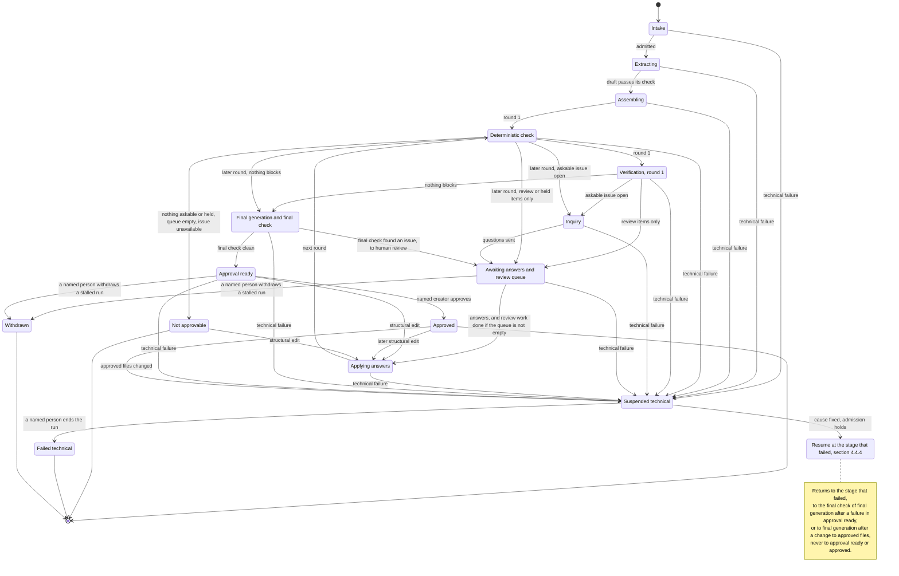

# Workflow

**Version:** 1.5.\
**Status:** Preliminary for Stage 1, decided on 2026-10-21 under interim authority ([ledger][led-s1]), amended on 2026-10-22 (changes C01 to C11) ([ledger][led-c11]) and on 2026-10-27 (decisions AD-D01 and AD-D04 to AD-D06) ([ledger][led-if07]; [ledger][led-d05]; [ledger][led-d06s]; [ledger][led-d06m]) and on 2026-10-28 (the stored approval summary, the monitoring repair action and deadlines, and how `closed_by` and `not_available` are written) ([ledger][led-sum]; [ledger][led-rep]; [ledger][led-dl]; [ledger][led-if08]), and again on 2026-10-28 (unit-scale compatibility of rate-law bindings) ([ledger][led-sc]; [ledger][led-if09]), and once more on 2026-10-28 (the boundary for numerical use of rate laws) ([ledger][led-num]; [ledger][led-if010]); Stage 2 sections proposed ([ledger][led-s2]). Written in phase P4 of the integration plan ([register, section 4.5][reg45]), 2026-10-20. This describes a proposed workflow for a system that is not implemented; nothing here has been built or run.\
**Precedence:** Where this document differs from the provenance ledger, the decided sections of [Architecture](../ARCHITECTURE.md) and [Open questions](../OPEN_QUESTIONS.md) (Q1-Q4), or [Issue format](../ISSUE_FORMAT.md), those texts take precedence (order in [register, section 3](PACKAGE_ADOPTION.md#3-precedence-and-pins)). Issue format version 0.10 (version 0.5, decided on 2026-10-20 ([ledger][led-if05]), amended on 2026-10-22 ([ledger][led-c11]), on 2026-10-27 ([ledger][led-if07]), on 2026-10-28 ([ledger][led-if08]), again that day ([ledger][led-if09]) and once more that day ([ledger][led-if010])) applies and ranks above the decisions of Tillman Heisner listed in [register, section 4.3](PACKAGE_ADOPTION.md#43-decided-by-tillman-heisner-on-2026-10-19-not-yet-in-the-ledger) (order in [register, section 3](PACKAGE_ADOPTION.md#3-precedence-and-pins)). Proposals of [register, section 11](PACKAGE_ADOPTION.md#11-pending-issue-format-changes) that version 0.5 did not take in appear here as design rules (not part of Issue format).\
**Rests on:** the documented decisions on the [pipeline][led-pipeline], the [issue format in its version 0.5][led-if05] (which replaced the [preliminary issue format of 2026-10-19][led-if]) as [amended on 2026-10-22][led-c11] to version 0.6 and [on 2026-10-27][led-if07] to version 0.7, [on 2026-10-28][led-if08] to version 0.8, [again that day][led-if09] to version 0.9 and [once more that day][led-if010] to version 0.10, and the [Stage 1 runtime][led-hermes]; the decisions of 2026-10-27 on [kinetic-equation bindings][led-d01] (AD-D01, with its clarification of the same day), [sequential round application][led-d04] (AD-D04), the [approval change summary][led-d05] (AD-D05), the [implementation sequence][led-d06s] and [monitor health][led-d06m] (AD-D06, with its clarification of the same day); the decisions of 2026-10-28 on the [stored approval summary][led-sum], the [monitoring repair action][led-rep], [monitoring deadlines][led-dl], [Issue format v0.8][led-if08], [rate-law unit scales][led-sc], [Issue format v0.9][led-if09], the [boundary for numerical use of rate laws][led-num] and [Issue format v0.10][led-if010]; decisions by Tillman Heisner, documented in the Stage 1 design ([ledger][led-s1]), of 2026-10-19 (D3, D4 A, D5 A, D9 A, token caps disabled in development), of 2026-10-20 (D6 A, D8 A, D10 A, D11 A1, D12 A, D13 A, D14 A, D15 A, D16 A, D17 B, D18 A to D24 A) and of 2026-10-21 (D25 A, D26 A, D27 B, D28 A to D32 A) ([register, section 4.3][reg43]). The points open in [register, section 4.4][reg44] do not change this document. D26 A, under which the inquiry packet has no INPUT block ([Handoffs, section 2.4][ho24]), changes no state or transition here.\
**Stage:** Stage 1 in full (sections 1 to 8, except section 6.2); Stage 2 as compact tables (sections 6.2 and 9). Labels follow the [stage legend](PACKAGE_ADOPTION.md#41-stage-legend).\
**Attribution:** Adapted in part from design package ARIADNE-AGENT-ARCH-001 v1.2.1 (AI-generated for Tillman Heisner, 2026-10-12).

## 1. Purpose and terms

**Stage:** Stage 1 and 2.

### 1.1 Purpose

**Stage:** Stage 1 and 2.

This document proposes how one record moves through ARIADNE's pipeline: the states it can be in, what moves it from one state to the next, what software checks before each move, and what happens when something breaks. It follows the flow of [Issue format 7.1][if71] step by step and adds what that flow leaves open: the assembly step as a state, the waits for people, a round of its own for the final check (step 10), and technical failures.

What this document does not define:

- the issue, question and answer formats: [Issue format](../ISSUE_FORMAT.md), which this document cites and never restates;
- what each agent receives and returns, and the format checks on it: [Handoffs][handoffs]; what each agent does, and what a technical re-run carries: [Roles][roles];
- the runtime and its process model: [Runtime](RUNTIME.md); the containment tests and admission: [Containment][cont]; run-log fields, checksums and budgets: [Run records][rr]; limits: [Runtime 12.3][rt123].

Package identifiers for states, transitions and guards are mapped only in the [register, section 6.3][reg63].

**For the scientist, in short** (Stage 1):

- You answer the questions ARIADNE asks about one record. Questions name things you know, never internal codes ([Issue format 5.3][if53]).
- Waiting for you never runs out: no question expires, and nothing is approved while you are away. Non-normative candidate examples of waiting versus withdrawal and partial-result review are in [Researcher review guidance](REVIEW_GUIDANCE.md).
- Nothing is approved without you: one named scientist, listed among the record's creators, approves the final record ([Issue format 7.2][if72]).
- A software problem never turns into a question for you. It becomes a review item or stops the run until the software is fixed (section 2.1).
- You may answer, handle review items and approve yourself, without switching roles ([Issue format 6][if6]). Someone else may enter your answer or approval for you; the record keeps you as its author ([Issue format 6.3][if63]).
- If you want a change that no open question covers, it is made as a structural edit with its basis ([Issue format 6.2][if62]). In a round, your answers are applied first, and any edit is then made on that result, one at a time (section 4.2).
- Before you approve, you see what changed since the first check, what each change rests on and which checks ran after it. Nothing is marked as verified, and the later checks are mechanical only (section 4.3, step 5).

### 1.2 Terms

**Stage:** Stage 1.

- **Run:** one pass of one stored STRENDA DB entry through the pipeline, from intake to an end. Software gives each run its id. An evaluation run is not a pipeline run: a mode B run covers only the round-1 part of one ([Evaluation interfaces, section 1.2][ev12]).
- **Round:** as defined in [Issue format 2][if2]. Software numbers the rounds. Proposed: a round's number is set when its deterministic check starts ([Issue format 7.1][if71], steps 3 and 8), and the final check after the final generation step has a round number of its own (section 4.3). The final check itself is stated in [Issue format 7.1][if71], step 10.
- **Round snapshot:** the record (the EnzymeML document, its evidence entries and its not-mapped entries) as it stands when a round's check starts. It is written once and never changed; the next round gets a new snapshot.
- **Working copy:** the copy of a round snapshot to which software applies the round's answers and then, one at a time, its human actions, before the result is committed as the next snapshot ([Issue format 7.1][if71], "Working copy"; section 4.2). Each version is stored with its checksum, and each human action names the version it was prepared against as its base. Preparing and changing it starts no round.
- **Agent step:** one agent's turn in a run: the extraction step, the verification step (round 1 only), or the inquiry step of one round. For the extraction in parts ([Handoffs, section 4.3][ho43]) each part is an agent step of its own, with its own technical re-run; the extraction as a whole is one pipeline stage ([Runtime 1.2][rt12]), and the attempts-per-stage guard counts the attempts of all its parts together.
- **Attempt:** one execution of one agent on one packet, in a fresh process ([Runtime 5.1][rt51]) inside a container of its own (D10 A; [Runtime 10][rt10]). A technical re-run is a second attempt of the same agent step (section 4.4.2).
- **Forwarded attempt:** an attempt for which the model gateway has forwarded at least one request (D25 A; section 4.4.2, clarification 4).
- **Askable issue:** an open issue that routing sends to the inquiry agent ([Issue format 4.2][if42], rule 6; for issues raised in round 2 or later, section 3.2), including one the person reviewing sends on (section 2.1), and that is not in the review queue ([Issue format 5.1][if51], rule 2). An `unavailable` or `held` issue is not askable ([Issue format 5.4][if54]; [5.1][if51], rule 2).
- **Person working on the record:** the named person who takes the human actions of [Issue format 6][if6]; normally the scientist, who may answer, handle review items and approve without switching roles. There is no separate curator role and no new administrator role.
- **Review queue:** what waits for the person working on the record: the review items, that is, open issues that routing sends to human review ([Issue format 4.2][if42], rule 6; [6][if6], "Human review"; section 3.2), and issues with a "does not fit" note, a rate model or bindings outside the options offered, or a chosen rate-law option that fails its checks ([Issue format 5.1][if51] and [6.2][if62]); and the `held` issues, evidence entries and parameter links, which wait until a named person maps or disposes them ([Issue format 7.1][if71], "Live pointers"; [6.2][if62]). Software computes the queue from the issues and the binding map; the person works on it. Notes on added issues that software does not register ([Issue format 4.2][if42], rule 2), and changes the scientist wants that no question covers, are not in the queue: they block nothing, no state waits for them, and a named person may act on one with a structural edit ([Issue format 6.2][if62]) wherever section 2.1 allows one.
- **Binding map:** the binding of each live pointer to the `id` of the object it addresses, which software keeps per round in the run log ([Issue format 2][if2], Live pointer; [Run records 2.3][rr23]).
- **Technical failure:** a step that ends without a usable result, such as a crash, unusable agent output or a failed start-up check. The term is defined in [Handoffs, section 1.2][ho12]. Only the attempt failure classes of [Handoffs, section 2.13][ho213] may use the one technical re-run; a failed admission, packet or start-up check, or a packet that does not fit, suspends the run and uses none (section 4.4).
- **Run log:** the Stage 1 log of a run: every state change with its cause, the counters, the software-computed checksums of D13 A and the usage measured at the model gateway. What it holds and its fields: [Run records, sections 1.2][rr12] and [2][rr2].

Names follow the [register's name table][reg5]: workflow controller, assembly step, answer application, final generation step, model gateway, run log, scientist, data owner. The register's name table names no curator; the former curator acts are the human actions of [Issue format 6][if6].

### 1.3 Ground rules

**Stage:** Stage 1.

1. **Only software moves a record.** The workflow controller evaluates every condition in sections 3 and 4 and makes no scientific judgment. A condition it cannot evaluate counts as not met. Agents return outputs only. Whatever an agent's text says, it never chooses a state, closes an issue, answers a question or approves anything.
2. **One machine step at a time.** Proposed: the workflow controller runs at most one machine step at a time; any number of runs may wait for people at once; and at most one run per stored entry is active, that is, not ended. Agents read their packets and return outputs. Only software writes the record files: the assembly step, answer application and the final generation step, and the workflow controller writes the approval entry ([Handoffs, section 2.12][ho212]). Human actions ([Issue format 6][if6]) are recorded, written into the round's working copy by answer application, and committed with it ([Issue format 7.1][if71], steps 6 and 7).
3. **Software computes every id, checksum, round number and timestamp.** No field an agent writes is one of these ([Issue format 4][if4] and [5.1][if51], column "Written by"). The extraction agent uses local link names, and the assembly step writes the ids ([Issue format 3.1][if31], `S-ID`). Software also stamps the time an answer or an approval is stored. Design rule (not part of Issue format).
4. **People are never timed out.** Waiting for people has no deadline, and no wait ever ends in approval. Only machine work has deadlines (limits: D12 A; [Runtime 12.3][rt123]; [Run records 4][rr4]).
5. **Approval needs a person.** A record is approved only by the act of one named scientist under [Issue format 7.2][if72]. Zero questions never means approval.
6. **Technical failures stay out of the record.** A technical failure is recorded in the run log and handled by the one technical re-run or by suspension (section 4.4). The record and its issues stay as they were before the failed step. How this relates to the issue format is noted once, in section 4.4.
7. **No model call without containment.** No agent attempt starts before the containment test suite has passed for the runtime in use ([ledger][led-hermes]). The attempts of a containment run itself, which reach only the stub model, are the one exception, as [Containment 12.4][cont124] sets out (AD-01 to AD-05 excepted).
8. **Everything is logged.** Every state change is recorded in the run log with its cause.

### 1.4 How evaluation runs use the workflow

**Stage:** Stage 1.

Evaluation runs use parts of this workflow ([Evaluation interfaces 2][ev2]). Mode A runs one step alone on a frozen packet. Mode B runs from the extraction step, after the admission of [Evaluation interfaces 7.1][ev71], to the round-1 inquiry step, with no person acting. Both use only the failure classes and the one technical re-run of sections 4.4.1 and 4.4.2; a failure that remains after the re-run is counted and reported, not suspended ([Evaluation interfaces 4.6][ev46]). How void attempts, batch stops and items not run are handled: [Evaluation interfaces 10.4][ev104]. Under the evaluation profile, a frozen cap hit is a technical failure that the evaluation run counts instead of suspending; a cap without a failure class of its own (the input cap, the request cap or the attempts-per-stage cap) ends the step with code `cap_hit` and no re-run ([Run records 4.10][rr410]). First-try and final results are reported separately (D14 A; [Evaluation interfaces 10.5][ev105]). An issue left without a judgment counts as not judged ([Evaluation interfaces 4.6][ev46]), as in section 3.3. Measurement runs ([Evaluation interfaces 1.2][ev12]) use the same parts and score nothing. Later rounds involve people and are not evaluated in Stage 1.

## 2. Stage 1 states

**Stage:** Stage 1.

Each run starts at intake, where the original input and its origin are preserved ([Architecture, Proposed flow][arch-flow]). The rows of section 3.1 are named in the column "Exits".

| State | Meaning | Who acts | Exits (section 3.1 rows) | Stage |
|---|---|---|---|---|
| Intake | The run starts. The stored entry, unchanged, is checked against its recorded checksum and download date ([Q1][q1]) and its recorded origin ([Architecture, Proposed flow][arch-flow]), and admission is checked (section 3.3). | A named person starts the run and names the scientist who will answer; the workflow controller checks admission. | Extracting (2); suspended technical (3) | Stage 1 |
| Extracting | One extraction agent attempt drafts the record and its evidence entries ([Issue format 7.1][if71], step 1), or one attempt per part, in order, in the contingency of [Handoffs, section 4.3][ho43]. Each packet holds the whole STRENDA XML, and the agent is offered no tools (D6 A; contents in [Handoffs][handoffs]). | Extraction agent; workflow controller | Assembling (4); extracting, for the one technical re-run (5); suspended technical (6) | Stage 1 |
| Assembling | The assembly step fills the SOFTWARE fields ([Issue format 3.1][if31]; 7.1 step 2). It raises no issues; a rule that cannot apply leaves the field for the deterministic check. | Assembly step | Deterministic check (7); suspended technical (8) | Stage 1 |
| Deterministic check | The deterministic verifier checks the round snapshot (section 4.1); software applies the re-check rules of [Issue format 7.1][if71] and routes the issues (section 3.2). | Deterministic verifier; workflow controller | Verification (9); inquiry (10); awaiting answers (11); final generation (12); not approvable (13); suspended technical (14) | Stage 1 |
| Verification (round 1) | One verification agent attempt judges the round-1 issues and adds its own ([Issue format 4.2][if42]; 7.1 step 4). Software registers the added issues that [Issue format 4.2][if42], rule 2, allows, gives them their ids and routes all issues; the others go to human review as notes (section 3.3). Entered in round 1 only. | Verification agent; workflow controller | Inquiry (15); awaiting answers (16); final generation (17); verification, for the one technical re-run (18); suspended technical (19) | Stage 1 |
| Inquiry | One inquiry agent attempt turns the open askable issues into questions ([Issue format 5.1][if51]; 7.1 step 5). Software writes the question ids and the round. | Inquiry agent; workflow controller | Awaiting answers (20); inquiry, for the one technical re-run (21); suspended technical (22) | Stage 1 |
| Awaiting answers | Waits for the scientist's answers to the round's questions; once they are all in, software prepares the round's working copy from them, and the run waits for the work on the review queue on that copy (7.1 step 6; section 4.2). No deadline. | Scientist; the person working on the record | Applying answers (23); suspended technical (24); withdrawn (38) | Stage 1 |
| Applying answers | The round's working copy is committed: the assembly step re-applies the SOFTWARE rules to its last version, and the result is written as the next snapshot, all or nothing. A structural edit of rows 31, 33 and 35 is first applied to a working copy of the last snapshot (section 4.2; 7.1 step 7). | Answer application; assembly step | Deterministic check, next round (25); suspended technical (26) | Stage 1 |
| Final generation | The final generation step sets `created` and `modified` and writes the final files (7.1 step 9). The deterministic verifier then checks exactly these files as a round of its own (section 4.3; [Issue format 7.1][if71], step 10). | Final generation step; deterministic verifier | Approval ready (27); awaiting answers (28); suspended technical (29) | Stage 1 |
| Approval ready | Waits for the approval of one named scientist ([Issue format 7.2][if72]). No deadline. | Scientist; a named person for a structural edit | Approved (30); applying answers (31); suspended technical (32); withdrawn (38) | Stage 1 |
| Approved | End. The deliverable is the EnzymeML document, the evidence file and the not-mapped report ([Issue format 7.2][if72]). Sharing needs the data owner's separate approval. | Nobody; a named person only for a later edit (row 33); software for the checksum comparison (row 34) | Applying answers (33); suspended technical (34) | Stage 1 |
| Not approvable | End. No askable issue is open, the review queue is empty, and at least one issue is `unavailable`. The record ends naming those fields in plain words ([Issue format 5.4][if54] and [5.3][if53]). | Nobody; a named person only for a later edit (row 35) | Applying answers (35) | Stage 1 |
| Suspended technical | A technical failure stopped the run. The run log names the failed stage and the cause (section 4.4). | A named person | The failed stage, on resume (36); failed technical (37) | Stage 1 |
| Failed technical | End. The run cannot continue; a restart is a new run (section 4.4.5). | Nobody | None | Stage 1 |
| Withdrawn | End. A named person withdrew a run that stalled while it waited for people; never approval and never a technical failure. Design rule (not part of Issue format) | Nobody | None | Stage 1 |

**Notes** (Stage 1)

- **Ends:** approved, not approvable, failed technical and withdrawn. **Waits for people:** awaiting answers and approval ready. **Technical wait:** suspended technical.
- **The verification agent runs once per run.** In later rounds, the issues of the deterministic check are routed without the verification agent ([Issue format 7.1][if71], step 8). Step 8 allows a re-run on fields written by structural edits only, if structural edits prove error-prone in the pilot; the register recommends switching it on only by a Decision recorded in the ledger ([register conflict C-10][reg7]). This state machine does not contain that re-run.
- **No admission denial over `/version`.** The validation profile handles the upstream schema defect ([Issue format 9][if9], item 1), so no state waits on it (trace 5.4).

### 2.1 What a person does to a run

**Stage:** Stage 1.

The human actions on issues are those of [Issue format 6][if6]; the people and their acts on a run are described in [Roles, section 4.2][roles42]. This table lists only the acts of a named person on a run ([Issue format 6][if6]: in Stage 1 the scientist or Tillman Heisner); row numbers refer to section 3.1. The same person may answer, take these acts and, as an eligible scientist, approve, without switching roles. Another named person may enter an act for its author ([Issue format 6.3][if63]).

| Act | Allowed in | Effect | Stage |
|---|---|---|---|
| Start a run for one stored entry and name the answering scientist | When no run of that entry is active (section 1.3) | Intake (row 1) | Stage 1 |
| Record an override, a structural edit, or the mapping of a `held` issue, evidence entry or parameter link ([Issue format 6][if6]) | Awaiting answers, once the round's working copy is prepared | Applied at once to the current version of the working copy, in the order accepted; refused as stale when its base is another version (section 4.2) | Stage 1 |
| Record a structural edit | Approval ready (row 31); not approvable (row 35); approved (row 33) | Prepared against a working copy of the last round snapshot; starts a new round through applying answers | Stage 1 |
| Send a rejected mechanical issue on an extracted value that the person reviewing finds real to the inquiry agent, unless the scientist already answered it with "The question does not fit" ([Issue format 4.2][if42], rule 6) | Awaiting answers | The issue leaves the review queue. It is asked as a lab fact ([Issue format 5.2][if52], rule 7) in the next round, after the deterministic check, if that check still finds it (rows 23, 25 and 10) | Stage 1 |
| Mark the round's review work done | Awaiting answers, once the round's working copy is prepared. Required only when the review queue on the working copy is not empty | The working copy is committed (row 23) | Stage 1 |
| Resume a suspended run, recording how the cause was fixed | Suspended technical | Row 36; section 4.4.4 | Stage 1 |
| End a suspended run | Suspended technical | Failed technical (row 37) | Stage 1 |
| Record a monitoring repair for an execution environment ([Containment 12.4][cont124]) | At any time, independently of any run or batch; also for an environment whose only held run has ended | Software runs a readiness check and, if it passes, releases the latest hold of that environment; the person never records the release. No run moves, an ended run stays ended, and nothing is reopened. Decided on 2026-10-28 ([ledger][led-rep]) | Stage 1 |
| Withdraw a run that stalls while it waits for people | Awaiting answers; approval ready | Withdrawn (row 38) | Stage 1 |

Withdrawing a stalled run is a design rule (not part of Issue format), item 25 of section 7.2.

## 3. Transitions

**Stage:** Stage 1.

### 3.1 Transition table

**Stage:** Stage 1.

The column "Issue format step" names the step of [Issue format 7.1][if71] that the move belongs to. A dash means the move is not part of that flow.

| # | From | To | Condition (checked by software) | Issue format step | Stage |
|---|---|---|---|---|---|
| 1 | (start) | Intake | A named person starts a run for one stored entry that has no active run. | Before step 1 | Stage 1 |
| 2 | Intake | Extracting | Admission holds (section 3.3). | Step 1 | Stage 1 |
| 3 | Intake | Suspended technical | Admission or the context check fails, for example a changed input checksum or no current VERIFIED containment report for the runtime manifest about to be used ([Containment 12.4][cont124]), or safe XML parsing refuses the input (section 4.4.1). No model call is made. | - | Stage 1 |
| 4 | Extracting | Assembling | The output passes the draft check (section 3.3). | Steps 1 to 2 | Stage 1 |
| 5 | Extracting | Extracting | A forwarded attempt ended with unparsable, truncated or crashed output, and the step's one technical re-run is unused (section 4.4.2). | Step 1 | Stage 1 |
| 6 | Extracting | Suspended technical | Any other technical failure, or the re-run failed too. A missing or unparsable extraction output is a technical failure, and no check follows. | - | Stage 1 |
| 7 | Assembling | Deterministic check | The SOFTWARE fields are filled and the context check passes (section 3.3); round 1 starts. | Steps 2 to 3 | Stage 1 |
| 8 | Assembling | Suspended technical | The assembly step cannot finish, or the context check before the deterministic check fails (section 3.3). | - | Stage 1 |
| 9 | Deterministic check | Verification (round 1) | Round 1, and the report is complete. This holds even when the draft label is "invalid" (section 4.1). | Steps 3 to 4 | Stage 1 |
| 10 | Deterministic check | Inquiry | Round 2 or later; the report is complete; at least one askable issue is open. New askable issues go straight to the inquiry agent, without the verification agent. | Step 8 to step 5 | Stage 1 |
| 11 | Deterministic check | Awaiting answers | Round 2 or later; no askable issue is open; the review queue is not empty (it holds every `held` item). | Step 8 to step 6 | Stage 1 |
| 12 | Deterministic check | Final generation | Round 2 or later; no askable issue is open; the review queue is empty, so nothing is `held`; no issue is `unavailable`. | Step 8 to step 9 | Stage 1 |
| 13 | Deterministic check | Not approvable | Round 2 or later; no askable issue is open; the review queue is empty, so nothing is `held`; at least one issue is `unavailable`. | Step 8; [Issue format 5.4][if54] | Stage 1 |
| 14 | Deterministic check | Suspended technical | The check cannot finish, for example a crash or an unreadable snapshot (section 4.4). | - | Stage 1 |
| 15 | Verification (round 1) | Inquiry | The report passes the verification check (section 3.3), the registered added issues have their ids, and at least one askable issue is open. | Steps 4 to 5 | Stage 1 |
| 16 | Verification (round 1) | Awaiting answers | As row 15, but no askable issue is open and the review queue is not empty. | Steps 4 to 6 | Stage 1 |
| 17 | Verification (round 1) | Final generation | As row 15, but no askable issue is open and the review queue is empty. No issue can be `unavailable` or `held` before the first answers. | Steps 4 to 9 | Stage 1 |
| 18 | Verification (round 1) | Verification (round 1) | As row 5. | Step 4 | Stage 1 |
| 19 | Verification (round 1) | Suspended technical | As row 6. | - | Stage 1 |
| 20 | Inquiry | Awaiting answers | The question round passes the question check (section 3.3); software writes the question ids and the round. | Steps 5 to 6 | Stage 1 |
| 21 | Inquiry | Inquiry | As row 5. | Step 5 | Stage 1 |
| 22 | Inquiry | Suspended technical | As row 6. | - | Stage 1 |
| 23 | Awaiting answers | Applying answers | Every question of the round has an accepted answer (a round for review work only has none), the round's working copy has been prepared from them (section 4.2), and, when the review queue on the working copy is not empty, the person working on the record has marked the round's review work done. An answer may leave issues without an item ([Issue format 5.2][if52], rule 5). | Steps 6 to 7 | Stage 1 |
| 24 | Awaiting answers | Suspended technical | A technical failure during the wait, for example an answer cannot be stored, or the working copy cannot be prepared or an accepted action cannot be applied to it. The questions stay open, and no snapshot is written. | - | Stage 1 |
| 25 | Applying answers | Deterministic check | The last version of the working copy, with the SOFTWARE rules re-applied, is written in full as the new snapshot and the context check passes (section 3.3); the next round starts. | Steps 7 to 8 | Stage 1 |
| 26 | Applying answers | Suspended technical | The commit cannot finish; no snapshot is written. A failed context check before the next deterministic check also leads here (section 3.3). | - | Stage 1 |
| 27 | Final generation | Approval ready | The ready check holds (section 3.3): the final check raised or reopened no issue, conditions 1 to 3 and 5 of [Issue format 7.2][if72] hold, and no technical failure is open. | Steps 9 and 10; final check: section 4.3 | Stage 1 |
| 28 | Final generation | Awaiting answers | The final check raised or reopened at least one issue. Each such issue goes to the review queue as a sign of a software defect (section 4.3; [Issue format 7.1][if71], step 10). | Step 10 to step 6; final check: section 4.3 | Stage 1 |
| 29 | Final generation | Suspended technical | The final generation step cannot finish, its files fail their self-check ([Handoffs, section 2.2][ho22]), `created` or `modified` is not set, or the final check cannot finish. | - | Stage 1 |
| 30 | Approval ready | Approved | One named scientist listed among the creators approves ([Issue format 7.2][if72], condition 4), also when another named person enters the approval ([Issue format 6.3][if63]); software records the approval and the approved-file checksums (section 4.3). | Step 11 | Stage 1 |
| 31 | Approval ready | Applying answers | Before approval, a named person makes a structural edit, for example the scientist ([Issue format 6.2][if62]). | Steps 6 to 7 | Stage 1 |
| 32 | Approval ready | Suspended technical | A technical failure while showing the record or recording the approval. | - | Stage 1 |
| 33 | Approved | Applying answers | A named person makes a structural edit after approval; the approval is void and a new round starts ([Issue format 7.2][if72], "Later changes"). | Steps 6 to 7 | Stage 1 |
| 34 | Approved | Suspended technical | The approved files no longer match the checksums recorded at approval (section 4.3, step 7). The approval is void ([Issue format 7.2][if72], "Later changes"), and the run log records the mismatch. | - | Stage 1 |
| 35 | Not approvable | Applying answers | A named person makes a structural edit that closes an `unavailable` issue, for example after the scientist finds the value, as [Issue format 5.4][if54] and [6.2][if62] state. Alternative: a new run of the entry (section 4.4.5). | Steps 6 to 7 | Stage 1 |
| 36 | Suspended technical | The failed stage | The resume conditions hold (section 4.4.4). After row 32 the run resumes at the final check of final generation, and after row 34 at final generation. Never approval ready or approved. | - | Stage 1 |
| 37 | Suspended technical | Failed technical | A named person ends the run: the cause cannot be fixed, or the failed agent step has no forwarded attempt left. | - | Stage 1 |
| 38 | Awaiting answers or approval ready | Withdrawn | A named person withdraws the run and records why. | - | Stage 1 |

### 3.2 Routing after a check

**Stage:** Stage 1.

After each check of the deterministic verifier, and after the verification agent's report in round 1, software chooses the next state from the issues alone. The first rule that applies wins:

1. **Round 1, after the deterministic check:** the verification agent (row 9).
2. **After the final check** (section 4.3; [Issue format 7.1][if71], step 10): approval ready if the check raised or reopened no issue and the ready check holds (row 27); otherwise the review queue (row 28).
3. **An askable issue is open:** the inquiry agent (rows 10 and 15). Questions on these issues go on even while other issues are `unavailable`, `held` or in the review queue.
4. **Otherwise, the review queue is not empty:** awaiting answers, for review work only (rows 11 and 16).
5. **Otherwise, an issue is `unavailable`:** not approvable, naming those fields in plain words ([Issue format 5.3][if53]) (row 13).
6. **Otherwise:** final generation (rows 12 and 17).

Every blocking issue that is open, `held` or `unavailable` is askable, in the review queue or `unavailable` (rules 3 to 5), and every `held` evidence entry or parameter link is in the review queue, so rule 6 is reached only when nothing blocks approval ([Issue format 4][if4], rule 1; [7.2][if72], condition 5). This includes issues raised in round 2 or later and reopened issues, which [Issue format 4.2][if42], rule 6, also routes (below).

**Issues raised in round 2 or later** have no judgment. They are routed as the paragraph below the table of [Issue format 4.2][if42], rule 6, states; it also covers values the scientist gave or a structural edit wrote, and the issues of the final check ([Issue format 7.1][if71], steps 8 and 10).

**Reopened issues** keep their id ([Issue format 7.1][if71], "On re-check") and are routed as the same paragraph of [Issue format 4.2][if42], rule 6, states; for example, a reopened mechanical issue that went to human review because the verification agent rejected it goes back to human review.

**Held issues and bindings** go nowhere until a named person maps or disposes them ([Issue format 4.2][if42], rule 6, paragraph below the table; [6.2][if62]). The workflow keeps them in the review queue, so that the run waits for a person (rule 4) and never reaches final generation or not approvable while anything is held. A mapped issue returns to its earlier status and is routed as before it was held.

**Incomplete verification output** (round 1). An issue that the verification agent should judge but leaves without a judgment, or with two different verdicts, is recorded in the run log as not judged and routed as [Issue format 4.2][if42], rule 4, states. Whether an issue that the verification agent adds is registered, including one whose pointer resolves to nothing, follows [Issue format 4.2][if42], rule 2; an added issue that is not registered goes to human review as a note (section 1.2, review queue). Both are counted ([Handoffs, section 2.8][ho28]; section 3.3, verification check).

**A `wrong_type` issue at an empty field that is neither extracted nor a SOFTWARE field** matched no row of the routing table under version 0.4 (section 4.1, notes). Design rule (not part of Issue format), for version 0.4 only: it goes to the review queue, and it closes on re-check once the field is filled, or by an override when the field's missing issue is `unavailable`. Under version 0.5 the case does not arise ([Issue format 4.1][if41], note 4).

### 3.3 What software checks before each move

**Stage:** Stage 1 (Stage 2 additions in section 9).

Only software evaluates these checks. A check that cannot be evaluated counts as failed.

| Check | Before | What software checks | Stage |
|---|---|---|---|
| Admission | Rows 2 and 36 (before each agent attempt as well: see attempt start) | The admission check of [Runtime 12.2][rt122] passes (items 1 to 4), as [Containment 12.4][cont124] applies it: a current VERIFIED containment report for the runtime manifest about to be used, matched by checksum (D13 A); exact pins; the source recorded: the stored entry's manifest row with its checksum, download date ([Q1][q1]) and origin ([Architecture, Proposed flow][arch-flow]), whose checksum the context check below compares with the stored file; and the route recorded, the one route of D11 A1 ([Runtime 12.1][rt121]). Attempts of a containment run are the exception that [Containment 12.4][cont124] sets out: they need no containment report, except in AD-01 to AD-05. Limits follow D12 A ([Runtime 12.3][rt123]). There is no data-owner step (Stage 2, [Q6][q6]), no denial over the `/version` pattern ([Issue format 9][if9], item 1) and no token reservation. | Stage 1 |
| Attempt start | Every agent attempt | The admission check of [Roles, section 8.2][roles82], row 14 (items 1 to 4 of [Runtime 12.2][rt122], as in the Admission row), among them a current VERIFIED containment report for the runtime manifest about to be used ([Containment 12.4][cont124]); attempts of a containment run are the exception that [Containment 12.4][cont124] sets out (no report needed, except in AD-01 to AD-05). The packet check of [Roles, section 7.2][roles72]. If either fails, the attempt is not forwarded and the run is suspended (codes `not_admitted` and `packet_check_failed`, [Roles, section 8.7][roles87]; section 4.4.1). The start-up self-check passes ([Runtime 5.4][rt54]). The agent is offered no tools (D6 A; [Runtime 5.3][rt53]). The packet fits the route's context length, measured before sending (D6 A). Isolation: one container per attempt, whose only network destination is the model gateway (D10 A; [Runtime 10][rt10]). Delegation, fallback models and helper calls are off. Software records the checksums of the prompt, the configuration and the packet (D13 A). Usage is measured at the model gateway; per-request token caps are off in development; runaway guards as D12 A and D19 A set them ([Runtime 12.3][rt123]). | Stage 1 |
| Context | Every step | Every input of the step belongs to this run, record and round, and nothing refers to another record. Outputs and answers refer only to ids that exist in the step's packet or round. Before building any packet that holds the input, before each deterministic check (rows 7 and 25) and at every resume (section 4.4.4), the workflow controller checks that the stored entry still has its recorded checksum ([Q1][q1]); a mismatch is a technical failure (section 4.4). The deterministic verifier never computes this checksum. | Stage 1 |
| Agent output | Every forwarded attempt | Software records the checksum of the output (D13 A) and runs the format check of [Handoffs, section 2.2][ho22]. Output that fails it is a technical failure (section 4.4). | Stage 1 |
| Draft check | Row 4 | The extraction output passes the format check of a draft proposal ([Handoffs][handoffs]). It carries no issues, classification, missing-field registry, ids or checksums. It carries the not-mapped entries, which the extraction agent drafts ([Issue format 7.1][if71], step 1; [8.1][if81]). | Stage 1 |
| Report complete | Rows 9 to 13 | Every step of section 4.1 ran on the round snapshot. A step that cannot run is a technical failure (section 4.4). | Stage 1 |
| Verification check | Rows 15 to 17 | The report passes its format check ([Handoffs, section 2.8][ho28]), for example: it refers only to issues in its packet, puts no judgment on the issues it adds ([Issue format 4.2][if42], rule 2), and gives each added issue the locators that [Issue format 4][if4] requires. An issue left without the judgment that rule 1 asks for, or with two different verdicts, is content, not a format fault; the workflow controller records it as not judged in the run log and routes it as section 3.2 says ([Issue format 4.2][if42], rule 4). An added issue that software does not register under [Issue format 4.2][if42], rule 2, for example one of a kind the verification agent may not raise, is recorded in the run log and passed to human review as a note (section 1.2, review queue), and the report is still used ([Handoffs, section 2.8][ho28]). Software gives the registered added issues their ids and round 1. | Stage 1 |
| Question check | Row 20 | The question round passes its format check ([Handoffs, section 2.9][ho29]): each question tags at least one issue, and only open askable issues of its packet. A round with no question fails the format check and is unparsable (D25 A; [Handoffs, section 2.9][ho29]), because the inquiry step is entered only with an askable issue open. Proposed: askable issues that no question tags are listed with the round ([Handoffs, section 2.9][ho29]) and in the run log, stay open and are asked in the next round. This is the workflow's form of the register's question-coverage row ([register, section 6.3][reg63]). Design rule (not part of Issue format). | Stage 1 (untagged issues: proposed) |
| Answer check | Each answer, on arrival | The answer is for a question of the current round, and its author (`answered_by`) is the scientist named for the run; an answer that another named person entered also carries `entered_by` and `original_ref` ([Issue format 5.2][if52]; [6.3][if63]). Its items follow [Issue format 5.2][if52] and name only issues its question tags. No item writes a SOFTWARE field, such as `/version` ([Issue format 3.1][if31]); an item for an `R-CTX-LAW` issue is not such an item: the scientist confirms a fully bound rate-law option, and software builds the equation from exactly that option ([Issue format 3.4][if34]; [3.1][if31], `S-RATELAW` and "Rate-law bindings"). Answers to earlier rounds' questions are refused as stale, and so are answers that arrive after the round's working copy is prepared; a change to an answered value is then a structural edit ([Issue format 7.1][if71], "Working copy"). Software stamps the time of arrival and records the stored answer's checksum (D13 A); that software writes the time is a design rule (not part of Issue format). Authentication is Stage 2 ([Q7][q7]). | Stage 1 |
| Human-action check | Each human action file, on arrival | Its `base` names the current version of the round's working copy (outside a round of questions, of the copy of section 4.2, "No question open"); otherwise it is refused as stale and returned with the changes since its base, and nothing of it is applied ([Issue format 7.1][if71], "Working copy"; [Handoffs, section 2.11][ho211]). The action records its person (`by`) and time (`at`), with `entered_by` and `original_ref` when another named person entered it ([Issue format 6][if6]; [6.3][if63]). It is recorded in a state that section 2.1 allows for it, and its `issue_ids`, and for a `map` the items of `mappings`, name only issues of this record that are `open`, `unavailable` or `held`; a `held` issue only in a mapping or in a structural edit that disposes of it ([Issue format 6.2][if62]). An override names only issues that [Issue format 6.1][if61] lets it close, none of them `held`. Every structural edit records its basis: source locators, a statement, or both ([Issue format 6.2][if62]; fields in [Handoffs, section 2.11][ho211]); an edit without a basis is refused, and each source locator must resolve as [Issue format 2][if2], Locator, requires. Whether the source states the change clearly is the person's judgment, not software's; an ambiguous source needs a statement ([Issue format 6.2][if62]). A structural edit that closes an `unavailable` issue with a value the scientist supplied has the scientist's statement as its basis. A mapping names, for each held item, pointers that resolve to one object, which software binds to that object's id. A failing file is returned to the person with the reason, and nothing of it is applied ([Handoffs, section 2.2][ho22]). Design rule (not part of Issue format). | Stage 1 |
| Live pointer | Every use of a live pointer by software | The pointer still addresses the object whose id the binding map records for it ([Issue format 7.1][if71], "Live pointers"). A pointer that resolves but addresses another object is never used: software retargets it through its id or holds it (section 4.2, steps 5 and 6). | Stage 1 |
| Application check | Row 25 | Every accepted item of the round was applied to the working copy, and every accepted human action to the version its base names, in recorded order; the live pointers were retargeted or held after each (section 4.2, steps 5 and 6) and the binding map recorded; the SOFTWARE rules were re-applied; and the last version was written in full as the new snapshot. Otherwise no snapshot was written. | Stage 1 |
| New round | Rows 25, 31, 33 and 35 | Only applied answers, human actions ([Issue format 6][if6]) and the SOFTWARE rules ([Issue format 3.1][if31]) change a record. Each commit of a working copy starts a new round with a deterministic check ([Issue format 7.1][if71]); preparing a working copy and applying actions to it start none. Only the deterministic verifier re-runs. | Stage 1 |
| Ready check | Row 27 | The final check raised or reopened no issue (section 4.3; [Issue format 7.1][if71], step 10). Conditions 1 to 3 and 5 of [Issue format 7.2][if72] hold on the final files, and no technical failure is open. | Stage 1 |
| Approval check | Row 30 | Condition 4 of [Issue format 7.2][if72]: the approver (`approved_by`) is one named scientist listed among the creators. An approval entered by another named person carries `entered_by` and `original_ref` and counts only for its author; entry assistance never confers approval authority ([Issue format 6.3][if63]). The statement names the round of the current final check and the stored approval summary of that check, by its artifact id, whose checksum software checks ([Handoffs, section 2.12][ho212]; [Run records 2.9][rr29]). A statement for an earlier round, or one stored while the record is not approval ready, is refused as stale, and the record stays where it is. Software stamps the time of approval. The stale rule and the time stamp are design rules (not part of Issue format). | Stage 1 |
| Approved-file check | Before any use of an approved record, and at every resume | The approved files still have the checksums recorded at approval (D13 A); a mismatch voids the approval (row 34; [Issue format 7.2][if72], "Later changes"). Uses are, for example, handing the record on for the data owner's sharing decision or exporting it. | Stage 1 |
| Resume check | Row 36 | Section 4.4.4. | Stage 1 |

## 4. Procedures

**Stage:** Stage 1.

### 4.1 Checking a draft

**Stage:** Stage 1.

The deterministic verifier is software, not an agent ([Architecture, Components][arch-comp]). It makes no model call and knows no input format. It checks one round snapshot. Steps 3 to 7 may run in any order; steps 8 and 9 use their results. It reads the input only in step 5 ([Issue format 8][if8]).

| # | Step | What happens | Defined in | Stage |
|---|---|---|---|---|
| 1 | Context | The snapshot belongs to this run, record and round; a mismatch is a technical failure (section 4.4). The workflow controller has checked the stored entry's checksum before the check starts (section 3.3). | Section 3.3 | Stage 1 |
| 2 | Read | The snapshot is read strictly. A snapshot that cannot be read stops the check as a technical failure. | [Handoffs][handoffs] | Stage 1 |
| 3 | Schema | Check `C-SCHEMA` against the pinned schema, with the documented `/version` deviation. | [Issue format 8][if8]; [9][if9], item 1 | Stage 1 |
| 4 | References | Check `C-REF`, with the rate-law label exception. | [Issue format 8][if8]; [9][if9], item 3 | Stage 1 |
| 5 | Citations | Check `C-CITE`. This is the only step that reads the input, and it reads only the cited xpaths and quotes. | [Issue format 8.2][if82] | Stage 1 |
| 6 | Units | Check `C-UNIT`, on the dimensions of the document's unit definitions. | [Issue format 8][if8]; [9][if9], item 2 | Stage 1 |
| 7 | Field roles | The role rules raise the missing issues, each at the highest empty level. | [Issue format 3][if3]; [4][if4], rule 2 | Stage 1 |
| 8 | Earlier issues | From round 2 on, software matches each problem with the earlier issues and sets their status as "On re-check" says ([Issue format 7.1][if71]), including which open issues close with `closed_by: recheck` ([Issue format 4][if4]; [10.3][if103], step 4) and which keep their status. | [Issue format 7.1][if71]; [10.3][if103] | Stage 1 |
| 9 | Report | Software gives new issues their ids and round, derives the draft label (below) and writes the round's report ([Handoffs, section 2.7][ho27]). The report is complete only if steps 1 to 8 all ran. | [Issue format 4][if4] | Stage 1 |

**Notes**

- **Empty required fields** (Stage 1). A schema "required" error at an empty field is raised as [Issue format 4.1][if41], note 4, states. Under version 0.4 it was a `wrong_type` issue, in addition to the field's missing issue from step 7. The evaluation's expected lists follow note 4 and name the version they follow ([Evaluation interfaces 4.3][ev43]). The routing table of version 0.4 had no row for such a `wrong_type` issue at a field that is neither extracted nor a SOFTWARE field; the design rule for that case is in section 3.2.
- **No coverage or mapping steps** (Stage 1). The deterministic verifier never searches the input for values, keeps no missing-field registry and holds no STRENDA mapping ([Issue format 11][if11]; [register conflict C-01][reg7]). Values the draft left out are found by the verification agent (`missed_value`) or by evaluation.
- **Draft label** (Stage 1). Software derives a label from the round-1 report for the run log and for evaluation. The label changes no routing: even an invalid draft goes on to the verification agent (row 9). The extraction agent classifies nothing.
  - **invalid:** the report holds a `broken_reference`, `bad_citation` or `wrong_unit` issue, or a `wrong_type` issue other than one for a schema "required" error at an empty field that has a field role other than SOFTWARE ([Issue format 4.1][if41], note 4). An empty SOFTWARE field keeps its `wrong_type` issue under both versions, so it makes the label invalid;
  - **incomplete:** none of these, but a `missing_required` or `missing_recommended` issue;
  - **complete:** neither.

  Defined this way, the label is the same under versions 0.4 and 0.5. "Incomplete" and "complete" mean that the draft is valid apart from fields left empty, which is how [Q2][q2] items 1 and 2 read together; whether the input really lacks those values is what the verification agent checks (`missed_value`).
- **Other rules** (Stage 1).
  - Step 5: how many nodes an xpath must select is stated in [Issue format 2][if2] (Locator) and [8.2][if82], check 1.
  - Step 5: the number grammar of the citation normaliser is stated in [Issue format 8.2][if82], check 3.
  - Step 3: a precondition on the schema checksum. Design rule (not part of Issue format), proposed: a mismatch is a technical failure (section 4.4.1).
- **Stage 2.** Binding each report to the file hashes of a revision is Stage 2, if ever ([Issue format 11][if11]); see section 9.3.

### 4.2 Applying answers

**Stage:** Stage 1.

Answer application is software. It applies only answer items ([Issue format 5.2][if52]) and never reads prose as a value. A "does not fit" note goes to human review ([Issue format 6.2][if62]); the note of a `not_available` item goes into its evidence entry ([Issue format 8.1][if81]). Scientists never write changes to the record themselves.

Within a round, the order is fixed (AD-D04; [Issue format 7.1][if71], steps 6 and 7, "Working copy"): the round's answers are collected and checked; they are applied to a working copy of the round snapshot, which is not committed; human actions are prepared against that copy and applied one at a time, each to the then-current version; and the last version, with the SOFTWARE rules re-applied, is committed as the next snapshot. Preparing the working copy belongs to awaiting answers and starts no round; the review work is done on the copy, and only the commit is the state applying answers.

| # | Step | What happens | Defined in | Stage |
|---|---|---|---|---|
| 1 | Receive | During awaiting answers, each answer passes the answer check (section 3.3) when it arrives. A failing answer is refused with a plain-language reason; nothing of it is applied, and the scientist may send it again. Until the round's working copy is prepared, a new answer to the same question replaces the earlier one; the run log keeps both. Software stamps each answer's arrival time and records its checksum (D13 A). | [Issue format 5.2][if52] | Stage 1 |
| 2 | Prepare the working copy | When every question of the round has an accepted answer (in a round for review work only, when the round starts), software copies the round snapshot and applies steps 3 to 5 to the copy. The result, version 0 of the round's working copy, is stored with its checksum ([Run records 2.1][rr21]) and shown to the person working on the record with the review queue computed on it. The snapshot itself is never changed, and no round starts. Answer collection then closes: a later answer to the round's questions is refused, and a change to an answered value is a structural edit (step 6). | [Issue format 7.1][if71], step 6 and "Working copy" | Stage 1 |
| 3 | Write items | Each item is written as [Issue format 5.2][if52] says, after software has checked that each pointer still addresses its bound object (rule 1); new objects named in an answer are created (rule 4); issues without an item stay open (rule 5). Evidence entries record scientist values, "not available" declarations, keep decisions and corrections ([Issue format 8.1][if81]). An item that chooses a rate-law option for an `R-CTX-LAW` issue is not written as a value: answer application checks the option ([Issue format 3.1][if31], "Rate-law bindings") and passes it, unchanged, with the question id to the assembly step, which builds the equation at the commit (step 8; [Handoffs, section 2.6][ho26]). If accepted items of one round would write different content to the same field, whether for one issue tagged by two questions or for two issues on that field, answer application writes none of them to that field. Those issues stay open and are asked again in the next round, and the run log records the items. Items with the same content are written once, citing the lowest question id. Design rule (not part of Issue format). | [5.2][if52]; [8.1][if81] | Stage 1 |
| 4 | Update issues | Answer application reports which issues each accepted item closes or makes `unavailable`, as [Issue format 5.4][if54] says, and the workflow controller writes their `status` and `closed_by` in the issue list ([Handoffs, section 2.7][ho27]). A "does not fit" item closes nothing and puts its issue in the review queue. An item for an `R-CTX-LAW` issue that gives a model or bindings outside the options offered (a `value` item, [Handoffs, section 2.10][ho210]), or that chooses an option failing a check of [Issue format 3.1][if31] ("Rate-law bindings"), closes nothing and puts its issue in the review queue ([Issue format 5.1][if51], rule 3), like a "does not fit" item; the run log records the option and the failed check ([Run records 2.3][rr23], `software_step`). | [5.4][if54]; [6.2][if62] | Stage 1 |
| 5 | Live pointers | After the items, software retargets every live pointer through the binding map when the correspondence is one-to-one; where a bound object was removed, split, merged or is otherwise ambiguous, it holds the affected issues, evidence entries and parameter links instead, never inferring a mapping or fabricating an id ([Issue format 7.1][if71], "Live pointers"). Held items join the review queue and are neither asked nor answered until a named person maps or disposes them ([Issue format 6.2][if62]). Stored snapshots, questions, answers and source xpaths keep their original pointers. Software records each retarget and hold in the run log (kinds `pointer_retarget` and `pointer_hold`, [Run records 2.3][rr23]) and the binding map. | [Issue format 7.1][if71] | Stage 1 |
| 6 | Human actions, one at a time | The person working on the record prepares each override, structural edit and mapping against the current version of the working copy and names it as its base ([Handoffs, section 2.11][ho211]). Software applies each accepted action at once, in the order it accepts them, to that version; the result is the next version, stored with its checksum, and the live pointers are maintained after it as in step 5; a mapping is applied as a retarget. An action whose base is not the current version is refused as stale and returned with the changes since its base (section 3.3, human-action check); it is never merged, and never replayed onto another version. A structural edit that gives a rate-law option ([Issue format 6.2][if62], "Rate law") has the option checked when it is applied, as in step 3: if a check fails, the option is not passed on, and the issue it addresses does not close and stays in the review queue; otherwise answer application passes it unchanged, with the edit's action id, to the assembly step. A structural edit may change a value that an answer of this or an earlier round wrote: its `changed_fields` show the change with the answer's question, the stored answer stays, and the edit's basis covers the change ([Issue format 6.2][if62]). | [Issue format 6.1][if61]; [6.2][if62]; [7.1][if71] | Stage 1 |
| 7 | Review done | When the review queue on the current version is empty, or the person has marked the round's review work done, the run moves to applying answers (row 23). | Section 3.1 | Stage 1 |
| 8 | Commit | In applying answers, the assembly step re-applies the SOFTWARE rules to the last version, for example `S-VESSEL`, `S-ID` for new objects and `S-RATELAW`, which builds each confirmed rate-law option after its re-validation ([Issue format 3.1][if31], "Rate-law bindings"). The result is written once, in full, as the next snapshot, and the binding map is recorded. If any part fails, no snapshot is written and the run is suspended (section 4.4.4). | [Issue format 3.1][if31]; [7.1][if71], step 7 | Stage 1 |
| 9 | Hand on | The deterministic check of the next round starts. | [Issue format 7.1][if71], step 8 | Stage 1 |

**Notes**

- **No dismissals** (Stage 1). There is no dismissal answer. For an empty ASK or ASK-IF field the scientist may answer "not available" with a reason code; a unit closes only with a value ([Issue format 3][if3], rule 3); an empty LIST field is only listed ([register conflict C-06][reg7]). Keeping the document value in a conflict or wrong-value question is a keep decision ([Issue format 8.1][if81]), which stays closed on re-check ([Issue format 7.1][if71]). Dismissing a faithfully copied value as implausible is out of Stage 1 scope ([Issue format 4.1][if41], note 3; [register conflict C-32][reg7]).
- **No question open** (Stage 1). With no open question, a change the scientist wants is made as a structural edit with its basis, by the scientist or by another named person, and starts a new round ([Issue format 6.2][if62]; [register conflict C-36][reg7]). In approval ready, not approvable and approved, software prepares version 0 of a working copy of the last round snapshot, with no answers, stores it with its checksum and shows it (step 2). The edit names that version as its base, is applied as in step 6 when it is accepted, and is committed as in step 8 (rows 31, 33 and 35).
- **Not a round, not a merge** (Stage 1). The working copy starts no round, raises no issue and is never committed in part. A stale action is refused for reconciliation; there is no locking, no automatic merge of actions and no new approval role. Compare-and-swap commits stay Stage 2, if ever (section 9.3). Design rule (not part of Issue format), following [Issue format 7.1][if71], "Working copy".
- **Stage 2.** Authenticated answers and an issue-linked correction command are Stage 2 ([Q7][q7]; section 9.8). Receipts, replay and compare-and-swap commits are Stage 2, if ever ([Issue format 11][if11]; sections 9.3 and 9.4).

### 4.3 Final generation and approval

**Stage:** Stage 1.

| # | Step | What happens | Defined in | Stage |
|---|---|---|---|---|
| 1 | Entry | Rows 12 and 17: no askable issue is open, the review queue is empty, so nothing is `held`, and no issue is `unavailable`. | Section 3.2 | Stage 1 |
| 2 | Generate | The final generation step sets `created` and `modified` from the software clock (`S-DATES`) and writes the final EnzymeML document, evidence file and not-mapped report. The files pass the self-check of [Handoffs, section 2.2][ho22]; a failure, or a date left unset, is a technical failure (row 29). | [Issue format 3.1][if31]; [7.1][if71], step 9 | Stage 1 |
| 3 | Final check | The deterministic verifier checks exactly these files as a round of its own (section 4.1). This is the final check of [Issue format 7.1][if71], step 10, and the last re-check of [7.2][if72], condition 2. The verification agent does not re-run ([Issue format 7.1][if71], step 8). | Section 4.1; [Issue format 7.1][if71], step 10 | Stage 1 |
| 4 | Ready | If the final check raised or reopened no issue, conditions 1 to 3 and 5 of [Issue format 7.2][if72] hold and no technical failure is open, the record becomes approval ready (row 27). Otherwise, the files differ from the last checked snapshot in more than the dates, which only a software defect can cause. Every issue the check raised or reopened goes to the review queue (row 28; [Issue format 7.1][if71], step 10); the person working on the record has the defect fixed, and the issue closes on the next re-check. | [Issue format 7.2][if72] | Stage 1 |
| 5 | Show | The scientist sees the record, its evidence file and not-mapped report, and the approval summary, with the round number of the final check, which the approval names ([Handoffs, section 2.12][ho212]). The summary lists the overrides ([Issue format 6.1][if61]), "not available" declarations, keep decisions and listed empty LIST fields, and the meaningful changes since round-1 verification (AD-D05): the workflow controller compares the final files with the round-1 snapshot, which the verification agent judged, and groups the changes by object in plain words ([Issue format 5.3][if53]): objects created, removed, split or merged; changed values, units and relationships, such as parameter links and reaction elements; each rate-law equation with its confirmed bindings and the stated value and unit of each bound quantity, or, for an equation that a named person wrote, for example one that handles a conversion of units, that person's equation with its basis ([Issue format 3.1][if31], "Units in the equation"), each shown without any claim that it suits a numerical use, since neither the summary nor the approval is evidence of that ([Issue format 3.1][if31], "Numerical use"; [7.2][if72]); and conflict resolutions (keep decisions and corrections). Each change or group names its basis (the source statement as locator and quote, the answer and its question, the human action with its basis, or the software rule with the inputs it used), the issues and questions it resolved, and the checks that ran after it: the deterministic checks of the later rounds and the final check. A value changed more than once after round 1 shows its round-1 and final values with the basis of the final value; the earlier steps stay in the stored round files ([Run records 2.1][rr21]). Routine software changes, such as the dates of `S-DATES` and the ids of new objects, are listed apart. The summary stays compact; its detail stays in the evidence file and the other stored files and run-log entries it is built from ([Handoffs, section 2.12][ho212]). The workflow controller stores the summary once, read-only, when the record becomes approval ready, and records its file reference and checksum in the run log (`approval_summary`, [Run records 2.3][rr23]); the approval refers to that summary and to the final files it describes (decided on 2026-10-28, [ledger][led-sum]). After a change to the scientific content, a new summary is built and stored, and a new approval is needed under [Issue format 7.2][if72]. Design rule (not part of Issue format). | [6.1][if61]; [3.5][if35] | Stage 1 |
| 6 | Approve | One named scientist listed among the creators approves ([Issue format 7.2][if72], condition 4). The workflow controller writes the approval entry into the evidence file ([Issue format 8.1][if81]), with the time from the software clock, and then records the checksums of the approved files, approval entry included, in the run log (D13 A, D31 A). An approval that another named person enters keeps its author in `approved_by`, with `entered_by` and `original_ref` ([Issue format 6.3][if63]), and names the stored summary that was supplied to the scientist. An approval whose author is anyone else is refused, as is one for an earlier final check (section 3.3, approval check), and the record stays approval ready. | [7.2][if72]; [8.1][if81] | Stage 1 |
| 7 | After approval | A later structural edit by a named person voids the approval and starts a new round (row 33). Software also compares the approved files with their recorded checksums before any use of the record and at every resume, so that a change made outside the workflow, even of bytes only, voids the approval and suspends the run (row 34). Both follow [Issue format 7.2][if72], "Later changes". The workflow controller removes the approval entry and records it in `approval_voided` ([Run records 2.3][rr23]). | Section 3.1; [Issue format 7.2][if72] | Stage 1 |
| 8 | Sharing | Sharing needs the data owner's separate approval ([Issue format 7.2][if72]). It is outside this workflow and is never triggered by approval; for researchers' data it is Stage 2 ([Q6][q6]). | [Architecture, Proposed flow][arch-flow] | Stage 1 and 2 |

**Notes**

- **Checksums** (Stage 1). Under D13 A, the approved-file checksums live only in the run log, and the approval entry in the evidence file keeps its form ([Issue format 7.2][if72]). [Issue format 11][if11], first bullet, states the same.
- **The approval entry** (Stage 1). It is written after the final check, so the checksums of step 6 are taken after it (D31 A). [Issue format 7.2][if72], "Later changes", allows for the approval entry itself.
- **What the summary does not claim** (Stage 1; AD-D05). Nothing is marked as verified or certified: the verification agent judged only the round-1 issues ([Issue format 4.2][if42]), and content present in round 1 that it did not flag is not thereby correct. The later checks are deterministic only ([Issue format 7.1][if71], steps 8 and 10): a passing final check is no fresh semantic review of later changes, and a value with no citation to the input, such as one the scientist typed or a structural edit wrote, is not compared with the input. Approval stays one act of one eligible named scientist on the whole record, with no confirmation per value; later changes still void it (step 7), and sharing still needs the data owner (step 8). No agent re-runs for the summary, and it adds no approval state and no review interface. Storing the summary records what was shown, not that it was read or understood, and it adds no signature or attestation. Design rule (not part of Issue format).
- **Stage 2.** Exact-byte approval binding, the 19-field approval record and disposition attestations are Stage 2, if ever ([Issue format 11][if11]); checks after approval and revocation are proposed in section 9.7. Several sign-offs are Stage 2 ([Q7][q7]).

### 4.4 Technical failures

**Stage:** Stage 1.

A technical failure stops a step without a usable result. It is recorded in the run log with its class ([Handoffs, section 2.13][ho213]). The step is then re-run once or the run is suspended, as below, and the record stays as it was before the failed step. How the runner classifies an attempt's result is in [Runtime 5.5][rt55] and [13.2][rt132]. The options of [Runtime 5.7][rt57] are decided (D15 A, D16 A, D17 B; [Runtime 14.1][rt141]).

How technical failures relate to issues is stated in [Issue format 7.1][if71], in the paragraph after step 11.

#### 4.4.1 What counts as a technical failure

**Stage:** Stage 1.

| Failure | Where | Handling | Stage |
|---|---|---|---|
| Admission or context check fails: an item of the admission check of [Runtime 12.2][rt122] fails (for example a pin differs, the route record is incomplete, or no current VERIFIED containment report covers the runtime about to be used), or the context check of section 3.3 fails | Intake; before every agent attempt, packet or check; every resume | Suspend; no model call; an agent attempt is not forwarded (code `not_admitted` for the admission check, [Roles, section 8.7][roles87]). Attempts of a containment run are the exception that [Containment 12.4][cont124] sets out: they need no containment report, except in AD-01 to AD-05. A changed stored entry, found by the context check, is recorded as the `input_check` result `checksum_mismatch` ([Run records 2.9][rr29]). | Stage 1 |
| The packet does not fit the route's context length | Before an agent attempt | Suspend before any request; the attempt is not forwarded (code `packet_too_large`). Under D6 A, read tools replace the whole-input packet only by a design change made after measurement, never as a fallback inside a run | Stage 1 |
| The packet check of [Roles, section 7.2][roles72] fails, for example on a canary in the packet or, proposed, on an input that starts with the mixture-of-agents marker (CT-19) | Before an agent attempt | Suspend before any request; the attempt is not forwarded (code `packet_check_failed`) | Stage 1 (the canary part runs whenever the canary list of [Runtime 11.2][rt112], rule 11, is non-empty: always in containment runs, in real runs only if evaluation canaries are adopted) |
| The start-up self-check refuses, or the attempt is stopped at the wall-clock guard after the model gateway has answered the runner's status request and before its first model request (the self-check still running, or finished with no request made yet); the model gateway cannot be reached, or answers the runner's status request with a refusal or an error (self-check item 8; a stop at the guard before it has answered is the attempt whose container ended before any request was forwarded, below); or a self-check item repeated after the turn fails ([Runtime 5.4][rt54]) | Any agent attempt | Suspend. Before the turn, or in a stop at the guard before the first model request, the attempt is not forwarded; after the turn it is void, and nothing it returned is used (section 4.4.2, clarification 4). Code `startup_check_failed` | Stage 1 |
| Unparsable output: it fails its format check (classes `not_json` and `not_in_format`; [Handoffs, sections 2.2 and 2.13][ho213]) | Any forwarded attempt | The one technical re-run if unused (section 4.4.2); otherwise suspend | Stage 1 |
| Truncated output: the model stopped at its length limit instead of a normal stop (class `truncated`; [Runtime 4.2][rt42], H-V4.4 and H-V10.1) | Any forwarded attempt | As for unparsable output | Stage 1 |
| Crashed attempt: the process or the model call ended without a final response, or the turn ended without a normal text exit, for example at the attempt's iteration limit (class `crashed`; [Handoffs, section 2.13][ho213]; [Runtime 4.2][rt42], H-V4.8) | Any forwarded attempt | As for unparsable output | Stage 1 |
| A stop at the wall-clock guard ([Runtime 12.3][rt123]), a container-limit hit (D20 A) or a cut stream that no repeat of the same body followed ([Runtime 13.2][rt132], rows 3 and 4) | Any forwarded attempt | Class `crashed`: the one technical re-run if unused (D18 A; section 4.4.2, clarification 2), otherwise suspend; the run log names the cause, and for a limit hit the limit | Stage 1 |
| The attempt's container started but ended before the model gateway forwarded any request, other than by a failed start-up self-check or as a void attempt (class `crashed`; [Run records 2.4][rr24], row `outcome`, `failure_class`, `code`) | Any agent attempt | Suspend; the attempt uses no try, so no re-run follows at once (section 4.4.2, clarification 4); resume starts a fresh attempt (section 4.4.4) | Stage 1 |
| The agent returns its failure form, saying that its packet cannot be used (class `failure_form`; [Handoffs, section 2.13][ho213]) | Any forwarded attempt | No re-run, because the same packet would fail again; suspend; the cause is recorded for the developer | Stage 1 |
| The extraction output is missing or unparsable | Extracting | As for unparsable output. No check follows, and the run never goes on with part of an output | Stage 1 |
| A run-time monitor (M1 to M3) records what the reviewed baseline does not explain: an outbound connection, a started process or a file event on a writable mount (`home/`, `output/` and the private in-memory temporary folders) that the baseline does not list ([Containment 5.2][cont52]) | Any agent attempt | Suspend; no re-run; the output is discarded and the attempt is void (code `containment_hit`; D22 A; [Runtime 10.3][rt103], step 3). Every run under the same runtime manifest, this one included, is then blocked until the containment suite passes again (D27 B; [Containment 12.4][cont124]) | Stage 1 |
| A run-time monitor (M1 to M3) or the monitor collector is not ready before the container starts, fails, reports lost events, or does not confirm observation through the container's end ([Runtime 10.3][rt103], steps 3, 7 and 8). An empty monitor log alone never shows that monitoring was complete | Any agent attempt | Suspend; no re-run and no try (code `monitor_incomplete`). Before the start, no container starts. After it, the launcher stops the container and the attempt is void: nothing it returned is used. Forwarded requests, reported usage and time stay counted. This is not a containment hit, so D27 B does not apply; but the execution environment admits no further attempt, in this run or any other, until a named person records a fix, by a resume, a batch's `fix` entry or the monitoring repair action of section 2.1, and its monitors pass a readiness check, after which software releases the hold ([Containment 12.4][cont124]). A missed readiness or end-of-observation deadline of the isolation profile is incomplete evidence of the same kind ([Runtime 10.3][rt103]). If an unexplained record is also observed, the attempt is `containment_hit` (row above), and the incomplete evidence is recorded with it (AD-D06) | Stage 1 |
| The attempts-per-stage guard stops an attempt from starting, or the request guard of gateway rule 8 refuses a request (D19 A) | Any agent attempt | Suspend; no re-run (code `runaway_guard`; [Runtime 12.3][rt123]); a request-guard refusal is outcome `technical_failure` | Stage 1 |
| The model gateway refuses a request under gateway rule 1, 3 to 7, 10 or 12 ([Runtime 11.2][rt112], Codes) | Any agent attempt | Suspend; the request is refused and the attempt is void; no re-run (code `route_refused`) | Stage 1 |
| A request holds a canary ([Evaluation interfaces 5.3][ev53]; gateway rule 11, [Runtime 11.2][rt112]) | Any agent attempt | Suspend; the request is refused and the attempt is void; no re-run (code `canary_hit`) | Stage 1 (the gateway's search is always on; in real runs its list is empty unless evaluation canaries are adopted) |
| A software step cannot finish, or its files fail their self-check ([Handoffs, section 2.2][ho22]): the assembly step, the deterministic verifier, answer application or the final generation step | Those steps | Suspend; resume re-runs the step on its stored inputs | Stage 1 |
| Something cannot be stored during a wait | Awaiting answers; approval ready | Suspend; resume restores the wait (for approval ready, through the final check of final generation, section 4.4.4) | Stage 1 |
| The launcher finds the target home folder not empty ([Runtime 10.3][rt103], step 2) | Before an agent attempt | Suspend; no container starts, no attempt is forwarded and no try is used (code `home_not_empty`) | Stage 1 |
| Safe XML parsing refuses the input (XP-01 to XP-03, [Containment 8][cont8]) | Intake | Suspend as a technical failure at intake; no packet is built and no attempt starts (code `xml_refused`) | Stage 1 |
| Under the evaluation profile, a frozen cap without a failure class of its own ends a step: the input cap or the attempts-per-stage cap before an attempt, or the request cap at the gateway | Any agent step of an evaluation run | A technical failure with no re-run; counted, not suspended (code `cap_hit`; [Run records 4.10][rr410]; section 1.4) | Stage 1 |
| The budget profile file's checksum, or a limit value in the binding, differs from the profile recorded for the run ([Run records 2.9][rr29], row Budget profile file) | Before every agent attempt | Suspend; no container starts, no attempt is forwarded and no try is used (`input_check` result `checksum_mismatch`) | Stage 1 |
| The pinned schema file's checksum differs | Before a deterministic check | Proposed: suspend. Design rule (not part of Issue format) | Stage 1 |

Output that arrives after an attempt was stopped is discarded (CT-18).

#### 4.4.2 The one technical re-run

**Stage:** Stage 1 (D14 A, D25 A and D28 A, decided on 2026-10-20 and 2026-10-21 and documented in the Stage 1 design).

- Each agent step has at most one technical re-run. It follows only unparsable, truncated or crashed output (D14 A).
- Software starts it at once, in a fresh process and container, with the same packet plus the TECHNICAL NOTE block ([Roles, section 7.7][roles77]; [Handoffs, section 2.13][ho213]). Those sections define what the block holds and how the re-run is recorded: never issues, judgments or findings, and no text of the failed output. The full error message stays in the run log.
- The run log counts every attempt and every re-run. Evaluation reports first-try and final results separately (D14 A; [Evaluation interfaces 10.5][ev105]).
- If the re-run fails too, the run is suspended (rows 6, 19 and 22).
- That this re-run is not the retry back to the extraction agent that [Issue format 7.1][if71] rules out is stated there, in the paragraph after step 11.

**Clarifications of D14, confirmed by D25 A and, for void attempts, D28 A** (Stage 1):

1. **Per agent step.** The limit applies per agent step, so each round's inquiry step has its own re-run, and so does each part of a split extraction ([Handoffs, section 4.3][ho43]).
2. **Wall-clock guard.** A stop at the wall-clock guard (a stop that counts as a failed start-up self-check excepted, [Runtime 5.4][rt54]), a container-limit hit and a cut stream that no repeat of the same body followed count as crashed output and may be re-run once if a request of the attempt was forwarded (D18 A, D25 A; [Runtime 12.3][rt123]).
3. **Format check.** Output that fails its format check counts as unparsable ([Handoffs, section 2.13][ho213]), including a question round with no question (section 3.3, question check).
4. **Forwarded attempts.** An attempt stopped before the model gateway forwarded any of its requests, for example after a failed admission, packet or start-up check, a home folder that is not empty, or with a packet that does not fit, is not the step's first try and uses up no re-run. Every void attempt counts in the same way, because nothing it returned is used: one that the model gateway made void (codes `route_refused` and `canary_hit`; D25 A), and, under D28 A, the other void cases of [Runtime 13.2][rt132], row 1, a start-up self-check repeated after the turn that fails (`startup_check_failed`) and an unexplained monitor record (`containment_hit`, section 4.4.1); and, under the same principle, incomplete monitoring evidence (`monitor_incomplete`, section 4.4.1; AD-D06). Design rule (not part of Issue format).

#### 4.4.3 Suspension

**Stage:** Stage 1.

When a run is suspended, software records in the run log the failed stage, the cause, the round, the counters (rounds, attempts, re-runs and usage) and the last round snapshot. Nothing from the failed step is used. The record and its issues stay as they were before the failed step. A named person then has the cause fixed and resumes the run, or ends it (section 4.4.5).

#### 4.4.4 Resume

**Stage:** Stage 1.

Every resume needs all of the following:

1. A named person ([Issue format 6][if6]) records how the cause was fixed.
2. Admission holds again (section 3.3), including a current VERIFIED containment report for the runtime manifest about to be used ([Containment 12.4][cont124]), or, for attempts of a containment run, as that section sets out.
3. The counters are kept: rounds, attempts, re-runs and usage are never reset.
4. Every agent attempt starts in a fresh process and container (D10 A).
5. The run resumes at the stage that failed, as the table says, and never directly at approval ready or approved: after a failure in approval ready it resumes at the final check of final generation, and after a change to approved files at final generation.
6. After `monitor_incomplete`, the fix is recorded for the execution environment, by the resume itself or earlier by the monitoring repair action (section 2.1), and its monitors pass a readiness check made after the latest hold, before any attempt there is admitted, in this run or another ([Containment 12.4][cont124]); a fix that changes an item of the runtime manifest needs a new VERIFIED report under the existing rules. The resumed step starts a fresh attempt; the discarded output is never accepted later, and its monitoring evidence is never relabelled complete (AD-D06).

| Failed stage | Resume | Stage |
|---|---|---|
| Intake | Admission runs again, for example after the containment suite passes again or the stored entry is restored. | Stage 1 |
| Extracting | A fresh attempt, only if the step still has a forwarded attempt left: the failed attempt was not forwarded or was void (section 4.4.2, clarification 4), or it was the first try and ended with unparsable, truncated or crashed output. A re-run carries only the TECHNICAL NOTE block (section 4.4.2). | Stage 1 |
| Assembling | The assembly step runs again on the stored extraction output. Software only, so always safe. | Stage 1 |
| Deterministic check | The check runs again on the unchanged round snapshot. Software only, so always safe. | Stage 1 |
| Verification (round 1) | As for extracting, with the same packet. | Stage 1 |
| Inquiry | As for extracting, with the same packet; the round does not change. | Stage 1 |
| Awaiting answers | The round's open questions and review queue are restored unchanged. Stored answers are kept after their checksums are checked (D13 A). If the working copy was prepared, software rebuilds its accepted chain from the run log ([Issue format 7.1][if71], "Working copy"): the round's `working_copy` entries in version order, version 0 made from the snapshot and the stored answers, and each later version made by an action whose `human_act` entry records `applied` with that version and names the version before it as its base ([Run records 2.3][rr23]). Software checks each version of the chain against the checksum its `working_copy` entry recorded, and each applied action's recorded base against the version before it, both its identity and its checksum, and then restores the last version. Actions recorded as `refused_stale` stay in the audit trail; they are no part of the chain, are never replayed and never stop the rebuild. An action whose application was interrupted, stored but with neither result recorded, is applied again only to the last version of the chain and only if its base names that version; otherwise it is refused as stale and returned to the person. If the preparation of version 0 was interrupted, version 0 is prepared again from the unchanged snapshot and the stored answers. A version of the chain whose checksum does not match, or an applied action whose recorded base is not the version before it, keeps the run suspended until it is restored ([Run records 2.9][rr29]); no action is ever applied to another base. | Stage 1 |
| Applying answers | After the checksums of the answer files and answer originals are checked (D13 A; [Run records 2.9][rr29]), the commit runs again from the last version of the accepted chain, rebuilt and checked as for awaiting answers, with its binding map, all or nothing. Actions refused as stale are neither replayed nor a reason to stop. If the accepted chain cannot be rebuilt, because a version fails its checksum or an applied action's recorded base is not the version before it, nothing is committed: the run stays suspended until the stored version is restored, or a named person ends it (section 4.4.5). No action is ever applied to a version other than its base, and no partial snapshot is ever written. | Stage 1 |
| Final generation | The final generation step and the final check run again from the round snapshot; `created` and `modified` are set anew. | Stage 1 |
| Approval ready | Only the final check runs again, on the stored final files, without regenerating them; it needs no model call. The record is shown for approval again only if [Issue format 7.2][if72] holds, with the approval summary stored for that final check; an approval statement that names an earlier summary is refused as stale. A partly written approval entry is discarded, and the approval must be given again. | Stage 1 |
| Not approvable | An end, so nothing resumes in it. A failure while the run was being ended is a failure of the deterministic check: that check runs again on the unchanged snapshot, reaches the same end with the same `unavailable` fields, and nothing is asked again. | Stage 1 |
| Approved | If the approved files no longer match their checksums (row 34): the approval stays void, and the run resumes at final generation from the last round snapshot. The scientist must approve again ([Issue format 7.2][if72], "Later changes"). | Stage 1 |

#### 4.4.5 Ending a run

**Stage:** Stage 1.

A named person ends a suspended run as failed technical when the cause cannot be fixed or the failed agent step has no forwarded attempt left (row 37). Failed technical is final. A restart is a new run of the same entry: software gives it a new id, the run log links it to the failed run, and it starts again at intake. Nothing is carried over, so answers given in the failed run are asked again. Carrying stored answers into a new run is Stage 2, if ever ([Issue format 11][if11]); evaluation's mode C is a separate Stage 2 proposal ([Evaluation interfaces 2][ev2]).

#### 4.4.6 Limits

**Stage:** Stage 1 (D12 A).

- Per-request token caps are disabled during development (decision of 2026-10-19, [register, section 4.3][reg43]; D12 A). Usage is always measured at the model gateway.
- Runaway guards follow D12 A, with the provisional values of D19 A ([Runtime 12.3][rt123]); evaluation caps follow D12 A and are set from measurements; budget profiles, the measurement plan, the evaluation caps and cap hits are in [Run records, sections 4.1 and 4.6 to 4.10][rr41].
- Rounds are counted and reported. Stage 1 sets no round cap ([Issue format 7.1][if71]; [register conflict C-11][reg7]); limits are set later from measurements.
- Waiting for people has no time limit (section 1.3).

## 5. Traces (Stage 1)

**Stage:** Stage 1.

The traces follow the public STRENDA DB entry T9HQ4X (https://doi.org/10.22011/strenda_db.T9HQ4X) through the states of section 2 and build on [Issue format 10.1][if101] to [10.3][if103]. All examples use this entry. Issue and question numbers, the choice of issues and all answers are illustrative; the real ones depend on the draft and the scientist. The traces run without technical failures. Section 5.5 turns them, with the cases of AD-D01 and AD-D04, into fixture tests for phase P8.

The traces follow version 0.7, including [Issue format 4.1][if41], note 4, for empty fields that the schema requires. Under version 0.4 alone, each such field would also have raised a `wrong_type` issue (section 4.1, notes), which would have gone to human review under the design rule of section 3.2.

### 5.1 Main path to approval

**Stage:** Stage 1.

| # | State | What happens | Stage |
|---|---|---|---|
| 1 | Intake | A named person starts a run for the stored T9HQ4X Export XML and names the answering scientist. The checksum matches and the containment report is current (row 2). | Stage 1 |
| 2 | Extracting | The extraction agent receives the whole XML in its packet and drafts the record: the enzyme, five small molecules, two reactions, the two datasets as measurements, their kinetic parameters, and a vessel with the volume stated in the methods text ("Reaction volume: 0.1ml"). HEPES NaOH, which the entry marks as the buffer, becomes a modifier with that role; phenazine methosulfate and reduced DCPIP, which the entry lists only as "Other Compound", become modifiers whose role stays empty. What the entry does not state stays empty, for example the creators, every `constant` field and each reaction's reversibility. | Stage 1 |
| 3 | Assembling | The assembly step writes `/version`, the ids, the unit internals, `vessel_id` (there is one vessel) and the parameter symbols, which are set to the parameter ids because the entry states "kcat" twice ([Issue format 3.1][if31], `S-SYMBOL`). | Stage 1 |
| 4 | Deterministic check, round 1 | The issues include `missing_required` at `/creators`, the six `constant` issues of [Issue format 10.2][if102] and the vessel's `constant`, the vessel name (ISS-007, [10.3][if103]), each reaction's reversibility, and the empty roles of phenazine methosulfate and reduced DCPIP in each reaction; `missing_recommended` for each reaction's rate law and products, each substrate's prepared concentration (the entry gives only ranges) and the kcat standard errors; and `missing_optional` for empty LIST fields such as the EC number. Draft label: incomplete, under versions 0.4 and 0.5 alike (section 4.1, notes). | Stage 1 |
| 5 | Verification (round 1) | The verification agent judges the issues. It raises the pH conflict (ISS-021, [Issue format 10.1][if101]), and it judges ISS-007 `rejected` and raises the missed vessel name (ISS-022, [10.3][if103]). Software registers both added issues, gives them their ids and routes everything; in this trace nothing goes to human review (row 15). | Stage 1 |
| 6 | Inquiry, round 1 | The questions cover, among others: the creators; the six `constant` fields in one grouped question (Q-001, [10.2][if102]); whether the reaction volume stays the same (the vessel's `constant`); the pH (Q-004, [10.1][if101]); the vessel name ([10.3][if103]); one grouped rate-law question for both reactions, whose options are bound by the parameter links: for each reaction, its own dataset's kcat and Km, its substrate and the enzyme, with the two kcat values told apart by dataset ([Issue format 5.1][if51], rule 3); the products; reversibility; the role of phenazine methosulfate; the role of reduced DCPIP; the prepared substrate concentrations; and the kcat standard errors (row 20). | Stage 1 |
| 7 | Awaiting answers, round 1 | The scientist answers every question: enters themselves among the creators, with a functional e-mail address if they prefer ([Issue format 3.2][if32]); chooses pH 7.8, a keep decision; confirms "microwell plate"; confirms, for each reaction, the Michaelis-Menten kcat option bound to that reaction's dataset; names each reaction's product; answers the `constant` and reversibility questions; chooses a modifier role for phenazine methosulfate; answers "The question does not fit", with a note, for reduced DCPIP; and answers "not available", with reason codes, for the prepared substrate concentrations and the kcat standard errors. With the last answer in, software prepares the round's working copy (section 4.2, steps 2 to 5): it writes the items and the evidence entries, the keep decision on both pH fields and the "not available" entries ([Issue format 8.1][if81]), creates the product molecules and reaction elements named in the answers ([Issue format 5.2][if52], rule 4) and reports the answered issues as closed. The reduced-DCPIP issues are in the review queue on that copy; the scientist handles them as trace 5.3 shows, without switching roles, the edit naming the copy as its base, and marks the round's review work done (row 23). | Stage 1 |
| 8 | Awaiting answers, then applying answers | The substrate ranges stay in the not-mapped report, where the extraction agent listed them ([Issue format 8.1][if81], "Values the field cannot hold"). The structural edit was applied to the working copy when it was accepted; software checked the live pointers and retargeted by id any that the edit moved (section 4.2, step 6). The edit removed the compound from each reaction's modifiers and inserted it into its reactants, lists whose elements have no `id`, so the live pointers whose path passes through these lists, for example the evidence entries of the phenazine methosulfate modifier and of the reactants, have no one-to-one correspondence: software holds them (`pointer_hold` with reason `list_changed`), and they join the review queue until the person maps or disposes them ([Issue format 7.1][if71], "Live pointers"; [6.2][if62]); while any is held, the record cannot be approved. At the commit, the assembly step writes the ids of the new objects (`S-ID`) and builds each reaction's rate-law equation from the confirmed option (`S-RATELAW`): the edit added reduced DCPIP to each reaction's reactants but changed neither a bound parameter nor a bound species' part, so the options still stand ([Issue format 3.1][if31], "Rate-law bindings"), and the evidence keeps them. The last version is written as round 2's snapshot (row 25). | Stage 1 |
| 9 | Deterministic check, round 2 | ISS-007 closes on re-check ([Issue format 10.3][if103]). The new product molecules raise new issues, for example their `constant` fields and their identity ([Issue format 3.4][if34], `R-ID-MOLECULE`), and the structural edit may raise some. The askable ones go straight to the inquiry agent; the verification agent does not re-run (row 10). | Stage 1 |
| 10 | Inquiry and awaiting answers, round 2 | A few questions about the products and the edited reactions; the scientist answers them. The pointers held in row 8 are the round's review items: once the last answer is in and the working copy is prepared, the scientist maps each, against the current version, to the list element it now concerns (`map`, [Issue format 6.2][if62]), and marks the round's review work done; the copy is then committed (rows 20 and 23). | Stage 1 |
| 11 | Applying answers; deterministic check, round 3 | No askable issue is open, the review queue is empty, and nothing is `held` or `unavailable`: the "not available" answers closed `missing_recommended` issues (rows 25 and 12). | Stage 1 |
| 12 | Final generation, round 4 | `created` and `modified` are set, and the final files are written and checked (the final check is proposed as round 4). Nothing is raised or reopened, and conditions 1 to 3 and 5 of [Issue format 7.2][if72] hold (row 27). | Stage 1 |
| 13 | Approval ready | The scientist sees the record, the evidence file, the not-mapped report and the approval summary (section 4.3, step 5): the "not available" declarations, the keep decision and the listed empty LIST fields, with no overrides; and the changes since round 1, each with its basis and the checks after it, among others: the creators, the vessel name, the `constant` fields, reversibility and the products from answers; each reaction's rate-law equation with its confirmed bindings; the modifier role of phenazine methosulfate; reduced DCPIP moved by the structural edit, whose basis is shown as a statement, not as source-supported; and the held pointers the scientist mapped. The changes from round-1 answers, the rate-law equations and the structural edit were followed by the deterministic checks of rounds 2 and 3 and the final check of round 4; the round-2 answers and the pointer mappings, committed in round 3's snapshot, only by the check of round 3 and the final check; the verification agent did not re-run, and nothing is marked as verified. The dates and the ids of new objects are listed apart as routine. | Stage 1 |
| 14 | Approved | The scientist, listed among the creators since step 7, approves. The workflow controller writes the approval entry and records the approved-file checksums in the run log (row 30). Sharing the record would still need the data owner's approval. | Stage 1 |

### 5.2 Required gap ending in not approvable

**Stage:** Stage 1.

| # | State | What happens | Stage |
|---|---|---|---|
| 1 | Intake to inquiry, round 1 | As in trace 5.1, steps 1 to 6. | Stage 1 |
| 2 | Awaiting answers, round 1 | The scientist cannot say whether the reaction of (R)-malate is reversible and answers "not available" with the reason code `not_at_hand`. Unlike trace 5.1, the scientist settles the pH conflict with the methods value, 7.4. Everything else is answered as in trace 5.1. | Stage 1 |
| 3 | Awaiting answers, then applying answers | That reversibility issue becomes `unavailable`: it is not asked again, but it still blocks ([Issue format 5.4][if54]). The working copy holds 7.4 in both pH fields, and the evidence keeps the replaced value 7.8 with its citation ([Issue format 8.1][if81], correction). A structural edit of this round must name this copy as its base: one prepared against the round snapshot, which still holds 7.8, is refused as stale (section 5.5, test L4). The copy is committed (row 25). | Stage 1 |
| 4 | Deterministic check, round 2 | The `unavailable` issue stays `unavailable` ([Issue format 7.1][if71]). Only the deterministic verifier checks the corrected pH. The new product issues are askable, so the run goes on to the inquiry agent: questions on other issues continue (row 10). | Stage 1 |
| 5 | Inquiry, awaiting answers, applying answers, round 2 | The product questions are answered. | Stage 1 |
| 6 | Deterministic check, round 3 | No askable issue is open and the review queue is empty, but one issue is `unavailable` (row 13). | Stage 1 |
| 7 | Not approvable | The record ends as not approvable, naming the field in plain words: whether the reaction of (R)-malate is reversible. No final generation and no approval follow. | Stage 1 |
| 8 | Later, if the value turns up | The scientist enters it by a structural edit whose basis is the scientist's statement, or another named person enters that edit for the scientist ([Issue format 6.3][if63]); it fills the value, closes the issue and starts round 4 (row 35; [Issue format 6.2][if62]). Alternative: a new run of the entry (section 4.4.5). | Stage 1 |

### 5.3 Structural edit: reduced DCPIP

**Stage:** Stage 1.

| # | State | What happens | Stage |
|---|---|---|---|
| 1 | Deterministic check, round 1 | As in trace 5.1, the draft lists "Reduced 2,6-Dichlorophenolindophenol" as a modifier of each reaction, with the role empty: a `missing_required` issue on each of these role fields. | Stage 1 |
| 2 | Inquiry, round 1 | One question asks which part the compound plays in the assay. It offers the allowed modifier roles in plain words and "The question does not fit: ...". It offers no "A different value", because the role is an enum field ([Issue format 5.1][if51], options). | Stage 1 |
| 3 | Awaiting answers, round 1 | The scientist answers "The question does not fit", with a note, for example: the methods text names DCPIP at 0.1 mM as the electron acceptor, and the compound listed here at 100 µM is that acceptor, which the reaction reduces, so it takes part in the reaction rather than modifying it. The issues stay open and move to the review queue ([Issue format 6.2][if62]); they are no longer asked. | Stage 1 |
| 4 | Awaiting answers, review work | Once every question of the round is answered and the working copy is prepared, the scientist, as the person working on the record, makes a structural edit against the current version of that copy, as the note describes, for example moving the compound from the modifiers to the reactants of each reaction. Its basis is the note, a statement: the entry itself does not clearly state the change, so it is not presented as source-supported ([Issue format 6.2][if62]). The issues close with `closed_by: structural_edit`. The scientist marks the round's review work done (row 23). | Stage 1 |
| 5 | Applying answers | The edit was applied to the working copy after the round's answers, in the order that AD-D04 fixes (section 4.2, step 6), with the live pointers maintained; at the commit the SOFTWARE rules are re-applied (section 4.2, step 8). | Stage 1 |
| 6 | Deterministic check, round 2 | The changed record is checked. Any new issue, for example on a new reaction element, is routed as section 3.2 says. The verification agent does not re-run ([Issue format 7.1][if71], step 8). A re-run on fields written by structural edits only is the fallback that step 8 allows if structural edits prove error-prone; the register recommends switching it on only by a Decision recorded in the ledger ([register conflict C-10][reg7]). | Stage 1 |
| 7 | Later states | As in trace 5.1. The evidence file records the structural edit and its basis ([Issue format 8.1][if81]). The approval summary lists the edit among the changes since round 1, gives the note as its statement basis, not as source-supported ([Issue format 6.2][if62]), and names the deterministic checks that ran after it, with no verification-agent re-run (section 4.3, step 5). | Stage 1 |

### 5.4 Validation profile: the /version field

**Stage:** Stage 1.

| # | State | What happens | Stage |
|---|---|---|---|
| 1 | Intake | Admission never checks the `/version` pattern ([Issue format 9][if9], item 1). The schema file stays exactly as pinned. | Stage 1 |
| 2 | Assembling | `S-VERSION` writes `"2.0"` ([Issue format 3.1][if31]). | Stage 1 |
| 3 | Deterministic check | `C-SCHEMA` validates `/version` against the documented deviation pattern as a whole-string match ([Issue format 9][if9], item 1). `"2.0"` passes; no issue is raised. | Stage 1 |
| 4 | Deterministic check, evaluation item | In a planted evaluation item whose `/version` reads `"2.0\n"` (family DV6, [Evaluation interfaces 5.1][ev51]), the whole-string match fails, and a `wrong_type` issue is raised at `/version`. | Stage 1 |
| 5 | Deterministic check, real run | The same issue in a real run would mean the assembly step is faulty. `/version` is a SOFTWARE field, so the issue goes to human review; it is never asked and never a gap ([Issue format 4.2][if42], rule 6). | Stage 1 |
| 6 | Awaiting answers, review work | The person working on the record has the assembly step fixed and marks the round's review work done. Applying answers re-applies `S-VERSION`, and the issue closes on the next round's re-check (rows 23 and 25). The run log records which software version each round used. | Stage 1 |
| 7 | Schema file | If the pinned schema file itself differed from its recorded checksum, that would be a technical failure (proposed, section 4.4.1). Design rule (not part of Issue format). | Stage 1 |
| 8 | Between runs | When upstream issue #35 is fixed, the deviation is removed and the schema re-pinned ([Issue format 9][if9], item 1). This happens between runs, and each run log names the pins it used. | Stage 1 |

### 5.5 Lifecycle slice tests (specified, not implemented)

**Stage:** Stage 1.

Proposed for phase P8, as the first proof of the implementation order ([Runtime 8.6][rt86]; AD-D06). The traces above, and the cases below, are replayed with stored fixtures: draft proposals, verification reports, question rounds, answers, human actions and approval statements, through the real assembly step, deterministic verifier, answer application, final generation step and workflow controller. No model is called and no container starts. These are software integration tests: not evaluation, not mode C ([Evaluation interfaces 2][ev2]) and no scientific authorization; a fixture approver is a fixture, never a real approval. Their run logs, and the fixture copy of the report index that their admission check reads, are kept apart from pipeline, evaluation and containment runs ([Runtime 8.6][rt86]). None of them has been built or run.

| # | Case | Expected | Stage |
|---|---|---|---|
| L1 | Traces 5.1 to 5.4 | The states and transitions the traces give; evidence consistent with [Issue format 8.1][if81]; the binding map recorded each round | Stage 1 |
| L2 | A held parameter link or evidence entry (trace 5.1, row 8) | Approval ready is not reached while it is held; mapping it returns the run to the normal path (rows 11, 12 and 48) | Stage 1 |
| L3 | A required item answered "not available" (trace 5.2) | Not approvable, naming the field; a later structural edit continues the run (row 35) | Stage 1 |
| L4 | AD-D04: an answer sets pH 7.4, and a split-measurement edit was prepared against the round snapshot, which holds 7.8 | The edit is refused as stale and returned with the changes since its base; prepared again against the current version, it keeps 7.4 unless the person changes it with a recorded basis, which `changed_fields` then shows | Stage 1 |
| L5 | AD-D04: two edits prepared against the same version | The first is applied; the second is refused as stale and must be prepared against the new version; nothing is merged | Stage 1 |
| L6 | AD-D04: interruption while preparing the working copy, while applying an action, and during the commit | No snapshot is written; resume rebuilds the accepted chain from the stored versions after their checksums are checked, applies no action to a version other than its base, and commits all or nothing (section 4.4.4) | Stage 1 |
| L10 | AD-D04 recovery with a refused action: action A is accepted and makes version 1 from version 0; action B, prepared against version 0, is refused as stale and logged; a later operation, the application of an action C or the commit, is interrupted | Resume rebuilds the accepted chain, version 0 and A's version 1, checks each against its recorded base and checksum, and restores version 1; B stays in the audit trail and is neither replayed nor a reason for the rebuild to fail; C is applied again only to version 1, and only if its base names version 1. If a version of the accepted chain fails its checksum, or A's recorded base is not version 0, nothing is committed and the run stays suspended (section 4.4.4) | Stage 1 |
| L11 | Stored approval summary: the record becomes approval ready; the scientist approves; another named person enters an approval received by e-mail; then a structural edit changes a value | The summary is stored once, read-only, with its checksum in the run log; each approval statement names the summary that was shown or supplied, and one naming another summary is refused as stale; after the edit a new summary is stored and a new approval is needed (section 4.3; [Handoffs, section 2.12][ho212]) | Stage 1 |
| L12 | Issue representations: an issue closes, reopens on re-check, becomes `unavailable` after a "not available" answer, is held and is mapped back | `closed_by` is present only while the issue is closed and is removed when it reopens or becomes `unavailable`, and the issue list history keeps the earlier closure; the answer item reads `not_available: true` with its reason code, an item without the key declares nothing unavailable, and `not_available: false` fails the answer's format check ([Issue format 4][if4]; [5.2][if52], rule 6) | Stage 1 |
| L7 | AD-D01: the binding tests of [Handoffs, section 2.15][ho215] (repeated names, same-dimension roles, missing or ambiguous binding, context-inconsistent option, an option invalidated by a later edit, a valid option built as confirmed, a renamed parameter) | As set out there; software never assigns, completes or substitutes a binding | Stage 1 |
| L8 | Approval, a later structural edit, and a byte change after approval | The approval entry is written with the approved-file checksums; the edit and the byte change each void it (rows 30, 33 and 34; `approval_voided`) | Stage 1 |
| L9 | AD-D05: the approval summary of trace 5.1 | Lists the changes since round 1 with their bases and the checks after them, the routine changes apart, and marks nothing as verified (section 4.3, step 5) | Stage 1 |

## 6. Failure table

**Stage:** Stage 1 and 2.

Each row gives a stimulus, the required outcome and the place that handles it. Rows that cite an Issue format section are settled there and are listed here as negative test ideas. Planted-defect families for evaluation are proposed in [Evaluation interfaces 5.1][ev51].

### 6.1 Stage 1

**Stage:** Stage 1.

| # | Stimulus | Required outcome | Where handled | Stage |
|---|---|---|---|---|
| 1 | A required field holds `""` or `[]` | Empty, so each field gets its own missing issue; a `""` placeholder is also `wrong_type`; all block | [Issue format 2][if2], [4.1][if41]; section 4.1 | Stage 1 |
| 2 | A `null`, `""` or `{}` placeholder in a draft | `wrong_type` | [Issue format 2][if2] | Stage 1 |
| 3 | A value of the wrong type, for example a name given as a number | `wrong_type`, never a gap; it closes only as [Issue format 5.4][if54] says | [4.1][if41], [5.4][if54] | Stage 1 |
| 4 | An object without an id, or an object the input omits | Ids are SOFTWARE fields that the assembly step writes; never asked, never a gap. An omitted object is raised at the highest empty level | [Issue format 3.1][if31], `S-ID`; [4][if4], rule 2 | Stage 1 |
| 5 | A stated unit that cannot be parsed | `wrong_unit`, never a guess; it closes with a corrected unit, and the correction entry keeps the original | [3.1][if31], [4.1][if41], [8.1][if81] | Stage 1 |
| 6 | A value stated in microlitres | The value stays as stated; the unit definition carries the scale | [Issue format 3.1][if31], `S-UNIT` | Stage 1 |
| 7 | An empty unit object | A unit with neither a name nor base units is empty and drafts omit it; a `{}` placeholder is `wrong_type`. A profile for "meaningless" objects is a Stage 2 proposal | [Issue format 2][if2] | Stage 1 and 2 |
| 8 | A reference to a species id that does not exist | `broken_reference`; a rate-law label is exempt. An unresolved link can be kept in the not-mapped report; the entry shape is in [Issue format 8.1][if81] | [Issue format 8][if8], [9][if9] item 3 | Stage 1 |
| 9 | A citation whose quote is not in the cited node | `bad_citation`, which blocks even when the schema passes and closes only as [Issue format 5.4][if54] says | [Issue format 8.2][if82], [7.2][if72] | Stage 1 |
| 10 | The citation check is made to read more of the input | It resolves only the xpath and quote and tests equality; a rejected mechanical issue goes to human review and still blocks | [8][if8], [8.2][if82], [4.2][if42] | Stage 1 |
| 11 | An empty LIST field, for example the description | `missing_optional`: listed, never asked, never blocking | [Issue format 3.5][if35], [4.1][if41] | Stage 1 |
| 12 | The input says an optional field does not apply | The extraction agent records no such claim; the empty LIST field stays listed; a required field declared not available still blocks | [3.5][if35], [5.4][if54] | Stage 1 |
| 13 | An attempt to dismiss a required gap or a mechanical issue | No dismissal answer exists, judgments never close an issue, and only a named person overrides mechanical issues, with a reason code | [4.2][if42] rule 3, [5.4][if54], [6.1][if61] | Stage 1 |
| 14 | The scientist "dismisses" a conflict | A keep decision, which stays closed on re-check; implausibility is out of scope | [4.1][if41] note 3, [8.1][if81]; section 4.2 | Stage 1 |
| 15 | The scientist settles a conflict with a choice or a different value | Applied as an answer item, with the replaced value kept; only the deterministic verifier re-runs | [5.2][if52], [8.1][if81], [7.1][if71]; section 4.2; trace 5.2 | Stage 1 |
| 16 | Any change to the record: an answer, a human action or a software fix | A new round with a deterministic check, in which only the deterministic verifier re-runs; for an approved record see row 22 | Section 3.3, "New round" | Stage 1 |
| 17 | A value, or "not available", for a required field | A value closes it; "not available" makes it `unavailable`, still blocking; each applied answer leads to a re-check round | [5.2][if52], [5.4][if54], [7.1][if71] | Stage 1 |
| 18 | The scientist cannot supply a required value | `unavailable`; the record ends not approvable once no askable issue is open and the review queue is empty | [5.4][if54]; section 3.2; trace 5.2 | Stage 1 |
| 19 | An answer in prose without items | Never applied; a "does not fit" note goes to human review; a prose value in a number field fails the re-check as `wrong_type` | [5.2][if52], [6.2][if62]; section 4.2 | Stage 1 |
| 20 | An answer to an earlier round's question, or an item for an issue its question does not tag, or for a SOFTWARE field | Refused on arrival; nothing is applied | Section 3.3, answer check | Stage 1 |
| 21 | Zero questions | Final generation, then the named scientist's approval; never automatic | [Issue format 7.2][if72]; section 4.3 | Stage 1 |
| 22 | An approval given for an earlier state of the record, or a byte change after approval | The approval counts only for the files whose checksums were recorded; a later edit or a mismatch voids it (section 3.1, rows 33 and 34; [Issue format 7.2][if72], "Later changes"); an approval statement for an earlier final check is refused as stale (section 3.3, approval check) | Section 4.3, step 7; D13 A | Stage 1 |
| 23 | Approval by someone not listed among the creators, also when entered by another named person | Refused; the record stays approval ready; entry assistance confers no approval authority | [Issue format 7.2][if72], condition 4; [6.3][if63] | Stage 1 |
| 24 | `/version` missing or altered | A SOFTWARE field: the issue goes to human review, is never asked and is never a gap; re-applied every round | [3.1][if31], [4.2][if42], [9][if9] item 1; trace 5.4 | Stage 1 |
| 25 | An issue kind from a raiser not allowed to raise it | The added issue is not registered; it is recorded in the run log and passed to human review as a note, which blocks nothing; the report is used | [Issue format 4.1][if41], "Raised by"; [4.2][if42], rule 2; section 3.3, verification check | Stage 1 |
| 26 | A missing issue whose kind does not fit the field's role, for example `missing_required` on a LIST field | The kind follows the role: here `missing_optional` | [Issue format 3][if3], [4.1][if41] | Stage 1 |
| 27 | Unparsable, truncated or crashed agent output | Never completes a step; for a forwarded attempt, one technical re-run carrying only the TECHNICAL NOTE block (D25 A); counted | Section 4.4 | Stage 1 |
| 28 | Missing or unparsable extraction output | A technical failure; no check follows; nothing beyond the one re-run | Section 4.4 | Stage 1 |
| 29 | A draft without its not-mapped entries | Unparsable output, with the one re-run as in row 27; no check follows. The extraction agent drafts these entries ([Issue format 7.1][if71], step 1) | Section 3.3, draft check | Stage 1 |
| 30 | A verification report that leaves an issue without a judgment | Not a technical failure; recorded as not judged and routed as [Issue format 4.2][if42], rule 4, states | Section 3.2; section 3.3, verification check | Stage 1 |
| 31 | A question round with no question while askable issues are open | Fails its format check, so it is unparsable (D25 A); one technical re-run, then suspension. Design rule (not part of Issue format) | Section 3.3, question check | Stage 1 |
| 32 | Askable issues that no question tags | Proposed: they stay open, are recorded, and are asked in the next round (a design rule, like row 31) | Section 3.3, question check | Stage 1 |
| 33 | The final check raises or reopens an issue | The issue goes to human review as a sign of a software defect; no approval until it closes on re-check | Section 4.3, steps 3 and 4; [Issue format 7.1][if71], step 10 | Stage 1 |
| 34 | The agent returns its failure form | No re-run; the run is suspended, and the cause is recorded for the developer | Section 4.4.1 | Stage 1 |
| 35 | Instruction text inside the STRENDA free text | No effect on states: agents return outputs only, and software checks every output. Tested by PI-01 to PI-13 ([Containment 7][cont7]) | Section 1.3; [Runtime 6][rt6] | Stage 1 |
| 36 | An agent output that claims approval or names a next state | Never acted on. A claim in a key the output format does not define fails the format check (`not_in_format`, with the one technical re-run); the same claim inside the draft EnzymeML document is raised as `wrong_type`; a claim in text the format allows is data. Only software moves a record | Section 1.3; [Handoffs, section 2.2][ho22]; PI-03 ([Containment 7][cont7]) | Stage 1 |
| 37 | The deterministic verifier crashes | A technical failure; the check is resumed on the unchanged snapshot | Section 4.4 | Stage 1 |
| 38 | No current VERIFIED containment report for the runtime manifest about to be used ([Containment 12.4][cont124]), a failed packet check, or a start-up self-check that fails before the turn | No model call; the run is suspended | Sections 3.3 and 4.4.1 | Stage 1 |
| 39 | An attempt runs past its deadline | Class `crashed`, with the one technical re-run if the attempt was forwarded (D18 A, D25 A); a stop at the guard after the model gateway has answered the status request and before the first model request (a start-up self-check still running, or finished with no request made yet) is `startup_check_failed`, with no re-run; a stop at the guard before that answer is class `crashed` with no forwarded request and no try ([Runtime 13.2][rt132]); people's waits are not machine time | Section 4.4.1 | Stage 1 |
| 40 | An attempt keeps sending requests | Stopped by the request guard of gateway rule 8 (D19 A): outcome `technical_failure`, code `runaway_guard`, no re-run; the run is suspended. A stage that keeps starting attempts is stopped by the attempts-per-stage guard: the attempt does not start (code `runaway_guard`), and the run is suspended | Sections 4.4.1 and 4.4.6 | Stage 1 |
| 41 | Output arriving after a stop | Discarded | Section 4.4.1; CT-18 | Stage 1 |
| 42 | The stored entry changes after intake | The context check before the next packet or check fails; the run is suspended | Section 3.3, context | Stage 1 |
| 43 | The scientist never answers or never approves | The run waits; no timeout and never approval. Design rule (not part of Issue format): a named person may withdraw the run (section 3.1, row 38) | Section 1.3; section 2.1 | Stage 1 |
| 44 | The person working on the record cannot close a review item | The run waits in awaiting answers. A rejected mechanical issue on an extracted value that the person reviewing finds real goes to the inquiry agent, as [Issue format 4.2][if42], rule 6, states | [Issue format 4.2][if42], rule 6; sections 2.1 and 7.2 | Stage 1 |
| 45 | Structural edits prove error-prone in the pilot | A verification-agent re-run on fields written by structural edits, which [Issue format 7.1][if71] step 8 allows; recommended only after a Decision recorded in the ledger ([register conflict C-10][reg7]) | Section 2, notes | Stage 1 |
| 46 | A request for another model route, or a request that holds a canary | The request is refused and the attempt is void; no re-run; the run is suspended | Section 4.4.1 | Stage 1 (canary search always on; in real runs its list is empty unless evaluation canaries are adopted) |
| 47 | A structural edit inserts an object before one that an open issue or evidence entry addresses, and the moved object keeps its id | The live pointers follow the object through its id; history keeps the old pointers | [Issue format 7.1][if71], "Live pointers"; section 4.2, step 6 | Stage 1 |
| 48 | A split, merge or removal leaves a bound object ambiguous | The affected issues, evidence entries and parameter links are `held`: not asked, not answered, blocking approval until a named person maps or disposes them; no mapping is inferred | [Issue format 6.2][if62], [7.1][if71], [7.2][if72] condition 5; sections 3.2 and 4.2 | Stage 1 |
| 49 | A pointer that still resolves but addresses another object | Never used; retargeted through its id or held | [Issue format 7.1][if71], "Live pointers"; section 3.3, live pointer | Stage 1 |
| 50 | A structural edit without a basis, or one that cites a person's explanation as source evidence | Refused on arrival; an explanation is a statement, and an ambiguous source needs one | [Issue format 6.2][if62]; section 3.3, human-action check | Stage 1 |
| 51 | A human action prepared against an earlier version of the working copy, or against the round snapshot after the answers were applied | Refused as stale and returned with the changes since its base; never merged or replayed onto another version | [Issue format 7.1][if71], "Working copy"; section 4.2, step 6; test L4 | Stage 1 |
| 52 | An answer that arrives after the round's working copy is prepared | Refused; a change to an answered value is made by a structural edit with a basis, which shows the change | Section 3.3, answer check; section 4.2, step 2 | Stage 1 |
| 53 | A failure while the working copy is prepared, an action is applied or the copy is committed | No snapshot is written; resume follows section 4.4.4 | Sections 4.2 and 4.4.4; test L6 | Stage 1 |
| 54 | A chosen rate-law option that is incomplete, names a wrong object type, mixes contexts, does not fit dimensionally, or binds quantities that must share a unit in units of different scale, or a Hill n whose unit does not have the scale 1 | Nothing is built; the issue goes to human review; software never rebinds and converts nothing; the stated values and units stay as they are, and the record is not marked invalid | [Issue format 3.1][if31], "Rate-law bindings"; [5.1][if51], rule 3; section 4.2, step 4 | Stage 1 |
| 55 | A later change to a bound parameter's name, value, unit or link, or to a bound species' part in the reaction | The equation is removed and the rate-law issue is asked again; a pointer move alone changes nothing | [Issue format 3.1][if31], "Rate-law bindings"; test L7 | Stage 1 |
| 56 | A monitor or the monitor collector is not ready, fails, loses events, or does not confirm the container's end | Output never accepted: before the start no container starts; after it the attempt is void (code `monitor_incomplete`); no re-run and no try; the run is suspended; the execution environment admits no attempt until a recorded fix and a passing readiness check; not a containment hit | Section 4.4.1; [Containment 5.3][cont53] | Stage 1 |
| 57 | A monitoring repair recorded for an environment whose held run has ended, a readiness check that fails, or a newer hold after the repair | Release only by software after a check that passed and came after the latest hold; a failed check or a newer hold leaves the environment held; the ended run stays ended | Section 2.1; [Containment 12.4][cont124] and section 5.4 of Containment | Stage 1 |
| 58 | An approval statement that names an earlier or another approval summary | Refused as stale; the record stays approval ready | Section 3.3, approval check | Stage 1 |

### 6.2 Stage 2

**Stage:** Stage 2.

| # | Stimulus | Required outcome | Where handled | Stage |
|---|---|---|---|---|
| 1 | Two answers to one question against the same revision | Compare-and-swap: one commits; the other is refused and must be sent again against the current record | Section 9.3 | Stage 2, if ever (Issue format 11) |
| 2 | A stale, repeated or colliding command, or two commands racing | Deduplicated by key; a repeat returns its original receipt; a collision is refused | Section 9.4 | Stage 2, if ever (Issue format 11) |
| 3 | A crash after a commit, or a duplicate response | The committed receipt is returned; no second change | Section 9.4 | Stage 2, if ever (Issue format 11) |
| 4 | A check fails after approval although the bytes are unchanged | The approval is revoked and the run suspended | Section 9.7 | Stage 2, if ever (Issue format 11) |
| 5 | A request whose outcome is unknown after a cancel | Its charge and its execution seat stay held until settled; that step does not resume before | Section 9.5 | Stage 2 |
| 6 | A limit is reached during a step | The run is suspended; counters are kept | Sections 9.1 and 9.5 | Stage 2 |
| 7 | Several records in machine steps at once | Separate contexts; shared limits checked atomically | Section 9.1 | Stage 2 |
| 8 | An unsolicited, issue-linked correction from the scientist | The correction command; any approval is voided; a new revision is checked | Section 9.8 | Stage 2 |
| 9 | An answer or approval that is not authenticated | Refused ([Q7][q7]) | Section 9.1 | Stage 2 |
| 10 | A researcher's data without the data owner's conditions | Not admitted ([Q6][q6]) | Section 9.1 | Stage 2 |
| 11 | A carried keep decision after an unrelated change | Re-assessed by the verification agent before it counts again | Section 9.6 | Stage 2, if ever (Issue format 11) |

## 7. Manual reachability review

**Stage:** Stage 1.

### 7.1 Review

**Stage:** Stage 1.

Done by hand on the transition table of section 3.1 on 2026-10-20, repeated on 2026-10-21 after row 38 was added, and repeated on 2026-10-22 after changes C01 and C10 changed the conditions and actors of rows 1, 11 to 13, 16, 17, 23, 27, 28, 30, 31, 33, 35, 37 and 38, and repeated on 2026-10-27 after decision AD-D04 changed the conditions of rows 23 to 26, which keep their from and to states (in neither change was a state or row added or removed, so the table below is unchanged). It is a review, not a proof, and is repeated whenever the table changes.

| State | Reached by rows | Left by rows | End | Stage |
|---|---|---|---|---|
| Intake | 1, 36 | 2, 3 | No | Stage 1 |
| Extracting | 2, 5, 36 | 4, 5, 6 | No | Stage 1 |
| Assembling | 4, 36 | 7, 8 | No | Stage 1 |
| Deterministic check | 7, 25, 36 | 9 to 14 | No | Stage 1 |
| Verification (round 1) | 9, 18, 36 | 15 to 19 | No | Stage 1 |
| Inquiry | 10, 15, 21, 36 | 20, 21, 22 | No | Stage 1 |
| Awaiting answers | 11, 16, 20, 28, 36 | 23, 24, 38 | No | Stage 1 |
| Applying answers | 23, 31, 33, 35, 36 | 25, 26 | No | Stage 1 |
| Final generation | 12, 17, 36 | 27, 28, 29 | No | Stage 1 |
| Approval ready | 27 | 30, 31, 32, 38 | No | Stage 1 |
| Approved | 30 | 33, 34 | Yes | Stage 1 |
| Not approvable | 13 | 35 | Yes | Stage 1 |
| Suspended technical | 3, 6, 8, 14, 19, 22, 24, 26, 29, 32, 34 | 36, 37 | No | Stage 1 |
| Failed technical | 37 | None | Yes | Stage 1 |
| Withdrawn | 38 | None | Yes | Stage 1 |

**Results** (Stage 1)

1. **Every state is reachable.** The main path is rows 1, 2, 4, 7, 9, 15, 20, 23, 25, 12, 27 and 30 (trace 5.1). Not approvable needs an `unavailable` issue, which only an applied "not available" answer creates (rows 23, 25 and 13; trace 5.2). Every working state and both waits reach suspended technical, and that reaches failed technical (row 37). Both waits also reach withdrawn (row 38).
2. **Every state that is not an end has an exit.** See the column "Left by rows". The ends can be left only by a later change (rows 33 and 34) or by a named person's structural edit (row 35).
3. **No path reaches approved without [Issue format 7.2][if72].** Only row 30 enters approved, and only from approval ready. Only row 27 enters approval ready, after the final check and with conditions 1 to 3 and 5. Row 30 adds condition 4, which an approval entered by another person meets only through its author, and the approval check refuses a statement for an earlier final check (section 3.3). The only change possible while the record is approval ready, a structural edit, leaves that state (row 31). Resume never targets approval ready or approved (section 4.4.4): after row 32 it runs the final check of final generation again, and approval ready is reached again only through row 27; after row 34 it targets final generation, so the scientist must approve again.
4. **No timeout leads to approval.** Awaiting answers and approval ready are left only by a person's act (rows 23, 30, 31 and 38) or a technical failure (rows 24 and 32). Deadlines exist only for agent attempts and lead only to a re-run or suspension (rows 5, 6, 18, 19, 21 and 22).
5. **Loops end or are counted.** The round loop (rows 10, 20, 23 and 25) repeats while askable issues stay open; each pass needs a person's answers. It is unbounded by design and counted ([register conflict C-11][reg7]). The loop through human review after the final check (rows 28, 23, 25 and 12) needs a person's act each time. Re-runs are limited per agent step (section 4.4.2). A question round without questions cannot loop, because it fails its format check (proposed, section 3.3).
6. **Held items do not stall or slip through.** A `held` issue, evidence entry or parameter link keeps the review queue non-empty, so after a check the run goes to inquiry (row 10) or waits in awaiting answers (row 11) and never takes rows 12 or 13; it leaves the wait only by a person's act (row 23). Final generation and not approvable are entered only with nothing held, and approval ready only with [Issue format 7.2][if72], condition 5. A structural edit made in approval ready, approved or not approvable (rows 31, 33 and 35) goes through applying answers, where any hold arises, and then through routing.

### 7.2 Findings proposed for the register

**Stage:** Stage 1.

The review found points where Issue format version 0.4 was silent. Each is an item of the one numbered list in [register, section 11](PACKAGE_ADOPTION.md#11-pending-issue-format-changes), which also holds the new points of [Handoffs, section 6][ho6] and [Roles][roles]. The table gives the item number for each point and where its rule now stands; the items themselves are stated only in the register. Version 0.5 took in items 15, 18, 19, 20, 22 and 23 ([changes from version 0.4][if-changes]), and this document links to the sections that hold them. Items 21, 24 and 25 were not taken in; where this document uses them, they are labelled design rule (not part of Issue format).

| Register item | Where version 0.4 was silent | Where the rule is now | Used in | Stage |
|---|---|---|---|---|
| 15 | An issue left without a judgment, or with two different verdicts, and an added issue whose pointer resolves to nothing; the same item covers the point of [Handoffs, section 6][ho6] | [Issue format 4.2][if42], rules 2 and 4 | Sections 3.2 and 3.3 | Stage 1 |
| 18 | Routing of issues raised in round 2 or later, which have no judgment, and of reopened issues ([Issue format 7.1][if71], step 8 and "On re-check"; [4.2][if42], rule 6) | [Issue format 4.2][if42], rule 6; [7.1][if71], step 8 | Section 3.2; rows 10 to 13 | Stage 1 |
| 19 | Re-check of issues the deterministic verifier never raises: `source_conflict`, `wrong_value`, `missed_value`, and `wrong_unit` raised by the verification agent ([Issue format 7.1][if71], "On re-check") | [Issue format 7.1][if71], "On re-check" | Section 4.1, step 8 | Stage 1 |
| 20 | Which check is "the last re-check" of [Issue format 7.2][if72], condition 2 | [Issue format 7.1][if71], step 10; [7.2][if72], condition 2 | Sections 1.2, 3.2 and 4.3; rows 27 and 28 | Stage 1 |
| 21 | Whether every askable issue must be tagged by a question ([Issue format 5.1][if51]; [register, section 6.3][reg63]) | Design rule (not part of Issue format) | Section 3.3, question check; section 4.4.2 | Stage 1 |
| 22 | Whether a record that ended as not approvable can continue ([Issue format 5.4][if54]) | [Issue format 5.4][if54]; [6.2][if62] | Row 35; trace 5.2 | Stage 1 |
| 23 | A review item (in the register's wording, a curator item) that cannot be closed, for example a mechanical issue that the verification agent rejected but the person reviewing finds real ([Issue format 4.2][if42], rule 6) | [Issue format 4.2][if42], rule 6; [5.1][if51], rule 2 | Section 2.1; section 6.1, row 44 | Stage 1 |
| 24 | The interim routing of a `wrong_type` issue for a schema "required" error at an empty field that is neither extracted nor a SOFTWARE field, which arises only under version 0.4 alone; under item 1 the case disappears | Design rule (not part of Issue format), for version 0.4 only; version 0.5 removes the case ([Issue format 4.1][if41], note 4) | Section 3.2 | Stage 1 |
| 25 | Ending a run that stalls while it waits for people, for example a scientist who never answers or never approves | Design rule (not part of Issue format) | Section 2.1; section 3.1, row 38; section 6.1, row 43 | Stage 1 |

## 8. State diagram

**Stage:** Stage 1.

The diagram shows the Stage 1 states, every edge into not approvable and every edge into suspended technical. The one technical re-run of an agent step (rows 5, 18 and 21) is left out to keep it readable, and the resume edges of section 4.4.4 are drawn as one box; section 3.1 is complete.

## 9. Stage 2 tables

**Stage:** Stage 2.

These tables complete the design for Stage 2 in compact form. Items that [Issue format 11][if11] lists as "Stage 2, if ever" are proposals, not commitments ([stage legend][reg41]). Moving any Stage 2 item into Stage 1 needs a new Decision entry in the ledger.

### 9.1 The state machine in Stage 2

**Stage:** Stage 2.

The Stage 1 states stay. Stage 2 changes the parts below.

| Part | Stage 1 | Stage 2 change | Stage |
|---|---|---|---|
| Intake | Stored entry, checksum, pins, containment | The data owner admits the source and the model route ([Q6][q6]); a record may have several input files | Stage 2 |
| Record history | Round snapshots, each written once | A revision chain with file hashes; every state change committed with its revision (section 9.3) | Stage 2, if ever (Issue format 11) |
| References between steps | Run, record and round ids; no reference into another record | Hash-bound references to earlier revisions of the same record only | Stage 2, if ever (Issue format 11) |
| Verification | Round 1 only | A verification-agent run after every check (section 9.6) | Stage 2 |
| Answers | Named scientist, answer check on arrival | Authenticated answer channel and answer forms ([Q7][q7]) | Stage 2 |
| Corrections | Through a structural edit with its basis ([Issue format 6.2][if62]) | An issue-linked correction command (section 9.8) | Stage 2 |
| Approval | One named creator; approval entry; checksums in the run log | Several sign-offs ([Q7][q7]) | Stage 2 |
| Approval record | Approval entry of [Issue format 7.2][if72] | The 19-field approval record, bound to the exact files | Stage 2, if ever (Issue format 11) |
| After approval | A later edit or a checksum mismatch voids approval ([Issue format 7.2][if72], "Later changes") | Checks after approval and revocation (section 9.7) | Stage 2, if ever (Issue format 11) |
| Suspension and resume | Section 4.4 | Execution seats, leases and unknown outcomes (section 9.5) | Stage 2 |
| Limits | D12 A: [Runtime 12.3][rt123]; [Run records 4][rr4] | Reservations per record, agent and shared group before every request ([Run records 5][rr5]) | Stage 2 |
| Concurrency | One machine step at a time; any number of runs waiting for people; at most one active run per stored entry | Machine steps of several records at once, with separate contexts and atomic shared limits | Stage 2 |
| Stores | Run log; model gateway | Record store; broker ([register, section 5][reg5]) | Stage 2 |
| Sharing | Outside the workflow | A separate data-owner authorization before any exchange, never triggered by approval | Stage 2 |

Transitions that Stage 2 adds or changes:

| From | To | Condition | Stage |
|---|---|---|---|
| Intake | Suspended technical | The data owner's conditions are missing or do not cover the model route ([Q6][q6]) | Stage 2 |
| Deterministic check, any round | Verification | Every round (section 9.6) | Stage 2 |
| Awaiting answers, approval ready, approved or not approvable | Applying answers | An authenticated, issue-linked correction command (section 9.8) | Stage 2 |
| Approved | Suspended technical | A check after approval fails, even with unchanged files; the approval is revoked first (section 9.7) | Stage 2, if ever (Issue format 11) |
| Any working state | Suspended technical | A reservation is refused or a limit is reached | Stage 2 |
| Suspended technical | The failed stage | As in Stage 1, plus: no request with an unknown outcome is outstanding, and its execution seat is released (section 9.5) | Stage 2 |

### 9.2 Package defects

**Stage:** Stage 1 and 2.

The workflow is written without the package defects listed in [register, section 9][reg9]. The properties that matter for this are stated in this document itself: every change to a record enters through applying answers and its checks (section 3.3, "New round"); each stage has its own resume rule (section 4.4.4); the diagram draws every edge into not approvable and into suspended technical (section 8); and Stage 1 sets no round cap, while re-runs are limited per agent step (section 4.4.2).

### 9.3 Atomic commits and compare-and-swap

**Stage:** Stage 2, if ever (Issue format 11).

| Rule | Content | Stage 1 light version | Stage |
|---|---|---|---|
| One commit per change | A state change, its revision, its receipts and any approval effect are committed together or not at all | Each snapshot is written once, all or nothing (section 4.2) | Stage 2, if ever (Issue format 11) |
| Compare-and-swap | A commit names the expected event number, state, head revision and manifest, and succeeds only if all still match | One machine step at a time (section 1.3) | Stage 2, if ever (Issue format 11) |
| Losers are refused | Of two racing commands only one commits; the other is refused and must be sent again against the current record | Answers are checked against the current round (section 3.3) | Stage 2, if ever (Issue format 11) |
| Failed commit | Leaves no partial change; the attempt is recorded | Section 4.4.3 | Stage 2, if ever (Issue format 11) |

### 9.4 Idempotent commands and replay

**Stage:** Stage 2, if ever (Issue format 11).

| Rule | Content | Stage |
|---|---|---|
| Command key | Run, record, authenticated person, command kind and key, plus a digest of the original request | Stage 2, if ever (Issue format 11) |
| Replay first | The key is looked up before any state check. The same key and content return the original receipt with no new effect, even after the record has moved on | Stage 2, if ever (Issue format 11) |
| Collision | The same key with different content is refused | Stage 2, if ever (Issue format 11) |
| New commands | Need the current state and head; a stale command is refused and must be sent again against the current record | Stage 2, if ever (Issue format 11) |
| Old receipts | Stay readable; reading one never makes a revoked approval active again | Stage 2, if ever (Issue format 11) |
| Crash during application | A committed change is never applied twice; a crash before the commit leaves a held-back preparation that is discarded or completed once | Stage 2, if ever (Issue format 11) |

### 9.5 Resume in Stage 2

**Stage:** Stage 2.

| Rule | Content | Stage |
|---|---|---|
| Execution seats | An execution seat is one of a fixed number of slots for agent attempts that may run at the same time across records; an attempt holds one from start to end | Stage 2 |
| Unknown outcomes | A stopped request whose outcome is unknown keeps its charge and its execution seat until the provider's record settles it; the step does not resume before | Stage 2 |
| Leases and stopping | Each attempt runs under a time-limited permission, its lease. Before stopping an attempt, software withdraws its permission to commit, so nothing it returns later is used | Stage 2 |
| Counters | Never reset by a resume, a new revision or a fresh context | Stage 1 and 2 (Stage 1: section 4.4.4) |
| Reusing checks | Earlier checks are reused only for byte-identical files of an unchanged stage; otherwise the run resumes at the deterministic check | Stage 2, if ever (Issue format 11) |
| Targets | Never directly approval ready or approved | Stage 1 and 2 |

### 9.6 Verification every round

**Stage:** Stage 2.

| Item | Content | Stage |
|---|---|---|
| Full re-run | The verification agent runs after every deterministic check, on the whole new record. Not in Stage 1 ([Issue format 7.1][if71], step 8; [register conflict C-10][reg7]) | Stage 2 |
| Partial re-run | On fields written by structural edits only, if structural edits prove error-prone ([Issue format 7.1][if71], step 8). Off unless a Decision recorded in the ledger switches it on, as the register recommends ([register conflict C-10][reg7]) | Stage 1 |
| Carried decisions | A keep decision or "not available" carried into a new revision is re-assessed by the verification agent before it counts again, with disposition attestations. In Stage 1 such issues stay closed or `unavailable` on re-check ([Issue format 7.1][if71]) | Stage 2, if ever (Issue format 11) |
| Cost | Each round adds a verification attempt, with its own technical re-run | Stage 2 |

### 9.7 After approval

**Stage:** Stage 2, if ever (Issue format 11).

| Item | Content | Stage |
|---|---|---|
| Identical files | After approval, the files are only read and compared; the approval binds their exact bytes | Stage 2, if ever (Issue format 11) |
| Check after approval | A check that fails after approval, even with unchanged files, revokes the approval before the record is used as approved, and suspends the run | Stage 2, if ever (Issue format 11) |
| Content change | Revokes the approval and starts a new revision with both checks and a new review by the scientist. Stage 1: section 4.3, step 7 | Stage 2, if ever (Issue format 11) |
| History | A revoked approval stays recorded and readable, never active | Stage 2, if ever (Issue format 11) |

### 9.8 Issue-linked correction command

**Stage:** Stage 2.

| Item | Content | Stage |
|---|---|---|
| What | The scientist names an issue, existing or new, and a correction. Software opens a correction issue if needed, without the inquiry agent writing a question for it | Stage 2 |
| From | Awaiting answers, approval ready, approved or not approvable | Stage 2 |
| Checks | An authenticated sender ([Q7][q7]); the current revision; the item rules of [Issue format 5.2][if52] | Stage 2 |
| Effect | Goes through applying answers; voids any approval; a new revision is checked | Stage 2 |
| Stage 1 | No command channel: a change is made as a structural edit with its basis (section 4.2) | Stage 1 |

[if2]: ../ISSUE_FORMAT.md#2-basic-terms
[if3]: ../ISSUE_FORMAT.md#3-field-roles
[if31]: ../ISSUE_FORMAT.md#31-software-fields
[if32]: ../ISSUE_FORMAT.md#32-ask-req-fields
[if34]: ../ISSUE_FORMAT.md#34-ask-if-fields-asked-if-empty-while-the-rule-applies
[if35]: ../ISSUE_FORMAT.md#35-list-fields
[if4]: ../ISSUE_FORMAT.md#4-issue
[if41]: ../ISSUE_FORMAT.md#41-kinds
[if42]: ../ISSUE_FORMAT.md#42-judgment-verification-agents-report
[if51]: ../ISSUE_FORMAT.md#51-question
[if52]: ../ISSUE_FORMAT.md#52-answer
[if53]: ../ISSUE_FORMAT.md#53-plain-language-rule
[if54]: ../ISSUE_FORMAT.md#54-closure
[if6]: ../ISSUE_FORMAT.md#6-human-actions
[if61]: ../ISSUE_FORMAT.md#61-override
[if62]: ../ISSUE_FORMAT.md#62-structural-edit
[if63]: ../ISSUE_FORMAT.md#63-assisted-entry
[if71]: ../ISSUE_FORMAT.md#71-flow
[if72]: ../ISSUE_FORMAT.md#72-approval
[if8]: ../ISSUE_FORMAT.md#8-what-the-deterministic-verifier-checks
[if81]: ../ISSUE_FORMAT.md#81-evidence-entries-this-format-relies-on
[if82]: ../ISSUE_FORMAT.md#82-citation-check
[if9]: ../ISSUE_FORMAT.md#9-validation-profile
[if101]: ../ISSUE_FORMAT.md#101-a-ph-conflict
[if102]: ../ISSUE_FORMAT.md#102-a-grouped-question
[if103]: ../ISSUE_FORMAT.md#103-a-missed-value
[if11]: ../ISSUE_FORMAT.md#11-deliberately-left-out
[if-changes]: ../ISSUE_FORMAT.md#changes-from-version-04
[q1]: ../OPEN_QUESTIONS.md#q1---which-existing-datasets-should-be-used
[q2]: ../OPEN_QUESTIONS.md#q2---what-must-the-enzymeml-records-contain
[q6]: ../OPEN_QUESTIONS.md#q6---which-researcher-workflows-and-data-may-be-used
[q7]: ../OPEN_QUESTIONS.md#q7---how-will-researchers-review-the-results
[arch-flow]: ../ARCHITECTURE.md#proposed-flow
[arch-comp]: ../ARCHITECTURE.md#components
[led-pipeline]: ../README.md#2026-10-12---pipeline-architecture-decided
[led-if]: ../README.md#2026-10-29---workflow-and-review-design-consolidated
[led-if05]: ../README.md#2026-10-29---workflow-and-review-design-consolidated
[led-hermes]: ../README.md#2026-10-29---workflow-and-review-design-consolidated
[led-s1]: ../README.md#2026-10-29---workflow-and-review-design-consolidated
[led-s2]: ../README.md#2026-10-29---workflow-and-review-design-consolidated
[led-c11]: ../README.md#2026-10-29---workflow-and-review-design-consolidated
[led-if07]: ../README.md#2026-10-29---workflow-and-review-design-consolidated
[led-d01]: ../README.md#2026-10-29---workflow-and-review-design-consolidated
[led-d04]: ../README.md#2026-10-29---workflow-and-review-design-consolidated
[led-d05]: ../README.md#2026-10-29---workflow-and-review-design-consolidated
[led-d06s]: ../README.md#2026-10-29---workflow-and-review-design-consolidated
[led-d06m]: ../README.md#2026-10-29---workflow-and-review-design-consolidated
[led-sum]: ../README.md#2026-10-29---workflow-and-review-design-consolidated
[led-rep]: ../README.md#2026-10-29---workflow-and-review-design-consolidated
[led-dl]: ../README.md#2026-10-29---workflow-and-review-design-consolidated
[led-if08]: ../README.md#2026-10-29---workflow-and-review-design-consolidated
[led-sc]: ../README.md#2026-10-29---workflow-and-review-design-consolidated
[led-if09]: ../README.md#2026-10-29---workflow-and-review-design-consolidated
[led-num]: ../README.md#2026-10-29---workflow-and-review-design-consolidated
[led-if010]: ../README.md#2026-10-29---workflow-and-review-design-consolidated
[rt86]: RUNTIME.md#86-implementation-order-phase-p8
[cont53]: CONTAINMENT.md#53-monitor-health-tests-mh-01-to-mh-07
[rr21]: RUN_RECORDS.md#21-what-is-kept-for-each-run
[ho215]: HANDOFFS.md#215-parameter-link-entries
[reg41]: PACKAGE_ADOPTION.md#41-stage-legend
[reg43]: PACKAGE_ADOPTION.md#43-decided-by-tillman-heisner-on-2026-10-19-not-yet-in-the-ledger
[reg44]: PACKAGE_ADOPTION.md#44-open-decisions
[reg45]: PACKAGE_ADOPTION.md#45-phases-of-the-integration-plan
[reg5]: PACKAGE_ADOPTION.md#5-name-table
[reg63]: PACKAGE_ADOPTION.md#63-transitions-guards-and-guard-predicates
[reg7]: PACKAGE_ADOPTION.md#7-conflict-register
[reg9]: PACKAGE_ADOPTION.md#9-known-package-defects
[rt12]: RUNTIME.md#12-terms
[rt42]: RUNTIME.md#42-agent-interface-and-output-caps
[rt51]: RUNTIME.md#51-one-fresh-process-per-agent-attempt
[rt53]: RUNTIME.md#53-what-the-launcher-sets-and-switches-off
[rt54]: RUNTIME.md#54-start-up-self-check
[rt55]: RUNTIME.md#55-during-and-after-the-turn
[rt57]: RUNTIME.md#57-options-that-need-a-decision
[rt6]: RUNTIME.md#6-paths-found-at-the-tag
[rt10]: RUNTIME.md#10-the-attempt-sequence
[rt103]: RUNTIME.md#103-the-sequence
[rt112]: RUNTIME.md#112-the-request-shape-rule
[rt121]: RUNTIME.md#121-the-route-record
[rt122]: RUNTIME.md#122-admission-before-each-attempt
[rt123]: RUNTIME.md#123-limits
[rt132]: RUNTIME.md#132-native-result-classification
[rt141]: RUNTIME.md#141-options-and-recommendations
[cont]: CONTAINMENT.md
[cont7]: CONTAINMENT.md#7-prompt-injection-tests-pi-01-to-pi-13
[cont8]: CONTAINMENT.md#8-xml-parser-tests-xp-01-to-xp-03
[cont52]: CONTAINMENT.md#52-monitors-on-every-run
[cont124]: CONTAINMENT.md#124-the-admission-check
[rr]: RUN_RECORDS.md
[rr12]: RUN_RECORDS.md#12-terms
[rr2]: RUN_RECORDS.md#2-record-keeping-stage-1
[rr23]: RUN_RECORDS.md#23-run-log-entries
[rr24]: RUN_RECORDS.md#24-attempt-entries
[rr29]: RUN_RECORDS.md#29-checksums-d13-a
[rr4]: RUN_RECORDS.md#4-budgets-stage-1
[rr41]: RUN_RECORDS.md#41-budget-profiles
[rr410]: RUN_RECORDS.md#410-cap-hits-in-evaluation
[rr5]: RUN_RECORDS.md#5-budgets-stage-2
[ev2]: EVALUATION_INTERFACES.md#2-evaluation-modes
[ev12]: EVALUATION_INTERFACES.md#12-terms
[ev43]: EVALUATION_INTERFACES.md#43-deterministic-verifier
[ev46]: EVALUATION_INTERFACES.md#46-uncertain-verdicts-and-other-special-cases
[ev51]: EVALUATION_INTERFACES.md#51-planted-defects
[ev53]: EVALUATION_INTERFACES.md#53-canary-strings
[ev71]: EVALUATION_INTERFACES.md#71-admission-proposed
[ev104]: EVALUATION_INTERFACES.md#104-how-runs-and-batches-end
[ev105]: EVALUATION_INTERFACES.md#105-first-try-and-final-results
[handoffs]: HANDOFFS.md
[ho12]: HANDOFFS.md#12-terms
[ho22]: HANDOFFS.md#22-format-check-content-checks-and-technical-failures
[ho24]: HANDOFFS.md#24-input-packets
[ho26]: HANDOFFS.md#26-assembled-draft
[ho27]: HANDOFFS.md#27-deterministic-report
[ho28]: HANDOFFS.md#28-verification-report
[ho29]: HANDOFFS.md#29-question-round
[ho210]: HANDOFFS.md#210-answers
[ho211]: HANDOFFS.md#211-human-actions
[ho212]: HANDOFFS.md#212-approval
[ho213]: HANDOFFS.md#213-attempt-result-and-technical-failure
[ho43]: HANDOFFS.md#43-extraction-in-parts-contingency
[ho6]: HANDOFFS.md#6-pending-issue-format-changes-that-touch-these-formats
[roles]: ROLES.md
[roles42]: ROLES.md#42-human-actions-and-run-acts
[roles72]: ROLES.md#72-packet-layout
[roles77]: ROLES.md#77-checking-an-output-and-the-technical-re-run
[roles82]: ROLES.md#82-operations
[roles87]: ROLES.md#87-denial-and-failure-codes
